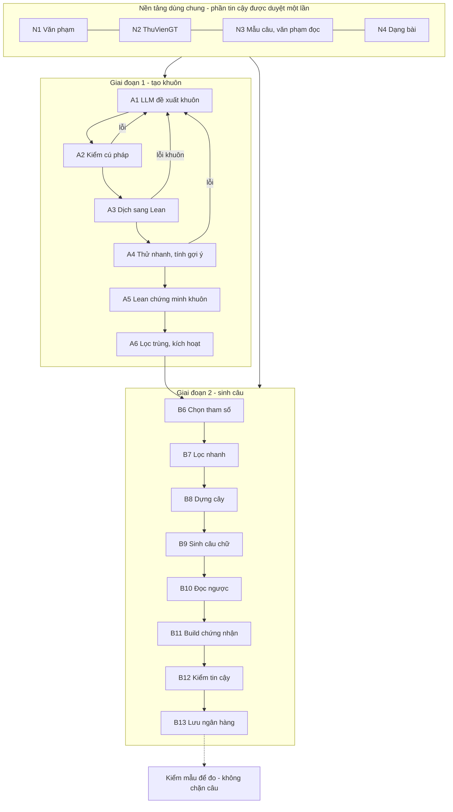

# Thiết kế hệ thống sinh đề bài Giải tích 1 có chứng nhận Lean

Phiên bản thiết kế: **1.2** · Ngày: 2026-11-23 · Thay cho bản 1.1 (thay đổi từ 1.1 lên 1.2 ghi ở Phụ lục B; từ 1.0 lên 1.1 ở Phụ lục A)
Đối tượng đọc: người cài đặt (Claude Code) và sinh viên làm đồ án.

---

## 0. Hướng dẫn cho người cài đặt

1. Đọc hết tài liệu trước khi viết mã. Làm theo thứ tự các mốc ở mục 17. Mốc sau chỉ bắt đầu khi mốc trước đạt tiêu chí nghiệm thu.
2. Mục 2 gồm các **nguyên tắc bất biến**. Không được vi phạm, kể cả để cho tiện hay để vượt qua kiểm thử.
3. Mục 3 liệt kê **nền tin cậy**, trong repo được đánh dấu `TIN CẬY` ở chú thích đầu tệp. Mọi thay đổi ở các thành phần này phải tạo phiên bản nền tảng mới và chờ người duyệt (mục 3.3). Không tự sửa chúng để "cho chạy được".
4. Mọi đoạn mã Lean trong tài liệu là **phác thảo chưa biên dịch**. Khi cài đặt:
   - đối chiếu tên định lý, tên hàm và cú pháp với phiên bản Lean và Mathlib đã cố định;
   - sửa cho biên dịch được, nhưng **không đổi nghĩa** của định nghĩa;
   - nếu một định nghĩa có vẻ lệch giáo trình, ghi vào `docs/cau_hoi_mo.md` và hỏi người dùng.
5. Thư viện `ThuVienGT` không được chứa `sorry`, `axiom` hay `native_decide`. Nếu không chứng minh được một định lý của thư viện, dừng lại và báo cáo. Không thêm giả thiết, không làm yếu định nghĩa.
6. Nếu hai mục của tài liệu mâu thuẫn nhau, dừng lại, ghi vào `docs/cau_hoi_mo.md` và hỏi người dùng.
7. Tên định danh trong mã dùng tiếng Việt không dấu. Chú thích và thông báo cho người dùng viết tiếng Việt có dấu.
8. Kiểm thử phải chạy được mà không cần API LLM, nhờ `FakeLLM`. Kiểm thử cần Lean đánh dấu `@pytest.mark.lean`. Kiểm thử cần Docker đánh dấu `@pytest.mark.sandbox`.

---

## 1. Mục tiêu và phạm vi

### 1.1 Mục tiêu
Hệ thống sinh **đề bài** Giải tích 1 có tham số. Mỗi câu vào ngân hàng có một **chứng nhận Lean** rằng đề đúng. Chứng nhận được phát biểu **trên chính cây biểu thức đọc được từ câu chữ hiển thị cho sinh viên**. Câu được hiển thị đúng chuỗi đã chứng nhận, không sinh lại lúc hiển thị.

Con người không tham gia vào việc sinh từng câu. Người chỉ làm hai việc:
- duyệt **một lần** nền tin cậy (mục 3);
- kiểm một mẫu nhỏ để **đo** chất lượng (mục 14). Việc kiểm mẫu không chặn câu.

### 1.2 Định nghĩa đề đúng
Một đề gồm giả thiết H(p), yêu cầu f(p) và miền tham số D. Đề đúng khi, với mọi p ∈ D:

| # | Điều kiện | Bảo đảm bởi |
|---|---|---|
| 1 | Chỉ hiểu được theo một nghĩa | Văn phạm đọc công thức không mơ hồ (mục 8.3); mẫu câu N3; chứng nhận phát biểu trên cây đọc được từ câu chữ (mục 12.6–12.7); kiểm mẫu đo cách người thật đọc (mục 14) |
| 2 | Mọi phép toán có nghĩa theo giáo trình | Lean: trường `xacDinh` |
| 3 | Giả thiết không mâu thuẫn | Lean: trường `nhatQuan` (cho dạng bài có giả thiết; MVP chưa có) |
| 4 | Yêu cầu có đúng một kết quả | Lean: trường `coKetQua` |
| 5 | Đúng dạng bài | Lean: trường `dungDang` |

### 1.3 Phạm vi của phiên bản này
- **Trong phạm vi:**
  - nền tảng N1–N4;
  - giai đoạn 1 (tạo khuôn) và giai đoạn 2 (sinh câu);
  - kiểm mẫu để đo;
  - lưu trữ, nhật ký, giao diện dòng lệnh (CLI), báo cáo.
- **MVP:**
  - dạng bài `GH_00`: giới hạn dạng 0/0 tại một điểm hữu tỉ, hai phía hoặc một phía;
  - khuôn có **đúng một tham số nguyên**;
  - khuôn không dùng `luythua` (lũy thừa số mũ thực).
- **Ngoài phạm vi, nhưng thiết kế chừa chỗ:**
  - đáp án, phương án nhiễu, lời giải. Khi chứng minh có dùng một giá trị giới hạn cụ thể, giá trị đó được lưu sẵn (mục 12.6);
  - câu tự do;
  - giới hạn tại vô cùng;
  - đạo hàm, tích phân, hàm nhiều biến;
  - khuôn nhiều tham số.

  Mục 18 mô tả cách mở rộng.

---

## 2. Nguyên tắc bất biến

| Mã | Nguyên tắc |
|---|---|
| I1 | Nội dung do LLM sinh **không bao giờ được thực thi** bằng Python hay shell: không `eval`, không `exec`, không đưa vào câu lệnh. Nó chỉ được đọc bằng bộ phân tích N1 hoặc kiểm bằng pydantic. Riêng **phần chứng minh Lean do LLM viết** chỉ được biên dịch **trong sandbox** (mục 13.2), sau khi qua bước kiểm văn bản (mục 13.3). |
| I2 | Một câu chỉ vào ngân hàng khi module chứng nhận của nó đã build xong và qua mọi phép kiểm tin cậy (mục 12.7). Câu được hiển thị đúng chuỗi `cau_chu` đã lưu và đã chứng nhận. |
| I3 | Mệnh đề Lean dùng làm cổng kiểm cuối cùng (mục 12.7) chỉ do tiện ích đối chiếu tin cậy dựng ra **từ câu chữ hiển thị**, trực tiếp ở mức `Expr`. Cổng kiểm không phân tích hay elaborate văn bản Lean nào trong môi trường đã nạp module không tin cậy. LLM chỉ viết phần thân chứng minh, và phần đó được chèn vào một chỗ cố định. |
| I4 | Câu chữ chỉ được ghép từ mẫu câu N3. |
| I5 | Mọi quyết định đạt hay không đạt dùng số chính xác (`Fraction`, ℚ). Bộ lọc nhanh (SymPy, số học khoảng) **chỉ được loại, không bao giờ được chấp nhận**. Loại nhầm chỉ làm mất câu tốt, không làm lọt câu sai. |
| I6 | Kết quả của CAS và tính số không bao giờ là bằng chứng. Chúng chỉ được dùng làm bộ lọc (I5) hoặc làm **gợi ý** cho chứng minh Lean. Gợi ý sai chỉ làm chứng minh thất bại. |
| I7 | Mọi lần gọi LLM, mọi lần chạy Lean và mọi phép kiểm đều được ghi vào cơ sở dữ liệu, đủ để tái lập: seed, các phiên bản, đầu vào, đầu ra. |
| I8 | N1–N4, khuôn, prompt và thư viện Lean đều có phiên bản. Mọi chứng nhận ghi lại các phiên bản nó dùng. Ở chế độ `chinh_thuc`, hệ thống từ chối chạy nếu phiên bản nền tảng hiện tại chưa được người duyệt (mục 3.3). |

---

## 3. Nền tin cậy

"Đúng tuyệt đối" ở đây nghĩa là **đúng so với nền tin cậy**: một tập nhỏ các thành phần mà tính đúng của mọi câu dựa vào. Các thành phần còn lại chỉ có thể làm câu bị loại, không thể làm lọt câu sai.

### 3.1 Thành phần thuộc nền tin cậy (phải duyệt)

| Thành phần | Vai trò | Cách giảm rủi ro |
|---|---|---|
| Lean 4 và Mathlib (phiên bản cố định) | Kiểm chứng minh | Giả định của đồ án; chạy lean4checker (mục 12.7) |
| Các **định nghĩa** trong `ThuVienGT`: `Ham`, `BT`, `Huong`, `cbrt`, `Ham.giaTri`, `BT.giaTri`, `Ham.dieuKien`, `XacDinh`, `locLan`, `Dang00`, `DeDungGioiHan00` | Phát biểu thế nào là đề đúng | Người duyệt đối chiếu giáo trình; các ví dụ đúng và sai bắt buộc (mục 7.8) |
| `GioiHanGT`, `GioiHanTraiGT`, `GioiHanPhaiGT`, `GioiHanTheoHuong` và **phát biểu** của định lý `DeDungGioiHan00.gioiHanGT` | Cho thấy `DeDungGioiHan00` khớp định nghĩa giới hạn của giáo trình | Người duyệt đối chiếu giáo trình; phần chứng minh do Lean kiểm |
| Văn phạm đọc công thức `latex_con.lark` và bộ chuyển `doc_nguoc.py` | Mô hình cách sinh viên đọc câu chữ | Người duyệt; văn phạm strict LALR; kiểm mẫu để đo (mục 14) |
| Khung câu N3 và trường `nghia_lean` | Lời văn tiếng Việt và nghĩa của nó trong Lean | Người duyệt |
| Các trường `menh_de_de_dung`, `huong_cho_phep`, `mau_cau_cho_phep` của N4 | Nối dạng bài với mệnh đề cần chứng minh | Người duyệt; kiểm nhất quán N3–N4 |
| Bộ in literal `sinhde/lean/in_lean_cay.py` (cây cụ thể → biểu thức Lean) | Đưa cây đọc được vào mệnh đề Lean | Rất ngắn, mỗi loại nút một dòng; kiểm chéo bằng `BT.toSExpr` (mục 7.1) |
| Tiện ích đối chiếu `lean/KiemKhop/Main.lean` (lean_exe `kiem_khop`) và các phép kiểm trong `sinhde/lean/kiem_tin_cay.py` | Cổng kiểm cuối cùng: so mệnh đề ở mức `Expr`, thu axiom | Không phân tích văn bản trong môi trường có module không tin cậy; không chạy mã của module được nạp; kiểm thử tấn công (mục 16.1) |
| Sandbox (mục 13.2) | An toàn cho máy; không ảnh hưởng tính đúng | Cấu hình cố định, có kiểm thử |

### 3.2 Thành phần không thuộc nền tin cậy
Các thành phần sau được phép sai. Khi chúng sai, câu hoặc khuôn bị loại:
- LLM (đề xuất khuôn, viết chứng minh);
- SymPy, mpmath (lọc nhanh, tính gợi ý);
- bộ phân tích N1 và bộ in chuỗi `in_chuoi`;
- `chuan_hoa` của Python;
- bộ in LaTeX của Python;
- bộ dịch khuôn sang Lean `dich_khuon.py`;
- hàm `chuanHoa` trong Lean (tính đúng của nó đã được Lean chứng minh);
- các công cụ chứng minh trong `ThuVienGT`: `XacDinhMo`, `KhaVi`, `BT.daoHam` và các bổ đề ở `HoTro.lean`, `DaoHam.lean`. Lean kiểm mọi định lý dùng chúng;
- các phép kiểm ở A2, A4, B10;
- các kịch bản chứng minh.

### 3.3 Quy trình duyệt nền tảng
- **Mã băm nền tảng:** SHA-256 trên toàn bộ tệp thuộc mục 3.1, gồm:
  - `lean/ThuVienGT/*.lean`, `sinhde/hien_thi/latex_con.lark`, `sinhde/hien_thi/doc_nguoc.py`;
  - `du_lieu/mau_cau/*.yaml`, `du_lieu/dang_bai/*.yaml`;
  - `sinhde/lean/in_lean_cay.py`, `sinhde/lean/kiem_tin_cay.py`, `lean/KiemKhop/*.lean`, thư mục `sandbox/`;
  - phiên bản Lean và mã commit Mathlib.
- **Ghi nhận duyệt:** lệnh `sinhde nen-tang duyet --nguoi "<tên>" --ghi-chu "<…>"` ghi người duyệt, thời điểm và mã băm vào bảng `phien_ban_nen_tang`, trạng thái `da_duyet`. Khuyến nghị có hai người duyệt độc lập cho `ThuVienGT` và N3.
- **Hai chế độ chạy** (khóa `che_do` trong `config.yaml`):
  - `phat_trien`: cho phép nền tảng chưa duyệt. Câu sinh ra có trạng thái `thu_nghiem` và không bao giờ vào ngân hàng;
  - `chinh_thuc`: bắt buộc mã băm nền tảng hiện tại đã được duyệt.
- **Mã băm `.olean` và tệp thực thi:** khi duyệt, lưu mã băm các tệp `.olean` của `ThuVienGT` và tệp thực thi `kiem_khop`. Trước mỗi đợt sinh và khi kiểm lại, so lại mã băm; nếu lệch thì dừng.

---

## 4. Kiến trúc tổng quan



- Một bước bất kỳ của giai đoạn 2 không đạt thì câu bị loại, lý do được ghi vào nhật ký. Câu bị loại không được sửa.
- Mọi lần chạy Lean đều diễn ra trong sandbox.
- Lọc trùng thực tế chạy trước A5 (mục 11.6).

---

## 5. Công nghệ, môi trường và cấu trúc repo

### 5.1 Công nghệ
| Thành phần | Lựa chọn |
|---|---|
| Ngôn ngữ chính | Python ≥ 3.11 |
| Bộ phân tích | `lark`, chế độ `parser="lalr"`, bật `strict=True` nếu phiên bản hỗ trợ; nếu không, kiểm xung đột bằng Bison với `%expect 0` |
| Kiểm tra dữ liệu | `pydantic` v2 |
| CAS, tính số, thống kê | `sympy`, `mpmath`, `scipy` |
| Kiểm thử | `pytest`, `hypothesis` |
| Lưu trữ | SQLite qua `sqlite3` |
| Khóa tệp | `filelock` |
| LLM | Lớp trừu tượng `LLMClient`; bản cài đặt mặc định dùng Anthropic API (`anthropic` SDK) |
| Lean | Lean 4 + Mathlib qua `elan` và `lake`; phiên bản cố định trong `lean-toolchain` và `lake-manifest.json` |
| Sandbox | Docker (trên Windows: WSL2 + Docker) |
| Kiểm LaTeX (tùy chọn) | `katex` trên Node.js, chỉ để kiểm công thức hiển thị được |
| CLI | `typer` hoặc `argparse` |

### 5.2 Môi trường
- Chạy trên Linux hoặc WSL2. Docker phải chạy được với người dùng thường.
- **Trên Windows** (máy phát triển hiện tại là Windows 11 Home):
  - dùng WSL2 và Docker Desktop với backend WSL2;
  - đặt toàn bộ dự án **trong hệ tệp của WSL2**, ví dụ `~/sinh-de-gt1`. Không đặt ở ổ Windows như `D:\` rồi truy cập qua `/mnt/d`: truy cập chéo hệ tệp chậm hơn nhiều, trong khi Mathlib có hàng nghìn module và vài GB tệp `.olean`;
  - WSL2 mặc định chỉ dùng khoảng một nửa RAM của máy. Chỉnh `memory` trong `%UserProfile%\.wslconfig` cho đủ `lean.so_tien_trinh × lean.bo_nho_gb`, cộng thêm phần cho Python và Docker. Nếu máy không đủ RAM, giảm `so_tien_trinh` xuống 1.
- Sau khi tạo dự án Lean, chạy `lake exe cache get` để tải bản Mathlib đã biên dịch sẵn. **Không** build Mathlib từ mã nguồn, vì việc đó mất nhiều giờ.
- Ảnh Docker `sinhde-lean` được build từ `sandbox/Dockerfile` và chứa đúng toolchain Lean của dự án.

### 5.3 Cấu trúc repo
```
sinh-de-gt1/
├── README.md
├── pyproject.toml
├── config.yaml
├── docs/
│   ├── cau_hoi_mo.md
│   └── su_co/                         # ghi chép sự cố nền tảng (mục 14.5)
├── sandbox/                           # TIN CẬY (an toàn)
│   ├── Dockerfile
│   └── chay_lean.sh                   # điểm vào trong container
├── sinhde/
│   ├── cli.py
│   ├── cau_hinh.py
│   ├── nen_tang/
│   │   ├── van_pham.lark              # N1
│   │   ├── van_pham.py                # doc_bieu_thuc, doc_dieu_kien, doc_diem
│   │   ├── cay.py                     # các lớp nút, to_sexpr
│   │   ├── in_chuoi.py
│   │   ├── chuan_hoa.py
│   │   ├── da_thuc_tham_so.py         # mục 6.6
│   │   ├── mau_cau.py                 # nạp N3
│   │   ├── dang_bai.py                # nạp N4
│   │   └── ma_bam.py                  # mã băm nền tảng (mục 3.3)
│   ├── hien_thi/
│   │   ├── latex.py                   # bộ in LaTeX (không tin cậy)
│   │   ├── latex_con.lark             # văn phạm đọc công thức (TIN CẬY)
│   │   ├── doc_nguoc.py               # đọc câu chữ (TIN CẬY)
│   │   └── cau_chu.py                 # điền mẫu câu
│   ├── lean/
│   │   ├── in_lean_cay.py             # bộ in literal (TIN CẬY)
│   │   ├── dich_khuon.py              # dịch khuôn sang Lean (không tin cậy)
│   │   ├── sinh_tep.py                # ghép tệp khuôn, tệp chứng nhận từ mẫu
│   │   ├── chay_lean.py               # LeanRunner, luôn đi qua sandbox
│   │   └── kiem_tin_cay.py            # gọi tiện ích kiem_khop, kiểm văn bản chứng minh (TIN CẬY)
│   ├── cas/
│   │   ├── sang_sympy.py
│   │   ├── thu_nhanh.py
│   │   └── goi_y.py                   # gợi ý cho chứng minh (mục 11.4)
│   ├── llm/
│   │   ├── client.py                  # LLMClient, AnthropicClient, FakeLLM
│   │   ├── de_xuat_khuon.py
│   │   └── sua_chung_minh.py
│   ├── giai_doan_1/                   # A1–A6
│   │   ├── kiem_cu_phap.py
│   │   ├── chung_minh_khuon.py
│   │   ├── loc_trung.py
│   │   └── quy_trinh.py
│   ├── giai_doan_2/                   # B6–B13
│   │   ├── chon_tham_so.py
│   │   ├── dung_cay.py
│   │   ├── doc_nguoc_cau.py
│   │   ├── chung_nhan.py
│   │   └── quy_trinh.py
│   ├── kiem_mau/
│   │   ├── xuat.py
│   │   └── nhap.py
│   └── luu_tru/
│       ├── schema.sql
│       └── kho.py
├── du_lieu/
│   ├── mau_cau/gioi_han.yaml          # N3 (TIN CẬY)
│   ├── dang_bai/GH_00.yaml            # N4 (một phần TIN CẬY)
│   ├── kich_ban/*.lean.tpl            # mẫu kịch bản chứng minh (không tin cậy)
│   └── khuon_vi_du/*.json             # khuôn mẫu cho few-shot
├── prompts/
│   ├── de_xuat_khuon.v1.md
│   └── sua_chung_minh.v1.md
├── schemas/khuon.schema.json
├── lean/
│   ├── lean-toolchain
│   ├── lakefile.lean
│   ├── ThuVienGT.lean
│   ├── ThuVienGT/                     # TIN CẬY (phần định nghĩa)
│   │   ├── BieuThuc.lean
│   │   ├── XacDinh.lean
│   │   ├── ChuanHoa.lean
│   │   ├── GiaoTrinh.lean
│   │   ├── DangBai.lean
│   │   ├── DeDung.lean
│   │   ├── HoTro.lean
│   │   ├── DaoHam.lean                # công cụ đạo hàm cho chiến lược K2 (mục 7.7)
│   │   └── ViDu.lean
│   ├── ThuVienKhuon/                  # sinh tự động: một module cho mỗi phiên bản khuôn
│   ├── ChungNhan/                     # sinh tự động: một module cho mỗi câu
│   └── KiemKhop/                      # TIN CẬY: Main.lean là tiện ích đối chiếu, lean_exe kiem_khop (mục 12.7)
├── tools/kiem_van_pham.py
└── tests/
```

### 5.4 Cấu hình `config.yaml`
```yaml
che_do: phat_trien                # phat_trien | chinh_thuc (mục 3.3)
llm:
  nha_cung_cap: anthropic
  mo_hinh: "<điền tên mô hình>"
  nhiet_do_de_xuat: 0.8
  nhiet_do_chung_minh: 0.2
  so_ung_vien_moi_lan: 3          # mỗi ứng viên là một lần gọi API riêng
  token_toi_da: 4000
  ngan_sach_moi_dot_usd: 5.0
giai_doan_1:
  so_vong_sua_khuon: 3            # K
  so_vong_sua_chung_minh: 4
  thoi_gian_lean_khuon_giay: 300
  mien_toi_da_tach_gia_tri: 20    # chiến lược tách theo giá trị chỉ dùng khi miền nhỏ hơn mức này
  so_lan_lhospital_toi_da: 3      # số lần lặp tối đa của chiến lược K2 (mục 11.5)
giai_doan_2:
  thoi_gian_lean_cau_giay: 120
khuon:
  mien_toi_thieu: 3               # số giá trị tham số tối thiểu sau khi lọc
  do_sau_toi_da: 8
  so_nut_toi_da: 40
  kich_thuoc_mien_toi_da: 50
lean:
  so_tien_trinh: 2                # số tiến trình Lean chạy song song tối đa
  bo_nho_gb: 8                    # giới hạn bộ nhớ mỗi container
  anh_docker: sinhde-lean
kiem_mau:
  so_cau_dau_moi_khuon: 10
  ti_le_ngau_nhien: 0.05
duong_dan:
  csdl: du_lieu/ngan_hang.sqlite
  lean: lean/
```

### 5.5 `lean/lakefile.lean`
```lean
import Lake
open Lake DSL

package sinh_de where

require mathlib from git
  "https://github.com/leanprover-community/mathlib4" @ "<commit cố định khi tạo dự án>"

@[default_target]
lean_lib ThuVienGT

lean_lib ThuVienKhuon where
  globs := #[.submodules `ThuVienKhuon]

lean_lib ChungNhan where
  globs := #[.submodules `ChungNhan]

-- Tiện ích đối chiếu (TIN CẬY, mục 12.7). Chỉ import ThuVienGT và Lean;
-- không import ThuVienKhuon hay ChungNhan: module cần kiểm được nạp lúc chạy.
lean_exe kiem_khop where
  root := `KiemKhop.Main
```
- Sửa cú pháp cho khớp phiên bản Lake đang dùng.
- Mỗi phiên bản khuôn và mỗi câu là **một module riêng**, build riêng (ví dụ `lake build ChungNhan.C000153`, cú pháp đích theo phiên bản Lake).
- Build sinh ra tệp `.olean`. Nhờ vậy tiện ích `kiem_khop` nạp được module chứng nhận, và lean4checker kiểm được nó.
- `kiem_khop` được build một lần khi chuẩn bị duyệt nền tảng (`lake build kiem_khop`). Lúc chạy chỉ gọi tệp thực thi đã build sẵn, không build lại.

---

## 6. N1 — Văn phạm biểu thức và chuẩn hóa

### 6.1 Tệp `sinhde/nen_tang/van_pham.lark`
```lark
// ===== Biểu thức =====
?bieu_thuc: hang_tu
          | bieu_thuc "+" hang_tu            -> cong
          | bieu_thuc "-" hang_tu            -> tru

?hang_tu: nhan_tu
        | hang_tu "*" nhan_tu                -> nhan
        | hang_tu "/" nhan_tu                -> chia

?nhan_tu: luy_thua
        | "-" nhan_tu                        -> am

?luy_thua: nguyen_to
         | nguyen_to "^" so_mu               -> mu

so_mu: SO_NGUYEN                             -> so_mu_duong
     | "(" "-" SO_NGUYEN ")"                 -> so_mu_am

?nguyen_to: SO_NGUYEN                        -> so
          | "x"                              -> bien
          | THAM_SO                          -> tham_so
          | HAM "(" bieu_thuc ")"            -> ham
          | "luythua" "(" bieu_thuc "," bieu_thuc ")"   -> luythua
          | "(" bieu_thuc ")"

// ===== Ràng buộc của tham số =====
?dieu_kien: dieu_kien_va
          | dieu_kien "or" dieu_kien_va      -> hoac
?dieu_kien_va: so_sanh
             | dieu_kien_va "and" so_sanh    -> va
so_sanh: bieu_thuc SO_SANH bieu_thuc

// ===== Điểm của giới hạn =====
diem: bieu_thuc

SO_SANH: "<=" | ">=" | "!=" | "<" | ">" | "="
HAM.2: "sin" | "cos" | "tan" | "cot" | "arcsin" | "arccos" | "arctan"
     | "exp" | "ln" | "sqrt" | "cbrt" | "abs"
THAM_SO: /[abcdfghkmnpqrstuvwyz]/
SO_NGUYEN: /[0-9]+/
%import common.WS
%ignore WS
```

### 6.2 Ghi chú
- Có ba điểm bắt đầu: `Lark(..., start=["bieu_thuc", "dieu_kien", "diem"], parser="lalr")`.
- **Không có số thập phân, không có hằng phân số.** Phân số viết bằng phép chia, ví dụ `1/2`, và được gộp thành hằng hữu tỉ khi chuẩn hóa (mục 6.5).
- **Tham số** là một chữ cái thuộc tập `a b c d f g h k m n p q r s t u v w y z`. Các chữ bị loại:
  - `e`: trùng với `e^{…}` khi hiển thị;
  - `i`, `j`, `l`, `o`: dễ nhầm;
  - `x`: là biến.
- **Không cần biểu thức nhìn trước.** Bộ tách từ của Lark xếp `HAM` (độ ưu tiên 2) và các từ khóa dài hơn lên trước `THAM_SO`. Vì vậy `sin`, `abs`, `and` không bị đọc thành tham số. Bắt buộc có kiểm thử cho từng tên hàm và từng từ khóa (mục 6.7).
- Ràng buộc không có ngoặc, để tránh xung đột với ngoặc của biểu thức. `and` ưu tiên hơn `or`.
- Số mũ của `^` chỉ là số nguyên viết trực tiếp. Lũy thừa số mũ thực viết `luythua(a, b)`; MVP không cho dùng trong khuôn (mục 11.2).
- Không có `log` (có thể là ln hoặc log cơ số 10), không có `tan^-1`.

### 6.3 Cây biểu thức `sinhde/nen_tang/cay.py`
Dùng `@dataclass(frozen=True)`, so sánh bằng theo cấu trúc, chuyển được sang JSON hai chiều.

```python
class Nut: ...                                             # lớp cơ sở
@dataclass(frozen=True) class So(Nut):      q: Fraction     # sau chuẩn hóa có thể âm hoặc là phân số
@dataclass(frozen=True) class Bien(Nut):    pass            # x
@dataclass(frozen=True) class ThamSo(Nut):  ten: str
@dataclass(frozen=True) class Am(Nut):      a: Nut
@dataclass(frozen=True) class Cong(Nut):    a: Nut; b: Nut
@dataclass(frozen=True) class Tru(Nut):     a: Nut; b: Nut
@dataclass(frozen=True) class Nhan(Nut):    a: Nut; b: Nut
@dataclass(frozen=True) class Chia(Nut):    a: Nut; b: Nut
@dataclass(frozen=True) class Mu(Nut):      a: Nut; n: int          # số mũ nguyên
@dataclass(frozen=True) class LuyThua(Nut): a: Nut; b: Nut          # số mũ thực
@dataclass(frozen=True) class Ham(Nut):     ten: str; a: Nut        # ten thuộc danh sách HAM

# Ràng buộc
@dataclass(frozen=True) class SoSanh:  op: str; trai: Nut; phai: Nut
@dataclass(frozen=True) class Va:      a: "DieuKien"; b: "DieuKien"
@dataclass(frozen=True) class Hoac:    a: "DieuKien"; b: "DieuKien"
```

Các hàm tiện ích bắt buộc:
- `chua_bien(t)`, `tham_so_dung(t)`, `do_sau(t)`, `so_nut(t)`;
- `thay_tham_so(t, gia_tri: dict[str, Fraction])`;
- `to_sexpr(t) -> str`: dạng S-biểu thức đầy đủ ngoặc, **phải trùng từng ký tự** với `BT.toSExpr` của Lean (mục 7.1):
  - `So(q)` → `(hang <tử>/<mẫu>)`, với phân số tối giản và mẫu luôn được ghi, ví dụ `(hang 4/1)`, `(hang -1/2)`;
  - `Bien` → `x`;
  - các nút còn lại → `(am A)`, `(cong A B)`, `(tru A B)`, `(nhan A B)`, `(chia A B)`, `(mu A n)`, `(luythua A B)`, `(ham <tên> A)`.

### 6.4 Bộ in chuỗi `in_chuoi.py` (không tin cậy)
`in_chuoi(t) -> str` in cây thành chuỗi văn phạm N1, chỉ thêm ngoặc khi cần:

| Mức (thấp → cao) | Nút | Kết hợp |
|---|---|---|
| 1 | Cong, Tru | trái |
| 2 | Nhan, Chia; So(q) với q không nguyên | trái |
| 3 | Am; So(q) với q nguyên âm | tiền tố |
| 4 | Mu | cơ số phải là `nguyen_to` |
| 5 | So(q) với q nguyên ≥ 0; Bien, ThamSo, Ham, LuyThua | — |

Mức của `So(q)` là mức của **chuỗi in ra**, không phải của nút:
- `1/2` và `-1/2` là phép chia (`-1/2` được đọc là `(-1)/2`), nên ở mức 2;
- `-2` là dấu trừ một ngôi, nên ở mức 3.

Ví dụ:
- `Tru(a, Tru(b, c))` in thành `a - (b - c)`;
- `Mu(Am(x), 2)` in thành `(-x)^2`;
- `Nhan(x, So(1/2))` in thành `x*(1/2)`. Nếu in thành `x*1/2` thì chuỗi này đọc lại thành `(x*1)/2`, và khứ hồi hỏng.

**Tính chất bắt buộc:** `chuan_hoa(doc_bieu_thuc(in_chuoi(t))) == t` với mọi cây t đã chuẩn hóa. Kiểm bằng Hypothesis trên ít nhất 5000 cây.

### 6.5 Chuẩn hóa `chuan_hoa.py`
Chuẩn hóa là **một lượt duy nhất đi từ lá lên gốc**: chuẩn hóa các con trước, rồi dựng lại nút bằng một **hàm dựng thông minh**. Không lặp đến điểm bất động. Thuật toán phải **giống hệt** `chuanHoa` trong Lean (mục 7.3); hai bên được kiểm chéo ở mục 7.9.

Các hàm dựng thử từng dòng theo thứ tự, dừng ở dòng đầu tiên khớp:

| Hàm dựng | Điều kiện (các con đã chuẩn hóa) | Kết quả |
|---|---|---|
| `mk_am(a)` | a = So(q) | So(−q) |
| | còn lại | Am(a) |
| `mk_cong(a, b)` | a = So(p), b = So(q) | So(p + q) |
| | b = So(q), q < 0 | Tru(a, So(−q)) |
| | còn lại | Cong(a, b) |
| `mk_tru(a, b)` | a = So(p), b = So(q) | So(p − q) |
| | b = So(q), q < 0 | Cong(a, So(−q)) |
| | còn lại | Tru(a, b) |
| `mk_nhan(a, b)` | a = So(p), b = So(q) | So(p · q) |
| | a = So(1) | b |
| | a = So(−1) | Am(b) |
| | a = So(p), p < 0 | Am(Nhan(So(−p), b)) |
| | còn lại | Nhan(a, b) |
| `mk_chia(a, b)` | a = So(p), b = So(q), q ≠ 0 | So(p / q) |
| | còn lại | Chia(a, b) |
| `mk_mu(a, n)` | a = So(p) và (p ≠ 0 hoặc n > 0) | So(pⁿ) |
| | a không phải So, n = 1 | a |
| | còn lại | Mu(a, n) |

Quy tắc áp dụng:
- `So`, `Bien`, `ThamSo` giữ nguyên.
- `LuyThua(a, b)` thành `LuyThua(chuan_hoa(a), chuan_hoa(b))`; `Ham(f, a)` thành `Ham(f, chuan_hoa(a))`. Hai loại nút này không gộp.
- `ThamSo` không phải `So`, nên cây con chứa tham số không bị gộp.

Ba nguyên tắc rút ra từ bảng:
- **Không làm mất chỗ không xác định:** `Chia(So p, So 0)` và `Mu(So 0, n ≤ 0)` không bị gộp.
- **Không bỏ thừa số 0:** `Nhan(So 0, b)` được giữ nguyên, vì b có thể không xác định. Phép kiểm "không tầm thường" ở A4 sẽ loại các đề kiểu này.
- **Chuẩn hóa không làm đổi giá trị và điều kiện xác định**, và giữ được dạng 0/0. Lean chứng minh các tính chất này (mục 7.3, 7.6).

### 6.6 Biểu thức đa thức theo tham số
Điểm giới hạn và các biểu thức trong ràng buộc chỉ được dùng **đa thức theo tham số với hệ số hữu tỉ**. Sau chuẩn hóa, các biểu thức này chỉ gồm:
- `So`, `ThamSo`, `Am`, `Cong`, `Tru`, `Nhan`;
- `Mu` với n ≥ 1;
- `Chia(u, So(q))` với q ≠ 0.

Nhờ vậy, Python tính bằng `Fraction` và Lean tính bằng ℚ luôn cho cùng kết quả. Không có phép chia cho 0 nào bị quy ước thành 0. Hàm `la_da_thuc_tham_so(t) -> bool` nằm trong `da_thuc_tham_so.py`.

### 6.7 Kiểm thử N1
- **Chuỗi hợp lệ** và cây mong đợi: `-x^2`, `sin(x)^2`, `sin(x^2)`, `2*x/3`, `x^(-1)`, `a - b - c`, `a and b` (trong ràng buộc).
- **Chuỗi bị cấm** phải bị từ chối: `sin x`, `2x`, `log(x)`, `x^y`, `x^1.5`, `tan^-1(x)`, `1.5`, `e*x` (`e` không phải tham số).
- **Bộ tách từ:** mỗi tên hàm và từ khóa (`sin` … `abs`, `luythua`, `and`, `or`) được tách đúng, không bị đọc thành tham số.
- **Hằng phân số và hằng âm ở vế phải của `*` và `/`:** khứ hồi đúng với `Nhan(x, So(1/2))`, `Chia(x, So(1/2))`, `Nhan(x, So(-1/2))`, `Chia(x, So(-2))` (mục 6.4).
- **Theo tính chất** (Hypothesis):
  - khứ hồi chuỗi (mục 6.4);
  - chuẩn hóa lũy đẳng: `chuan_hoa(chuan_hoa(t)) == chuan_hoa(t)`;
  - chuẩn hóa giữ giá trị: so số tại các điểm hữu tỉ mà biểu thức xác định.
- `tools/kiem_van_pham.py`: kiểm văn phạm không có xung đột LALR. Dùng `strict=True` của Lark nếu có; nếu không, chuyển sang Bison với `%expect 0`.

---

## 7. N2 — Thư viện Lean `ThuVienGT`

Thư viện định nghĩa **nghĩa toán học theo giáo trình**. Mỗi định nghĩa có chú thích `-- GT: mục ?, trang ?` để người dùng điền.

Thứ tự các tệp: `BieuThuc` → `XacDinh` → `ChuanHoa` → `GiaoTrinh` → `DangBai` → `DeDung` → `HoTro` → `DaoHam` → `ViDu`. Mọi tệp đều nằm trong `namespace ThuVienGT` và có `open Filter Topology`.

Lúc đầu có thể dùng `import Mathlib`. Khi thư viện ổn định (cuối mốc M2), thay bằng các import cụ thể để Lean nạp nhanh hơn và tốn ít bộ nhớ hơn.

### 7.1 `BieuThuc.lean`
```lean
import Mathlib
namespace ThuVienGT

inductive Ham
  | sin | cos | tan | cot | arcsin | arccos | arctan | exp | ln | sqrt | cbrt | abs
  deriving DecidableEq, Repr

inductive BT
  | hang (q : ℚ)
  | x
  | am (a : BT)
  | cong (a b : BT)
  | tru (a b : BT)
  | nhan (a b : BT)
  | chia (a b : BT)
  | mu (a : BT) (n : ℤ)
  | luythua (a b : BT)
  | ham (f : Ham) (a : BT)
  deriving DecidableEq, Repr

inductive Huong
  | haiPhia | trai | phai
  deriving DecidableEq, Repr

/-- Căn bậc ba theo giáo trình: cbrt (-8) = -2. GT: mục ?, trang ? -/
noncomputable def cbrt (t : ℝ) : ℝ :=
  if 0 ≤ t then t ^ ((1:ℝ)/3) else -((-t) ^ ((1:ℝ)/3))

noncomputable def Ham.giaTri : Ham → ℝ → ℝ
  | .sin, t    => Real.sin t
  | .cos, t    => Real.cos t
  | .tan, t    => Real.tan t
  | .cot, t    => Real.cos t / Real.sin t
  | .arcsin, t => Real.arcsin t
  | .arccos, t => Real.arccos t
  | .arctan, t => Real.arctan t
  | .exp, t    => Real.exp t
  | .ln, t     => Real.log t
  | .sqrt, t   => Real.sqrt t
  | .cbrt, t   => cbrt t
  | .abs, t    => |t|

/-- Giá trị theo quy ước của Mathlib; chỉ có nghĩa khi `XacDinh` đúng. -/
noncomputable def BT.giaTri : BT → ℝ → ℝ
  | .hang q, _      => (q : ℝ)
  | .x, t           => t
  | .am a, t        => -(a.giaTri t)
  | .cong a b, t    => a.giaTri t + b.giaTri t
  | .tru a b, t     => a.giaTri t - b.giaTri t
  | .nhan a b, t    => a.giaTri t * b.giaTri t
  | .chia a b, t    => a.giaTri t / b.giaTri t
  | .mu a n, t      => a.giaTri t ^ n
  | .luythua a b, t => a.giaTri t ^ b.giaTri t
  | .ham f a, t     => f.giaTri (a.giaTri t)

def Ham.ten : Ham → String
  | .sin    => "sin"
  | .cos    => "cos"
  | .tan    => "tan"
  | .cot    => "cot"
  | .arcsin => "arcsin"
  | .arccos => "arccos"
  | .arctan => "arctan"
  | .exp    => "exp"
  | .ln     => "ln"
  | .sqrt   => "sqrt"
  | .cbrt   => "cbrt"
  | .abs    => "abs"

def soStr (q : ℚ) : String := toString q.num ++ "/" ++ toString q.den

/-- S-biểu thức đầy đủ ngoặc; phải trùng từng ký tự với `to_sexpr` của Python (mục 6.3).
    Chỉ dùng để kiểm chéo bộ in literal. -/
def BT.toSExpr : BT → String
  | .hang q      => "(hang " ++ soStr q ++ ")"
  | .x           => "x"
  | .am a        => "(am " ++ a.toSExpr ++ ")"
  | .cong a b    => "(cong " ++ a.toSExpr ++ " " ++ b.toSExpr ++ ")"
  | .tru a b     => "(tru " ++ a.toSExpr ++ " " ++ b.toSExpr ++ ")"
  | .nhan a b    => "(nhan " ++ a.toSExpr ++ " " ++ b.toSExpr ++ ")"
  | .chia a b    => "(chia " ++ a.toSExpr ++ " " ++ b.toSExpr ++ ")"
  | .mu a n      => "(mu " ++ a.toSExpr ++ " " ++ toString n ++ ")"
  | .luythua a b => "(luythua " ++ a.toSExpr ++ " " ++ b.toSExpr ++ ")"
  | .ham f a     => "(ham " ++ f.ten ++ " " ++ a.toSExpr ++ ")"
```
- Bộ in literal `in_lean_cay.py` in mỗi nút Python thành đúng hàm tạo Lean tương ứng, viết đầy đủ tên. Ví dụ `BT.hang ((-1 : ℚ) / 2)`, `BT.mu BT.x (2 : ℤ)`.
- **Kiểm chéo bộ in literal** (mục 7.9): với ít nhất 1000 cây ngẫu nhiên, sinh literal bằng Python, cho Lean in `toSExpr` của literal đó (bằng `#eval` trong sandbox), rồi so với `to_sexpr` của Python.

### 7.2 `XacDinh.lean`
```lean
/-- Điều kiện để hàm sơ cấp xác định tại giá trị đối số u. GT: mục ?, trang ? -/
def Ham.dieuKien : Ham → ℝ → Prop
  | .tan, u    => Real.cos u ≠ 0
  | .cot, u    => Real.sin u ≠ 0
  | .arcsin, u => -1 ≤ u ∧ u ≤ 1
  | .arccos, u => -1 ≤ u ∧ u ≤ 1
  | .ln, u     => 0 < u
  | .sqrt, u   => 0 ≤ u
  | _, _       => True        -- sin cos arctan exp cbrt abs

/-- Biểu thức e xác định tại t theo giáo trình. -/
def XacDinh : BT → ℝ → Prop
  | .hang _, _      => True
  | .x, _           => True
  | .am a, t        => XacDinh a t
  | .cong a b, t    => XacDinh a t ∧ XacDinh b t
  | .tru a b, t     => XacDinh a t ∧ XacDinh b t
  | .nhan a b, t    => XacDinh a t ∧ XacDinh b t
  | .chia a b, t    => XacDinh a t ∧ XacDinh b t ∧ b.giaTri t ≠ 0
  | .mu a n, t      => XacDinh a t ∧ (n ≤ 0 → a.giaTri t ≠ 0)   -- 0^0 không xác định
  | .luythua a b, t => XacDinh a t ∧ XacDinh b t ∧ 0 < a.giaTri t
  | .ham f a, t     => XacDinh a t ∧ f.dieuKien (a.giaTri t)

/-- Bản "mở" của điều kiện hàm (bất đẳng thức chặt), dùng để suy ra xác định trên cả một lân cận. -/
def Ham.dieuKienMo : Ham → ℝ → Prop
  | .tan, u    => Real.cos u ≠ 0
  | .cot, u    => Real.sin u ≠ 0
  | .arcsin, u => -1 < u ∧ u < 1
  | .arccos, u => -1 < u ∧ u < 1
  | .ln, u     => 0 < u
  | .sqrt, u   => 0 < u
  | _, _       => True

/-- Giống `XacDinh`, nhưng dùng `Ham.dieuKienMo`. -/
def XacDinhMo : BT → ℝ → Prop
  | .hang _, _      => True
  | .x, _           => True
  | .am a, t        => XacDinhMo a t
  | .cong a b, t    => XacDinhMo a t ∧ XacDinhMo b t
  | .tru a b, t     => XacDinhMo a t ∧ XacDinhMo b t
  | .nhan a b, t    => XacDinhMo a t ∧ XacDinhMo b t
  | .chia a b, t    => XacDinhMo a t ∧ XacDinhMo b t ∧ b.giaTri t ≠ 0
  | .mu a n, t      => XacDinhMo a t ∧ (n ≤ 0 → a.giaTri t ≠ 0)
  | .luythua a b, t => XacDinhMo a t ∧ XacDinhMo b t ∧ 0 < a.giaTri t
  | .ham f a, t     => XacDinhMo a t ∧ f.dieuKienMo (a.giaTri t)
```
`XacDinhMo` là công cụ chứng minh, không thuộc nền tin cậy.

### 7.3 `ChuanHoa.lean`
Cài **đúng** bảng ở mục 6.5. Hàm `chuanHoa` không thuộc nền tin cậy: tính đúng của nó được chứng minh bằng các định lý ở cuối mục này.

```lean
def mkAm : BT → BT
  | .hang q => .hang (-q)
  | e       => .am e

def mkCong : BT → BT → BT
  | .hang p, .hang q => .hang (p + q)
  | a, .hang q       => if q < 0 then .tru a (.hang (-q)) else .cong a (.hang q)
  | a, b             => .cong a b

def mkTru : BT → BT → BT
  | .hang p, .hang q => .hang (p - q)
  | a, .hang q       => if q < 0 then .cong a (.hang (-q)) else .tru a (.hang q)
  | a, b             => .tru a b

def mkNhan : BT → BT → BT
  | .hang p, .hang q => .hang (p * q)
  | .hang p, b       =>
      if p = 1 then b
      else if p = -1 then .am b
      else if p < 0 then .am (.nhan (.hang (-p)) b)
      else .nhan (.hang p) b
  | a, b             => .nhan a b

def mkChia : BT → BT → BT
  | .hang p, .hang q => if q ≠ 0 then .hang (p / q) else .chia (.hang p) (.hang q)
  | a, b             => .chia a b

def mkMu : BT → ℤ → BT
  | .hang p, n => if p ≠ 0 ∨ 0 < n then .hang (p ^ n) else .mu (.hang p) n
  | a, n       => if n = 1 then a else .mu a n

def chuanHoa : BT → BT
  | .hang q      => .hang q
  | .x           => .x
  | .am a        => mkAm (chuanHoa a)
  | .cong a b    => mkCong (chuanHoa a) (chuanHoa b)
  | .tru a b     => mkTru (chuanHoa a) (chuanHoa b)
  | .nhan a b    => mkNhan (chuanHoa a) (chuanHoa b)
  | .chia a b    => mkChia (chuanHoa a) (chuanHoa b)
  | .mu a n      => mkMu (chuanHoa a) n
  | .luythua a b => .luythua (chuanHoa a) (chuanHoa b)
  | .ham f a     => .ham f (chuanHoa a)

theorem giaTri_chuanHoa (e : BT) : (chuanHoa e).giaTri = e.giaTri := by sorry
theorem xacDinh_chuanHoa (e : BT) (t : ℝ) : XacDinh (chuanHoa e) t ↔ XacDinh e t := by sorry
```

Mọi `sorry` ở trên **phải** được chứng minh trước khi đóng M2. Ghi chú về các định lý:
- Hai định lý đúng nhờ chính các điều kiện ở bảng 6.5: chỉ gộp phép chia khi mẫu khác 0, chỉ gộp lũy thừa khi cơ số khác 0 hoặc số mũ dương.
- Nên chứng minh trước một bổ đề cho mỗi hàm dựng, ví dụ `giaTri (mkCong a b) t = a.giaTri t + b.giaTri t`.

### 7.4 `GiaoTrinh.lean`
Mỗi khái niệm có hai phần:
- định nghĩa sát câu chữ giáo trình;
- định lý tương đương với khái niệm của Mathlib.

```lean
open Filter Topology

/-- Lân cận bỏ điểm theo hướng. -/
def locLan : Huong → ℝ → Filter ℝ
  | .haiPhia, a => 𝓝[≠] a
  | .trai, a    => 𝓝[<] a
  | .phai, a    => 𝓝[>] a

instance locLan_neBot (h : Huong) (a : ℝ) : (locLan h a).NeBot := by
  cases h <;> (simp only [locLan]; infer_instance)

/-- Giới hạn hai phía theo giáo trình (ε–δ; f xác định trên lân cận bỏ điểm). GT: mục ?, trang ? -/
def GioiHanGT (e : BT) (a L : ℝ) : Prop :=
  (∃ r > 0, ∀ t, 0 < |t - a| → |t - a| < r → XacDinh e t) ∧
  (∀ ε > 0, ∃ δ > 0, ∀ t, 0 < |t - a| → |t - a| < δ → |e.giaTri t - L| < ε)

/-- Giới hạn trái theo giáo trình. GT: mục ?, trang ? -/
def GioiHanTraiGT (e : BT) (a L : ℝ) : Prop :=
  (∃ r > 0, ∀ t, a - r < t → t < a → XacDinh e t) ∧
  (∀ ε > 0, ∃ δ > 0, ∀ t, a - δ < t → t < a → |e.giaTri t - L| < ε)

/-- Giới hạn phải theo giáo trình. GT: mục ?, trang ? -/
def GioiHanPhaiGT (e : BT) (a L : ℝ) : Prop :=
  (∃ r > 0, ∀ t, a < t → t < a + r → XacDinh e t) ∧
  (∀ ε > 0, ∃ δ > 0, ∀ t, a < t → t < a + δ → |e.giaTri t - L| < ε)

def GioiHanTheoHuong : Huong → BT → ℝ → ℝ → Prop
  | .haiPhia => GioiHanGT
  | .trai    => GioiHanTraiGT
  | .phai    => GioiHanPhaiGT

theorem gioiHanTheoHuong_iff (h : Huong) (e : BT) (a L : ℝ) :
    GioiHanTheoHuong h e a L ↔
      (∀ᶠ t in locLan h a, XacDinh e t) ∧ Tendsto e.giaTri (locLan h a) (𝓝 L) := by
  sorry -- PHẢI chứng minh trước khi đóng M2
```

### 7.5 `DangBai.lean`
```lean
/-- Dạng 0/0 theo hướng h tại a: e là thương p/q, p và q cùng tiến về 0. -/
def Dang00 (h : Huong) (e : BT) (a : ℝ) : Prop :=
  ∃ p q, e = .chia p q ∧
    Tendsto p.giaTri (locLan h a) (𝓝 0) ∧ Tendsto q.giaTri (locLan h a) (𝓝 0)
```

### 7.6 `DeDung.lean`
```lean
structure DeDungGioiHan00 (h : Huong) (e : BT) (a : ℝ) : Prop where
  xacDinh  : ∀ᶠ t in locLan h a, XacDinh e t
  coKetQua : ∃ L, Tendsto e.giaTri (locLan h a) (𝓝 L)
  dungDang : Dang00 h e a

/-- Cầu nối: đề đúng nghĩa là giới hạn theo giáo trình tồn tại. -/
theorem DeDungGioiHan00.gioiHanGT {h e a} (d : DeDungGioiHan00 h e a) :
    ∃ L, GioiHanTheoHuong h e a L := by sorry

-- Chuyển qua chuẩn hóa, từng trường và cả cấu trúc
theorem xacDinh_chuanHoa_iff (h : Huong) (e : BT) (a : ℝ) :
    (∀ᶠ t in locLan h a, XacDinh (chuanHoa e) t) ↔ (∀ᶠ t in locLan h a, XacDinh e t) := by sorry
theorem tendsto_chuanHoa_iff (h : Huong) (e : BT) (a L : ℝ) :
    Tendsto (chuanHoa e).giaTri (locLan h a) (𝓝 L) ↔ Tendsto e.giaTri (locLan h a) (𝓝 L) := by sorry
theorem dang00_chuanHoa {h e a} : Dang00 h e a → Dang00 h (chuanHoa e) a := by sorry
theorem dang00_of_chuanHoa {h e a} (he : ∃ p q, e = .chia p q) :
    Dang00 h (chuanHoa e) a → Dang00 h e a := by sorry
theorem DeDungGioiHan00.chuanHoa {h e a} :
    DeDungGioiHan00 h e a → DeDungGioiHan00 h (chuanHoa e) a := by sorry
theorem DeDungGioiHan00.of_chuanHoa {h e a} :
    DeDungGioiHan00 h (chuanHoa e) a → (∃ p q, e = .chia p q) → DeDungGioiHan00 h e a := by sorry
```

Mọi `sorry` phải được chứng minh trong M2. Vì sao các định lý về dạng 0/0 đúng:
- `chuanHoa (.chia p q)` chỉ khác nút chia khi cả tử và mẫu thành hằng **và** mẫu khác 0.
- Mẫu là hằng c mà tiến về 0 theo `locLan` (một bộ lọc không suy biến) thì c = 0. Vậy với biểu thức dạng 0/0, nút chia ở gốc luôn được giữ.
- Đây là lý do cần thể hiện `locLan_neBot` ở mục 7.4.

### 7.7 `HoTro.lean` và `DaoHam.lean` (bổ đề hỗ trợ chứng minh)
Các bổ đề này giúp kịch bản chứng minh ở mục 11.5 ngắn và tự động được. Chúng không thuộc nền tin cậy, nhưng như mọi định lý khác của thư viện, phải được chứng minh xong trong M2.

```lean
theorem locLan_le_nhds (h : Huong) (a : ℝ) : locLan h a ≤ 𝓝 a := by sorry
theorem lienTuc_of_xacDinh {e : BT} {a : ℝ} (he : XacDinh e a) : ContinuousAt e.giaTri a := by sorry
theorem XacDinhMo.xacDinh {e : BT} {t : ℝ} : XacDinhMo e t → XacDinh e t := by sorry
theorem eventually_xacDinhMo {e : BT} {a : ℝ} (he : XacDinhMo e a) :
    ∀ᶠ t in 𝓝 a, XacDinhMo e t := by sorry
theorem eventually_locLan_of_banKinh {P : ℝ → Prop} (h : Huong) {a r : ℝ} (hr : 0 < r)
    (hP : ∀ t, 0 < |t - a| → |t - a| < r → P t) : ∀ᶠ t in locLan h a, P t := by sorry
theorem tendsto_locLan_of_lienTuc {f : ℝ → ℝ} (h : Huong) {a : ℝ} (hf : ContinuousAt f a) :
    Tendsto f (locLan h a) (𝓝 (f a)) := by sorry
/-- Khử dạng: e = g trên lân cận bỏ điểm và g xác định tại a, nên giới hạn bằng g(a). -/
theorem tendsto_of_eventuallyEq {e g : BT} (h : Huong) {a : ℝ}
    (heq : ∀ᶠ t in locLan h a, e.giaTri t = g.giaTri t) (hg : XacDinh g a) :
    Tendsto e.giaTri (locLan h a) (𝓝 (g.giaTri a)) := by sorry
/-- Mẫu = (x − a)^k · r với r(a) ≠ 0 thì mẫu khác 0 trên lân cận bỏ điểm. -/
theorem mau_khac_khong {q r : BT} (h : Huong) {a : ℝ} (k : ℕ)
    (hq : ∀ t, q.giaTri t = (t - a) ^ k * r.giaTri t) (hr : XacDinh r a) (hr0 : r.giaTri a ≠ 0) :
    ∀ᶠ t in locLan h a, q.giaTri t ≠ 0 := by sorry
/-- Tử và mẫu xác định và bằng 0 tại a thì có dạng 0/0. -/
theorem dang00_of_lienTuc {p q : BT} (h : Huong) {a : ℝ}
    (hp : XacDinh p a) (hq : XacDinh q a) (hp0 : p.giaTri a = 0) (hq0 : q.giaTri a = 0) :
    Dang00 h (.chia p q) a := by sorry
```

`lienTuc_of_xacDinh` đúng với mọi hàm trong `Ham`. Riêng `sqrt`, `arcsin`, `arccos` của Mathlib liên tục trên toàn ℝ, nên vẫn liên tục tại biên của miền xác định. Hàm `cbrt` cần chứng minh liên tục một lần.

**`DaoHam.lean`** là công cụ cho chiến lược K2 (mục 11.5). Tệp này không thuộc nền tin cậy, nhưng như mọi tệp khác của thư viện, phải được chứng minh xong trong M2. `KhaVi` có cùng cấu trúc với `XacDinhMo` (mục 7.2), chỉ khác ở điều kiện của `abs` và `cbrt`.

```lean
/-- Điều kiện để hàm sơ cấp khả vi tại giá trị đối số u. -/
def Ham.khaVi : Ham → ℝ → Prop
  | .abs, u  => u ≠ 0            -- |u| không khả vi tại 0
  | .cbrt, u => u ≠ 0            -- tiếp tuyến đứng tại 0
  | f, u     => f.dieuKienMo u   -- các hàm còn lại: như XacDinhMo

def KhaVi : BT → ℝ → Prop
  | .hang _, _      => True
  | .x, _           => True
  | .am a, t        => KhaVi a t
  | .cong a b, t    => KhaVi a t ∧ KhaVi b t
  | .tru a b, t     => KhaVi a t ∧ KhaVi b t
  | .nhan a b, t    => KhaVi a t ∧ KhaVi b t
  | .chia a b, t    => KhaVi a t ∧ KhaVi b t ∧ b.giaTri t ≠ 0
  | .mu a n, t      => KhaVi a t ∧ (n ≤ 0 → a.giaTri t ≠ 0)
  | .luythua a b, t => KhaVi a t ∧ KhaVi b t ∧ 0 < a.giaTri t
  | .ham f a, t     => KhaVi a t ∧ f.khaVi (a.giaTri t)

/-- f′(u), viết thành biểu thức của u. -/
def Ham.daoHamTai : Ham → BT → BT
  | .sin, u    => .ham .cos u
  | .cos, u    => .am (.ham .sin u)
  | .tan, u    => .chia (.hang 1) (.mu (.ham .cos u) 2)
  | .cot, u    => .am (.chia (.hang 1) (.mu (.ham .sin u) 2))
  | .arcsin, u => .chia (.hang 1) (.ham .sqrt (.tru (.hang 1) (.mu u 2)))
  | .arccos, u => .am (.chia (.hang 1) (.ham .sqrt (.tru (.hang 1) (.mu u 2))))
  | .arctan, u => .chia (.hang 1) (.cong (.hang 1) (.mu u 2))
  | .exp, u    => .ham .exp u
  | .ln, u     => .chia (.hang 1) u
  | .sqrt, u   => .chia (.hang 1) (.nhan (.hang 2) (.ham .sqrt u))
  | .cbrt, u   => .chia (.hang 1) (.nhan (.hang 3) (.mu (.ham .cbrt u) 2))
  | .abs, u    => .chia (.ham .abs u) u

/-- Đạo hàm hình thức theo x. -/
def BT.daoHam : BT → BT
  | .hang _      => .hang 0
  | .x           => .hang 1
  | .am a        => .am a.daoHam
  | .cong a b    => .cong a.daoHam b.daoHam
  | .tru a b     => .tru a.daoHam b.daoHam
  | .nhan a b    => .cong (.nhan a.daoHam b) (.nhan a b.daoHam)
  | .chia a b    => .chia (.tru (.nhan a.daoHam b) (.nhan a b.daoHam)) (.mu b 2)
  | .mu a n      => .nhan (.nhan (.hang (n : ℚ)) (.mu a (n - 1))) a.daoHam
  | .luythua a b => .nhan (.luythua a b)
                      (.cong (.nhan b.daoHam (.ham .ln a)) (.chia (.nhan b a.daoHam) a))
  | .ham f a     => .nhan (f.daoHamTai a) a.daoHam
```

Các định lý của `DaoHam.lean`:

```lean
theorem hasDerivAt_daoHam {e : BT} {t : ℝ} (he : KhaVi e t) :
    HasDerivAt e.giaTri (e.daoHam.giaTri t) t := by sorry
theorem eventually_khaVi {e : BT} {a : ℝ} (he : KhaVi e a) :
    ∀ᶠ t in 𝓝 a, KhaVi e t := by sorry
/-- L'Hospital theo hướng, phát biểu trên BT. Chứng minh từ các định lý L'Hospital
    của Mathlib (`Mathlib/Analysis/Calculus/LHopital.lean`, tên kiểm theo phiên bản),
    tách ba trường hợp của `Huong`. -/
theorem tendsto_lhopital {p q : BT} (h : Huong) {a L : ℝ}
    (hkv : ∀ᶠ t in locLan h a, KhaVi p t ∧ KhaVi q t)
    (hq' : ∀ᶠ t in locLan h a, q.daoHam.giaTri t ≠ 0)
    (hp : Tendsto p.giaTri (locLan h a) (𝓝 0)) (hq : Tendsto q.giaTri (locLan h a) (𝓝 0))
    (hL : Tendsto (BT.chia p.daoHam q.daoHam).giaTri (locLan h a) (𝓝 L)) :
    Tendsto (BT.chia p q).giaTri (locLan h a) (𝓝 L) := by sorry
```

Ghi chú:
- `hasDerivAt_daoHam` chứng minh bằng quy nạp trên `e`, dùng các quy tắc đạo hàm của Mathlib. Riêng `cbrt` cần chứng minh đạo hàm một lần, tách hai nhánh u > 0 và u < 0.
- `eventually_khaVi` đúng vì mọi điều kiện trong `KhaVi` là điều kiện mở, và các biểu thức con liên tục (`lienTuc_of_xacDinh`).

### 7.8 `ViDu.lean` (ví dụ bắt buộc phải chứng minh)
Đặt e₁ = (x² − 4)/(x − 2).

1. `¬ XacDinh e₁ 2` và `XacDinh e₁ 3`.
2. `¬ XacDinh (ln x) 0`.
3. `cbrt (-8) = -2`.
4. `¬ ∃ L, GioiHanGT (sin(1/x)) 0 L`.
5. `GioiHanGT e₁ 2 4`.
6. `DeDungGioiHan00 .haiPhia e₁ 2`.
7. `¬ Dang00 .haiPhia ((x² + 1)/(x − 2)) 2`.
8. `¬ DeDungGioiHan00 .haiPhia ((x − 2)/(x − 2)²) 2`: có dạng 0/0, nhưng giới hạn không hữu hạn.
9. `¬ DeDungGioiHan00 .haiPhia (|x|/x) 0`, nhưng `DeDungGioiHan00 .phai (|x|/x) 0`.
10. `¬ XacDinh (.mu (.hang 0) 0) t` với mọi t, và `chuanHoa (.mu (.hang 0) 0) = .mu (.hang 0) 0`: 0⁰ không bị gộp.
11. `chuanHoa (.chia (.hang 1) (.hang 0)) = .chia (.hang 1) (.hang 0)`: chia cho 0 không bị gộp.
12. `DeDungGioiHan00 .haiPhia (sin(x)/x) 0`, trong đó trường `coKetQua` được chứng minh bằng `tendsto_lhopital`. Ví dụ này kiểm công cụ ở `DaoHam.lean`.

### 7.9 Nghiệm thu N2
- `lake build ThuVienGT` chạy thành công trong sandbox.
- `grep -R "sorry\|axiom\|native_decide" lean/ThuVienGT` không ra kết quả nào.
- `#print axioms` của mọi định lý trong thư viện chỉ gồm `propext`, `Classical.choice`, `Quot.sound`.
- **Kiểm chéo chuẩn hóa:** với ít nhất 1000 cây ngẫu nhiên, Python `chuan_hoa` và Lean `chuanHoa` cho kết quả trùng nhau. So bằng `toSExpr`, hoặc bằng `decide` trên phép so bằng của `BT`.
- **Kiểm chéo bộ in literal** (mục 7.1).
- **Đo hiệu năng của `decide`:** với 50 cây ngẫu nhiên kích thước tối đa (mục 5.4), chứng minh `chuanHoa e = c` bằng `decide` phải xong trong 10 giây mỗi cây.
  - Nếu chậm hoặc không chạy, thử lần lượt: `decide` dùng kernel (cú pháp theo phiên bản Lean), `rfl`, `simp`/`norm_num` với các định nghĩa `mk…`.
  - Không bao giờ dùng `native_decide`.
  - Ghi lựa chọn cuối cùng vào `docs/`.

---

## 8. N3 — Mẫu câu, hiển thị và đọc ngược

### 8.1 Tệp `du_lieu/mau_cau/gioi_han.yaml` (TIN CẬY)
```yaml
phien_ban: 2
mau_cau:
  - ma: TINH_GIOI_HAN
    dang_bai: [GH_00]
    khung: "Tính giới hạn sau: ${CT}$."
    cho_trong:
      CT: {kieu: cong_thuc_gioi_han}
    nghia_lean: ThuVienGT.DeDungGioiHan00
    vi_du_da_duyet:
      - "Tính giới hạn sau: $\\lim\\limits_{x \\to 2} \\dfrac{x^{2} - 4}{x - 2}$."
      - "Tính giới hạn sau: $\\lim\\limits_{x \\to 0^{+}} \\dfrac{\\left|x\\right|}{x}$."
```
- Chỗ trống viết là `{CT}`. Hai ký tự `$` là ký tự thường của câu, dùng để mở và đóng công thức.
- Hướng của giới hạn nằm trong công thức (`2`, `2^{-}`, `2^{+}`), nên chỉ cần **một** mẫu câu.

### 8.2 Bộ in LaTeX `hien_thi/latex.py` (không tin cậy)
Bộ in phải sinh ra chuỗi **thuộc ngôn ngữ của văn phạm đọc** (mục 8.3) và thỏa tính chất khứ hồi (mục 8.5). Các quy tắc dưới đây là cách mặc định để đạt điều đó. Có thể chỉnh nếu kiểm thử cho thấy cần, nhưng phải giữ các quy ước dễ đọc ở bảng này.

Hàm in nhận thêm một **ngữ cảnh** cho biết vị trí của nút:

| Ký hiệu | Ngữ cảnh |
|---|---|
| TD | tự do: đầu công thức, tử hoặc mẫu của `\dfrac`, bên trong ngoặc hoặc `{}` |
| PC | vế phải của `+` hoặc `-` hai ngôi |
| TN | thừa số trái của `\cdot` |
| PN | thừa số phải của `\cdot` |
| SA | sau dấu trừ một ngôi |
| CS | cơ số của lũy thừa |

**Dạng in của từng nút** (chưa bọc ngoặc):

| Nút | Dạng in |
|---|---|
| So(q), q nguyên ≥ 0 | chữ số của q |
| So(q), q nguyên < 0 | `-` + chữ số của −q |
| So(q), q không nguyên | `\dfrac{m}{n}` nếu q > 0; `-\dfrac{m}{n}` nếu q < 0 (m/n tối giản, m, n > 0) |
| Bien | `x` |
| Am(a) | `-` + in(a, SA) |
| Cong(a, b) | in(a, TD) + ` + ` + in(b, PC) |
| Tru(a, b) | in(a, TD) + ` - ` + in(b, PC) |
| Nhan(So(c), b), c > 0, b thuộc **nhóm viết liền** | in(So c, TD) + in(b, TD), viết liền không dấu nhân, ví dụ `2x`, `\dfrac{1}{2}x`, `3\sin\left(x\right)` |
| Nhan(a, b), các trường hợp khác | in(a, TN) + ` \cdot ` + in(b, PN) |
| Chia(a, b) | `\dfrac{` + in(a, TD) + `}{` + in(b, TD) + `}` |
| Mu(a, n) | in(a, CS) + `^{` + n + `}` |
| LuyThua(a, b) | in(a, CS) + `^{` + in(b, TD) + `}` |
| Ham(f, a), f ∈ {sin, cos, tan, cot, arcsin, arccos, arctan, ln} | `\sin\left(` + in(a, TD) + `\right)`, tương tự với `\cos`, `\tan`, `\cot`, `\arcsin`, `\arccos`, `\arctan`, `\ln` |
| Ham(exp, a) | `e^{` + in(a, TD) + `}` |
| Ham(sqrt, a); Ham(cbrt, a); Ham(abs, a) | `\sqrt{…}`; `\sqrt[3]{…}`; `\left|…\right|` |

Nhóm viết liền: b là `Bien`, `Mu(Bien, n)`, hoặc `Ham(·, ·)` bất kỳ.

**Bọc ngoặc:** in(t, ngữ cảnh) = `\left(` + dạng in + `\right)` khi:

| Nút | Bọc trong các ngữ cảnh |
|---|---|
| Cong, Tru | PC, TN, PN, SA, CS |
| Nhan dạng `\cdot` | PN, SA, CS |
| Nhan dạng viết liền | PN, CS |
| Am; So âm (mọi chuỗi bắt đầu bằng `-`) | PC, TN, PN, SA, CS |
| So phân số dương; Chia | CS |
| Mu, LuyThua | CS |
| Ham (mọi hàm, kể cả exp, sqrt, cbrt, abs) | CS |
| Bien; So nguyên ≥ 0 | không bao giờ |

Ví dụ: `\left(\sin\left(x\right)\right)^{2}`, `\left(e^{x}\right)^{2}`, `x - \left(-x\right)`, `x \cdot \left(-2\right)`, `-\left(x \cdot y\right)`, `-2x`.

**Điểm và giới hạn:**
- Hai phía: điểm D = in(So q, TD).
- Một phía: `D^{-}` (trái) hoặc `D^{+}` (phải), với D = in(So q, TD) nếu q là số nguyên ≥ 0. Ngược lại D = `\left(` + in(So q, TD) + `\right)`, ví dụ `\left(-\dfrac{1}{2}\right)^{+}`.
- Công thức: `\lim\limits_{x \to ` + điểm + `} ` + in(e, TD).

Khoảng trắng phải viết đúng như trong bảng: một dấu cách quanh `+`, `-`, `\cdot`, và không có dấu cách nào khác.

### 8.3 Văn phạm đọc công thức `hien_thi/latex_con.lark` (TIN CẬY)
Đây là **mô hình cách sinh viên đọc công thức**. Toàn bộ tính đúng của câu dựa vào việc mô hình này khớp với cách người thật đọc. Yêu cầu:

1. **Chấp nhận** mọi chuỗi mà quy tắc ở mục 8.2 sinh ra. **Từ chối** mọi cách viết mà người đọc có thể hiểu theo nhiều cách, như `\sin x`, `\sin^2 x`, `\sin\left(x\right)^{2}` (cơ số là hàm mà không có ngoặc ngoài), hoặc `2 x` có khoảng trắng. Chuỗi được chấp nhận ngoài các chuỗi bộ in sinh ra là được phép, miễn mọi chuỗi chấp nhận đều chỉ có một cách đọc.
2. Văn phạm LALR không có xung đột (strict), nên mỗi chuỗi chấp nhận được có đúng một cây.
3. **Quy ước đọc.** Người duyệt xác nhận các quy ước này khớp cách sinh viên đọc.
   - Thứ tự ưu tiên từ thấp đến cao:
     1. `+` và `-` hai ngôi, kết hợp trái;
     2. `\cdot`, kết hợp trái;
     3. dấu trừ một ngôi;
     4. nhân viết liền;
     5. lũy thừa `^{…}`;
     6. khối.

     Ví dụ: `-x^{2}` là −(x²); `-2x` là −(2x); `-x \cdot y` là (−x)·y.
   - Nhân viết liền chỉ hợp lệ khi vế trái là hằng số dương (số nguyên hoặc `\dfrac{m}{n}`) và vế phải là `x`, `x^{n}` hoặc một hàm. Điều kiện này được kiểm ngay sau khi phân tích.
   - Các cụm `\dfrac{…}{…}`, hàm có `\left( \right)`, `\sqrt{}`, `\sqrt[3]{}`, `\left| \right|`, `e^{…}` và `\left(…\right)` đều là một khối.
   - `^{n}` gắn vào khối ngay trước nó. Cơ số không phải `x` hay số tự nhiên thì phải có `\left( \right)`.
   - `\lim\limits_{x \to D}` có D là hằng số hữu tỉ. `D^{-}` và `D^{+}` là giới hạn trái và phải. D không phải số tự nhiên thì phải viết `\left(D\right)^{-}` hoặc `\left(D\right)^{+}`.
4. **Đầu ra là cây thô, không chuẩn hóa:**
   - số là `So` nguyên không âm;
   - dấu trừ một ngôi là `Am`;
   - phân số là `Chia`;
   - nhân viết liền là `Nhan`.

   Kèm theo là điểm (ℚ, tính chính xác từ hằng số trong chỉ số dưới), hướng và mã mẫu câu.

### 8.4 Câu chữ và đọc ngược
- `cau_chu.py`: `dien_mau(ma_mau, latex) -> str` thay `{CT}` trong khung bằng chuỗi LaTeX.
- `doc_nguoc.py` (TIN CẬY): `doc_cau_chu(chuoi) -> (ma_mau, cay_tho, diem: Fraction, huong)`. Các bước:
  1. So khớp từng ký tự phần chữ nằm ngoài `$…$` với khung của từng mẫu trong N3. Phải khớp đúng một mẫu.
  2. Đọc phần trong `$…$` bằng `latex_con.lark`.
  3. Chuyển cây phân tích thành cây thô (mục 8.3).

### 8.5 Nghiệm thu N3
- **Khứ hồi** (Hypothesis, ít nhất 5000 cây đã chuẩn hóa, không có `LuyThua`):

  `chuan_hoa(doc_cau_chu(dien_mau("TINH_GIOI_HAN", in_cong_thuc_gioi_han(t, q, h))).cay_tho) == t`,

  đồng thời điểm và hướng đọc lại trùng q, h.
- `tools/kiem_van_pham.py` cũng kiểm `latex_con.lark` không có xung đột.
- Nếu có Node.js: mọi chuỗi LaTeX sinh ra đều được KaTeX hiển thị mà không báo lỗi.
- Người duyệt xác nhận các quy ước đọc ở mục 8.3 và các ví dụ trong `vi_du_da_duyet`.

---

## 9. N4 — Danh mục dạng bài

### 9.1 Tệp `du_lieu/dang_bai/GH_00.yaml`
```yaml
ma: GH_00
phien_ban: 2
ten: Giới hạn dạng 0/0 tại một điểm hữu tỉ
chuyen_de: Giới hạn hàm số
mo_ta_cho_llm: >
  Biểu thức là một thương p/q theo biến x, có đúng một tham số nguyên.
  Tại điểm d (đa thức theo tham số), với MỌI giá trị tham số thỏa ràng buộc:
  p và q cùng tiến về 0, biểu thức xác định trên lân cận bỏ điểm của d
  (theo hướng đã chọn), và giới hạn tồn tại hữu hạn. Không dùng luythua.
loai_yeu_cau: gioi_han
huong_cho_phep: [hai_phia, trai, phai]          # TIN CẬY
mau_cau_cho_phep: [TINH_GIOI_HAN]               # TIN CẬY
menh_de_de_dung: ThuVienGT.DeDungGioiHan00      # TIN CẬY
so_tham_so_toi_da: 1
kieu_dap_an: so_thuc
truong_nghia_vu: [xacDinh, coKetQua, dungDang]
chien_luoc:                                     # không tin cậy; tinh chỉnh ở mốc M6
  xacDinh:  [X1_phan_tich_mau, X2_ban_kinh]
  dungDang: [D1_lien_tuc]
  coKetQua: [K1_khu_dang, K2_lhospital]
rang_buoc_chat_luong: [khong_tam_thuong]
cho_phep_sinh_tu_do: false
```

### 9.2 Kiểm nhất quán (`dang_bai.py`, chạy khi nạp)
- Mọi mẫu câu trong `mau_cau_cho_phep` đều có trong N3, và mẫu đó khai báo dạng bài này.
- `nghia_lean` của mẫu câu trùng `menh_de_de_dung` của dạng bài.
- Mọi tên mệnh đề tồn tại trong Lean. Kiểm bằng một tệp tạm chứa `#check ThuVienGT.DeDungGioiHan00`.
- Mọi chiến lược trong `chien_luoc` có tệp mẫu tương ứng trong `du_lieu/kich_ban/`.

---

## 10. Lưu trữ `sinhde/luu_tru/schema.sql`

```sql
CREATE TABLE phien_ban_nen_tang (
  id INTEGER PRIMARY KEY,
  ma_bam TEXT UNIQUE,               -- mã băm nền tảng (mục 3.3)
  lean_toolchain TEXT, mathlib_rev TEXT,
  olean_ma_bam TEXT,                -- JSON: tệp .olean của ThuVienGT và tệp thực thi kiem_khop -> SHA-256
  trang_thai TEXT,                  -- cho_duyet | da_duyet | thay_the
  nguoi_duyet TEXT, duyet_luc TEXT, ghi_chu TEXT, tao_luc TEXT);

CREATE TABLE khuon (
  id INTEGER PRIMARY KEY, ma TEXT, phien_ban INTEGER, ma_dang_bai TEXT,
  json_goc TEXT, cay_json TEXT, ten_tham_so TEXT,
  rang_buoc TEXT, rang_buoc_siet TEXT, diem TEXT, huong TEXT,
  mien_hop_le TEXT,                 -- JSON: danh sách giá trị tham số
  goi_y TEXT,                       -- JSON: giá trị tham số -> gợi ý (mục 11.4)
  trang_thai TEXT,                  -- ung_vien | dat_cu_phap | da_dich | da_thu | da_kich_hoat | tam_dung | het_hieu_luc | bi_loai
  nhan TEXT,                        -- cm_theo_khuon | cm_mot_phan | cm_theo_cau
  truong_da_cm TEXT,                -- JSON: ["xacDinh", "dungDang", ...]
  module_lean TEXT, lean_hash TEXT, olean_hash TEXT, dang_chuan_hash TEXT,
  nen_tang_id INTEGER REFERENCES phien_ban_nen_tang(id),
  ly_do_loai TEXT, tao_luc TEXT,
  UNIQUE(ma, phien_ban));

CREATE TABLE cau (
  id INTEGER PRIMARY KEY, khuon_id INTEGER REFERENCES khuon(id),
  tham_so TEXT, seed INTEGER,
  cay_json TEXT,                    -- cây đã chuẩn hóa phía sinh (không tin cậy; dùng về sau cho đáp án)
  cay_doc_json TEXT,                -- cây thô đọc được từ câu chữ (B10)
  diem TEXT, huong TEXT, ma_mau_cau TEXT, latex TEXT,
  cau_chu TEXT,                     -- chuỗi hiển thị, đúng như đã chứng nhận
  module_lean TEXT, lean_hash TEXT, axioms TEXT,
  dap_an_da_cm TEXT,                -- tùy chọn: giá trị giới hạn đã chứng minh (cây hằng, JSON)
  nhan_de TEXT,                     -- da_chung_nhan_theo_khuon | da_chung_nhan_theo_cau
  trang_thai TEXT,                  -- dang_xu_ly | thu_nghiem | trong_ngan_hang | bi_loai | can_kiem_lai | bi_go
  ly_do_loai TEXT, dot_sinh_id INTEGER,
  nen_tang_id INTEGER REFERENCES phien_ban_nen_tang(id), tao_luc TEXT);

CREATE TABLE kiem_mau (
  id INTEGER PRIMARY KEY, cau_id INTEGER REFERENCES cau(id), nguoi_kiem TEXT,
  loai_mau TEXT,                    -- ngau_nhien | phat_hien | ca_hai (mục 14.2)
  bieu_thuc_go_lai TEXT, diem_go_lai TEXT, huong_go_lai TEXT,
  khop INTEGER,                     -- 1 nếu cách đọc của người kiểm khớp cây đã chứng nhận
  mot_nghia INTEGER,                -- người kiểm thấy câu chỉ có một cách hiểu
  nhan_xet_chat_luong TEXT, luc TEXT);

CREATE TABLE lan_goi_llm (
  id INTEGER PRIMARY KEY, muc_dich TEXT, mo_hinh TEXT, prompt_phien_ban TEXT,
  dau_vao TEXT, dau_ra TEXT, token_vao INTEGER, token_ra INTEGER,
  chi_phi REAL, thoi_gian_ms INTEGER, khuon_id INTEGER, cau_id INTEGER, tao_luc TEXT);

CREATE TABLE lan_chay_lean (
  id INTEGER PRIMARY KEY, che_do TEXT,      -- kiem_tep_tam | build_module | kiem_khop
  muc_tieu TEXT, tep_hash TEXT, ket_qua TEXT, thong_bao TEXT, thoi_gian_ms INTEGER,
  khuon_id INTEGER, cau_id INTEGER, tao_luc TEXT);

CREATE TABLE lan_kiem (
  id INTEGER PRIMARY KEY, doi_tuong TEXT, doi_tuong_id INTEGER, buoc TEXT,
  dat INTEGER, ma_loi TEXT, chi_tiet TEXT, tao_luc TEXT);

CREATE TABLE dot_sinh (
  id INTEGER PRIMARY KEY, loai TEXT, tham_so TEXT, seed INTEGER, che_do TEXT,
  trang_thai TEXT, tao_luc TEXT, xong_luc TEXT);
```

---

## 11. Giai đoạn 1 — Tạo khuôn

Bộ điều phối là `giai_doan_1/quy_trinh.py`:
`tao_khuon(ma_dang_bai: str, yeu_cau_dot: dict, so_khuon: int) -> list[KetQuaKhuon]`.

Thứ tự thực tế: A1 → A2 → A3 (chứng minh để trống) → A4 → lọc trùng → A5 → kích hoạt.

### 11.1 A1 — LLM đề xuất khuôn
**Giao diện LLM** (`llm/client.py`):
```python
class LLMClient(Protocol):
    def goi_json(self, he_thong: str, nguoi_dung: str, schema: dict, nhiet_do: float) -> dict: ...
    def goi_van_ban(self, he_thong: str, nguoi_dung: str, nhiet_do: float) -> str: ...

class AnthropicClient(LLMClient): ...  # JSON đúng schema: tool use với tool_choice bắt buộc một công cụ
                                        # có input_schema = schema (hoặc structured outputs nếu API hỗ trợ)
class FakeLLM(LLMClient): ...           # trả về câu trả lời định sẵn từ tệp; dùng cho kiểm thử
```
- API không sinh nhiều ứng viên trong một lần gọi. Vì vậy **mỗi ứng viên là một lần gọi riêng**, tổng cộng `so_ung_vien_moi_lan` lần.
- Mọi lần gọi được ghi vào `lan_goi_llm`. Dừng khi chạm `ngan_sach_moi_dot_usd`.

**Prompt** `prompts/de_xuat_khuon.v1.md` có các chỗ trống do `de_xuat_khuon.py` điền:
- `{{mo_ta_dang_bai}}`, `{{van_pham_rut_gon}}`, `{{danh_sach_ham}}`, `{{chu_cai_tham_so}}`;
- `{{khuon_vi_du}}`: 2–3 khuôn trong `du_lieu/khuon_vi_du`;
- `{{khuon_da_co}}`: dạng chuẩn của các khuôn đã kích hoạt cùng dạng bài;
- `{{yeu_cau_dot}}`, `{{loi_lan_truoc}}`.

Prompt nói rõ: LLM **không viết lời văn**, chỉ điền JSON; khuôn có đúng một tham số và không dùng `luythua`.

**Schema** `schemas/khuon.schema.json` (JSON Schema 2020-12):
```json
{
  "type": "object",
  "required": ["ma_dang_bai", "tham_so", "rang_buoc", "bieu_thuc", "yeu_cau", "mau_cau"],
  "additionalProperties": false,
  "properties": {
    "ma_dang_bai": {"type": "string", "enum": ["GH_00"]},
    "tham_so": {
      "type": "array", "minItems": 1, "maxItems": 1,
      "items": {
        "type": "object", "additionalProperties": false,
        "required": ["ten", "kieu", "tu", "den"],
        "properties": {
          "ten": {"type": "string", "pattern": "^[abcdfghkmnpqrstuvwyz]$"},
          "kieu": {"type": "string", "enum": ["nguyen"]},
          "tu": {"type": "integer"}, "den": {"type": "integer"}
        }
      }
    },
    "rang_buoc": {"type": "string"},
    "bieu_thuc": {"type": "string"},
    "yeu_cau": {
      "type": "object", "additionalProperties": false,
      "required": ["loai", "diem", "huong"],
      "properties": {
        "loai": {"type": "string", "enum": ["gioi_han"]},
        "diem": {"type": "string"},
        "huong": {"type": "string", "enum": ["hai_phia", "trai", "phai"]}
      }
    },
    "mau_cau": {"type": "string", "enum": ["TINH_GIOI_HAN"]},
    "y_tuong": {"type": "string"},
    "vi_du_tu_kiem": {"type": "object"}
  }
}
```
- Các danh sách `enum` được sinh từ N3 và N4 lúc chạy, không viết cứng.
- `y_tuong` và `vi_du_tu_kiem` chỉ dùng để ghi nhật ký. Hệ thống không tin hai trường này.

**Vòng sửa:** mỗi ứng viên chạy A2 → A3 → A4. Gặp lỗi thì gửi `{{loi_lan_truoc}}` cho LLM và yêu cầu sửa **chính ứng viên đó**. Tối đa `so_vong_sua_khuon` vòng; hết vòng thì loại ứng viên với mã `E_HET_VONG_SUA`.

### 11.2 A2 — Kiểm cú pháp khuôn (`kiem_cu_phap.py`)
`kiem_cu_phap(json_khuon: dict, dang_bai, mau_cau) -> KhuonDaDoc | LoiKhuon`

Các phép kiểm chạy theo thứ tự và dừng ở lỗi đầu tiên. Mỗi lỗi có mã và thông báo tiếng Việt cụ thể, kèm vị trí:

| Mã lỗi | Kiểm |
|---|---|
| `E_SCHEMA` | Hợp lệ theo pydantic hoặc JSON Schema |
| `E_VAN_PHAM` | Đọc được `bieu_thuc` (điểm bắt đầu `bieu_thuc`), `rang_buoc` (`dieu_kien`) và `yeu_cau.diem` (`diem`); báo dòng và cột lỗi |
| `E_THAM_SO_THUA` / `E_THAM_SO_THIEU` | Tập tham số dùng trong biểu thức, ràng buộc và điểm phải trùng tập đã khai báo |
| `E_X_SAI_CHO` | `x` xuất hiện trong ràng buộc hoặc điểm |
| `E_KHONG_CO_BIEN` | Biểu thức không chứa `x` |
| `E_NGOAI_MVP` | Có `luythua`, hoặc số tham số vượt `so_tham_so_toi_da` |
| `E_DANG_BAI` | `ma_dang_bai` có trong N4; `mau_cau` thuộc `mau_cau_cho_phep`; `huong` thuộc `huong_cho_phep` |
| `E_KHONG_PHAI_THUONG` | Gốc của cây biểu thức sau chuẩn hóa không phải `Chia` |
| `E_DIEM` | Điểm không phải đa thức theo tham số (mục 6.6) |
| `E_RANG_BUOC` | Ràng buộc dùng biểu thức không phải đa thức theo tham số (mục 6.6) |
| `E_MIEN` | Không thỏa tu ≤ den, hoặc kích thước miền vượt `kich_thuoc_mien_toi_da` |
| `E_MIEN_NHO` | Liệt kê miền, đánh giá ràng buộc chính xác bằng `Fraction`; số giá trị thỏa nhỏ hơn `mien_toi_thieu` |
| `E_KICH_THUOC` | Độ sâu vượt `do_sau_toi_da` hoặc số nút vượt `so_nut_toi_da` |

`KhuonDaDoc` gồm:
- `cay`: đã chuẩn hóa, còn nút `ThamSo`;
- `ten_tham_so`, `rang_buoc` (cây), `diem` (cây);
- `mien_hop_le: list[Fraction]`;
- `huong`, `ma_mau_cau`.

### 11.3 A3 — Dịch khuôn sang Lean (`sinhde/lean/dich_khuon.py`, không tin cậy)
Quy tắc dịch:
1. **Tham số** luôn có tên cố định `p1` trong Lean, kiểu ℤ, bất kể tên trong khuôn là gì. Như vậy tên tham số không bao giờ trùng với biến buộc trong mệnh đề (ví dụ `t`).
2. **Cây khuôn** (đầu ra A2) được dịch **giữ nguyên cấu trúc**:
   - mỗi nút thành hàm tạo `BT` tương ứng;
   - `ThamSo` thành `BT.hang (p1 : ℚ)`;
   - `So(q)` thành `BT.hang (<q>)`.

   Không gộp hằng, không tính trước. Việc gộp chỉ do `chuanHoa` làm, ở B11.
3. **Ràng buộc** dịch thành `abbrev R (p1 : ℤ) : Prop := tu ≤ p1 ∧ p1 ≤ den ∧ <ràng buộc>`.
   - Phần khoảng của miền viết trên ℤ; phần ràng buộc viết trên ℚ, với `(p1 : ℚ)` và hằng ℚ.
   - Ràng buộc là đa thức theo tham số (mục 6.6), nên Python và Lean cho cùng kết quả.
   - Dùng `abbrev` để `decide` tìm được thể hiện `Decidable`.
4. **Điểm** dịch thành `def diemQ (p1 : ℤ) : ℚ := …`, tính được bằng máy.
5. **Hướng** dịch thành `def huong : Huong := …`.
6. **Mệnh đề** lấy theo `menh_de_de_dung` của N4, trên `locLan huong (diemQ p1 : ℝ)`.

Mẫu tệp `lean/ThuVienKhuon/<MA>_v<PB>.lean`, với khuôn ví dụ `(x^2 - a^2)/(x - a)`, a từ 1 đến 6, `a != 0`, x → a:
```lean
import ThuVienGT
open ThuVienGT Filter Topology
set_option autoImplicit false
namespace Khuon.GH00_017_v1

abbrev R (p1 : ℤ) : Prop := 1 ≤ p1 ∧ p1 ≤ 6 ∧ ((p1 : ℚ) ≠ 0)

def de (p1 : ℤ) : BT :=
  BT.chia (BT.tru (BT.mu BT.x 2) (BT.mu (BT.hang (p1 : ℚ)) 2))
          (BT.tru BT.x (BT.hang (p1 : ℚ)))

def diemQ (p1 : ℤ) : ℚ := (p1 : ℚ)
def huong : Huong := Huong.haiPhia

theorem xacDinh (p1 : ℤ) (h : R p1) :
    ∀ᶠ t in locLan huong (diemQ p1 : ℝ), XacDinh (de p1) t := by
  CHUNG_MINH_xacDinh
theorem coKetQua (p1 : ℤ) (h : R p1) :
    ∃ L, Tendsto (de p1).giaTri (locLan huong (diemQ p1 : ℝ)) (𝓝 L) := by
  CHUNG_MINH_coKetQua
theorem dungDang (p1 : ℤ) (h : R p1) : Dang00 huong (de p1) (diemQ p1 : ℝ) := by
  CHUNG_MINH_dungDang
theorem dung (p1 : ℤ) (h : R p1) : DeDungGioiHan00 huong (de p1) (diemQ p1 : ℝ) :=
  ⟨xacDinh p1 h, coKetQua p1 h, dungDang p1 h⟩

end Khuon.GH00_017_v1
```
- `CHUNG_MINH_*` là chỗ giữ chỗ. Ở A3, cả ba được thay bằng `sorry` rồi biên dịch thử trong sandbox (chế độ `kiem_tep_tam`, mục 13.1).
- Mã lỗi:
  - `E_DICH_KHONG_HO_TRO`: khuôn dùng cấu trúc bộ dịch chưa hỗ trợ. Lỗi này được trả về cho LLM.
  - `E_DICH_BIEN_DICH`: tệp không biên dịch được. Đây là **lỗi hệ thống**: ghi nhật ký mức nghiêm trọng, dừng đợt sinh, báo người quản trị. Không gửi lỗi này cho LLM.

### 11.4 A4 — Thử nhanh và tính gợi ý (`cas/thu_nhanh.py`, `cas/goi_y.py`)
`thu_nhanh(khuon, v) -> KetQuaThu` chạy cho **mọi** giá trị v trong `mien_hop_le`.

**Chuyển sang SymPy** (`sang_sympy.py`):
- `x = Symbol('x', real=True)`;
- `ln` thành `log`, `cbrt(u)` thành `real_root(u, 3)`, `abs` thành `Abs`, `cot` thành `cot`.

**Các phép thử.** Mỗi phép thử trả về `DAT`, `HONG` hoặc `KHONG_RO`, chạy trên cây đã thay giá trị và chuẩn hóa, với giới hạn 5 giây (quá giờ thì ra `KHONG_RO`):

| Phép thử | Cách làm | Ra `HONG` khi |
|---|---|---|
| T1 Đúng dạng | SymPy tính giới hạn của tử và của mẫu theo hướng | Một trong hai giới hạn tính được và khác 0 |
| T2 Xác định gần điểm | Lấy t = d ± 10⁻ᵏ với k = 3, 6, 9, chỉ phía của hướng. Đánh giá `XacDinh` bằng số chính xác (`Fraction`) khi được, nếu không thì bằng `mpmath.iv` với 60 chữ số | Một điều kiện chắc chắn bị vi phạm |
| T3 Có kết quả | SymPy tính giới hạn theo hướng (hai phía thì tính cả `+` lẫn `-`) | Giới hạn là ±∞ hoặc `zoo`, hoặc giới hạn trái khác giới hạn phải |
| T4 Không tầm thường | Xem điều kiện ngay dưới bảng | Vi phạm một điều kiện |

Điều kiện "không tầm thường" của T4:
- tử khác mẫu (so cấu trúc);
- không có `Nhan` hay `Cong`/`Tru` có một vế là `So(0)`;
- không có `Mu(·, 0)` và không có `Am(Am(·))`;
- `cancel(tử/mẫu)` không ra một hằng số.

**Quyết định:**
- Không có giá trị nào `HONG`: khuôn đạt A4.
- Có giá trị `HONG`:
  - nếu số giá trị còn lại vẫn ≥ `mien_toi_thieu`, **tự siết ràng buộc**: loại các giá trị hỏng khỏi R. Ghi `rang_buoc_siet`, cập nhật `mien_hop_le`, sinh lại tệp Lean ở A3. Trong Lean, phần siết được ghép vào sau ràng buộc gốc, giữ khoảng của miền ở đầu, ví dụ `1 ≤ p1 ∧ p1 ≤ 6 ∧ (((p1 : ℚ) ≠ 0) ∧ p1 ≠ 3 ∧ p1 ≠ 5)`. Như vậy lệnh `obtain ⟨h1, h2, _⟩ := h` ở mục 11.5 vẫn dùng được. Cách siết này an toàn vì Lean vẫn phải chứng minh lại với ràng buộc mới;
  - nếu không, ra mã `E_THU_HONG` và gửi cho LLM danh sách giá trị hỏng cùng phép thử bị hỏng, ví dụ "Với a = 3: tử tiến về 2 ≠ 0 khi x → 1".
- `KHONG_RO` không làm khuôn bị loại; Lean sẽ quyết định.

**Gợi ý cho chứng minh** (`goi_y.py`). Gợi ý được tính cho từng giá trị, và ở mức khuôn khi SymPy làm được với ký hiệu tham số. Gợi ý được lưu vào `khuon.goi_y` và **không được tin** (I6):

| Gợi ý | Cách tính | Dùng cho |
|---|---|---|
| g | `cancel` (hàm hữu tỉ) hoặc `radsimp` (nhân liên hợp) của biểu thức. Chỉ giữ g nếu g xác định tại điểm (kiểm chính xác hoặc bằng khoảng) | K1 |
| (k, h) phân tích mẫu | Mẫu q = (x − d)^k · h với h(d) ≠ 0 (`factor`, `div`) | X1 |
| r bán kính | Một số hữu tỉ bé hơn nửa khoảng cách từ d tới điểm kỳ dị gần nhất khác d trong (d − 1, d + 1), và không quá 1. Điểm kỳ dị là nghiệm của mẫu, hoặc biên miền xác định của ln, căn, arcsin, arccos | X2 |
| k_lh | Số lần cần dùng L'Hospital: lấy đạo hàm tử và mẫu bằng SymPy cho đến khi mẫu khác 0 tại điểm, tối đa `so_lan_lhospital_toi_da` lần. Bản thân đạo hàm do `BT.daoHam` trong Lean tính, không lấy từ SymPy | K2 |
| L | Giá trị giới hạn (với K1, L = g(d)), lưu dưới dạng cây hằng | lưu đáp án đã chứng minh (mục 12.6) |

### 11.5 A5 — Lean chứng minh khuôn (`chung_minh_khuon.py`)
`chung_minh_khuon(khuon) -> KetQuaChungMinh(truong_da_cm: list[str], tep_hoan_chinh: str)`

Với **từng trường** trong `truong_nghia_vu`, thử ở hai mức:
- **mức khuôn:** chứng minh cho mọi p1, dùng gợi ý dạng ký hiệu nếu có;
- **mức tách theo giá trị:** khi miền ≤ `mien_toi_da_tach_gia_tri`, mở đầu bằng
  ```lean
  obtain ⟨h1, h2, _⟩ := h
  interval_cases p1 <;> …
  ```
  rồi dùng gợi ý của từng giá trị.

Ở mỗi mức, thử lần lượt các chiến lược trong `chien_luoc` của N4, sau cùng là LLM. Dừng ở chiến lược đầu tiên thành công. Mẫu kịch bản nằm ở `du_lieu/kich_ban/<mã>.lean.tpl`, có chỗ trống cho gợi ý (`{{g}}`, `{{k}}`, `{{h}}`, `{{r}}`, …). Các mẫu này không thuộc nền tin cậy và được tinh chỉnh ở mốc M6.

| Mã | Trường | Ý tưởng | Gợi ý | Bổ đề hỗ trợ (mục 7.7) |
|---|---|---|---|---|
| X1_phan_tich_mau | xacDinh | Tử và mẫu xác định trên một lân cận (`XacDinhMo` tại điểm). Mẫu = (x − d)^k · h với h(d) ≠ 0, nên mẫu khác 0 khi x ≠ d | k, h | `eventually_xacDinhMo`, `mau_khac_khong`, `locLan_le_nhds` |
| X2_ban_kinh | xacDinh | Chứng minh trực tiếp: mọi t với 0 < \|t − d\| < r thì biểu thức xác định | r | `eventually_locLan_of_banKinh` |
| D1_lien_tuc | dungDang | Tử và mẫu xác định và bằng 0 tại điểm, nên liên tục và tiến về 0 | — | `dang00_of_lienTuc` |
| K1_khu_dang | coKetQua | e = g trên lân cận bỏ điểm (`field_simp`, `ring`, dùng mẫu ≠ 0), và g xác định tại điểm, nên giới hạn bằng g(d) | g | `tendsto_of_eventuallyEq` |
| K2_lhospital | coKetQua | Dùng `tendsto_lhopital` để chuyển sang giới hạn của `chia p.daoHam q.daoHam`. Điều kiện q′ ≠ 0 trên lân cận bỏ điểm chứng minh như X1 hoặc X2. Giới hạn mới chứng minh bằng liên tục (khi mẫu khác 0 tại điểm), bằng K1, hoặc lặp lại K2, tổng cộng tối đa `so_lan_lhospital_toi_da` lần. Dùng cho các giới hạn như `sin x/x`, `(eˣ − 1)/x`, `(1 − cos x)/x²` | k_lh | `tendsto_lhopital`, `hasDerivAt_daoHam`, `eventually_khaVi`, `tendsto_locLan_of_lienTuc` |
| LLM | mọi trường | Vòng sửa chứng minh | mọi gợi ý | danh sách bổ đề của `ThuVienGT` |

**Vòng sửa chứng minh bằng LLM** (`llm/sua_chung_minh.py`, prompt `prompts/sua_chung_minh.v1.md`):
1. Gửi cho LLM:
   - phát biểu định lý (chỉ để đọc);
   - định nghĩa của `BT.giaTri`, `XacDinh`, `Dang00`, `locLan`;
   - danh sách bổ đề của `ThuVienGT` và các gợi ý;
   - thông báo lỗi Lean của lần thử trước, cắt ngắn còn tối đa 4000 ký tự.
2. LLM chỉ trả về **phần thân chứng minh**.
3. Kiểm văn bản bằng `kiem_tin_cay.kiem_doan_chung_minh` (mục 13.3).
4. Chèn vào chỗ giữ chỗ, mỗi dòng thụt thêm 2 dấu cách. Biên dịch trong sandbox ở chế độ `kiem_tep_tam`, với giới hạn `thoi_gian_lean_khuon_giay`.
5. Lặp tối đa `so_vong_sua_chung_minh` vòng.

**Kiểm phủ định (không bắt buộc ở MVP):** nếu một trường thất bại ở mọi chiến lược, thử chứng minh phủ định của trường đó tại từng giá trị. Chứng minh được phủ định tức là có **bằng chứng chắc chắn** khuôn sai tại giá trị đó: siết R hoặc loại khuôn.

**Nhãn của khuôn:**
- `cm_theo_khuon`: mọi trường chứng minh được (ở mức khuôn hoặc tách theo giá trị);
- `cm_mot_phan`: chỉ một số trường chứng minh được;
- `cm_theo_cau`: không trường nào chứng minh được.

Tệp hoàn chỉnh chỉ giữ các định lý đã chứng minh. Định lý `dung` chỉ có khi mọi trường đều đã chứng minh. Tệp hoàn chỉnh không còn `sorry` và phải qua kiểm ở mục 13.4.

### 11.6 A6 — Lọc trùng và kích hoạt (`loc_trung.py`)
- **Dạng chuẩn để so trùng:**
  - đổi tên tham số thành `p1`;
  - với `Cong` và `Nhan`, sắp xếp hai toán hạng theo chuỗi `in_chuoi`;
  - lấy `in_chuoi` của kết quả, ghép với hướng và điểm, băm SHA-256 thành `dang_chuan_hash`.
- Trùng `dang_chuan_hash` với một khuôn đã kích hoạt cùng dạng bài thì loại với mã `E_TRUNG`. Bước này chạy **trước A5**.
- **Kích hoạt:**
  1. ghi tệp vào `lean/ThuVienKhuon/` (có khóa, mục 13.6);
  2. build module trong sandbox;
  3. lưu mã băm tệp `.lean` và `.olean`;
  4. chuyển trạng thái sang `da_kich_hoat`.
- Khuôn có nhãn `cm_theo_cau` phải **chứng nhận thử được một câu** (B6–B12 với một giá trị) trước khi kích hoạt. Nếu không được, loại khuôn với mã `E_KHONG_CHUNG_NHAN_DUOC`.
- Sửa khuôn thì tạo phiên bản mới (`phien_ban + 1`), và phiên bản mới phải qua lại toàn bộ A2–A6.

---

## 12. Giai đoạn 2 — Sinh câu

Bộ điều phối là `giai_doan_2/quy_trinh.py`:
`sinh_cau(khuon_id: int, so_cau: int, seed: int) -> list[KetQuaCau]`.

Ở chế độ `chinh_thuc`, trước khi chạy phải kiểm: nền tảng đã duyệt, mã băm `.olean` của `ThuVienGT` và của khuôn không đổi.

### 12.1 B6 — Chọn tham số (`chon_tham_so.py`)
- `rng = random.Random(seed)`. Lấy mẫu không lặp từ `mien_hop_le`, trừ các giá trị đã có câu trong ngân hàng.
- Không dùng LLM.
- Tạo bản ghi `cau` ở trạng thái `dang_xu_ly` để có mã câu; ghi `seed` và giá trị đã chọn.

### 12.2 B7 — Lọc nhanh
- Bắt buộc khi khuôn có nhãn `cm_theo_cau` hoặc `cm_mot_phan`: chạy T1–T4 cho giá trị đã chọn.
- Gặp `HONG` thì loại câu với mã `E_LOC_NHANH`.

### 12.3 B8 — Dựng cây (`dung_cay.py`)
- `cay = chuan_hoa(thay_tham_so(khuon.cay, {ten: v}))`.
- `q = gia_tri_chinh_xac(khuon.diem, v)`, kiểu `Fraction`. Luôn tính được, vì điểm là đa thức theo tham số.
- Không có bước rút gọn nào khác.

### 12.4 B9 — Sinh câu chữ
- `latex = in_cong_thuc_gioi_han(cay, q, huong)` (mục 8.2).
- `cau_chu = dien_mau("TINH_GIOI_HAN", latex)`.
- Lưu biểu thức SymPy của `cay` để dùng về sau cho phần đáp án.

### 12.5 B10 — Đọc ngược (`doc_nguoc_cau.py`)
- `(ma, cay_doc, q2, h2) = doc_cau_chu(cau_chu)`, dùng bộ đọc tin cậy (mục 8.4). `cay_doc` là **cây thô** mà sinh viên sẽ đọc ra.
- Kiểm (không tin cậy, chỉ để phát hiện lỗi sớm): `ma` đúng mẫu câu, `q2 == q`, `h2 == huong`, `chuan_hoa(cay_doc) == cay`.
- Không đạt thì loại câu với mã `E_KHU_HOI`. Nếu lỗi này xảy ra ở từ 2 câu trở lên của cùng một khuôn trong một đợt, tạm dừng khuôn và báo người quản trị, vì đó là dấu hiệu bộ in hoặc chuẩn hóa có lỗi.
- Lưu `cay_doc_json`. **Mọi bước sau dùng `cay_doc`**, không dùng `cay`.

### 12.6 B11 — Build chứng nhận (`chung_nhan.py`, `sinhde/lean/sinh_tep.py`)
Định lý chính của chứng nhận phát biểu trên **literal của `cay_doc`** (gọi là `deDoc`), in bằng bộ in tin cậy `in_lean_cay.py`. Mẫu tệp `lean/ChungNhan/C<id>.lean` khi khuôn có nhãn `cm_theo_khuon`:

```lean
import ThuVienKhuon.GH00_017_v1
open ThuVienGT Filter Topology
set_option autoImplicit false
namespace ChungNhan.C000153

/-- Cây thô đọc được từ câu chữ hiển thị (bộ đọc tin cậy, mục 8.3). -/
def deDoc : BT :=
  BT.chia (BT.tru (BT.mu BT.x 2) (BT.hang 4)) (BT.tru BT.x (BT.hang 2))

theorem thoa_R : Khuon.GH00_017_v1.R 2 := by decide
theorem khop_cay : chuanHoa deDoc = chuanHoa (Khuon.GH00_017_v1.de 2) := by decide
theorem khop_diem : Khuon.GH00_017_v1.diemQ 2 = (2 : ℚ) := by decide
theorem khop_huong : Khuon.GH00_017_v1.huong = Huong.haiPhia := rfl

theorem dung : DeDungGioiHan00 Huong.haiPhia deDoc ((2 : ℚ) : ℝ) := by
  have k := DeDungGioiHan00.chuanHoa (Khuon.GH00_017_v1.dung 2 thoa_R)
  rw [khop_diem, khop_huong, ← khop_cay] at k
  exact DeDungGioiHan00.of_chuanHoa k ⟨_, _, rfl⟩

end ChungNhan.C000153
```

Ý nghĩa của các định lý:
- `thoa_R`: giá trị đã chọn thỏa ràng buộc của khuôn.
- `khop_cay`: cây đọc được và khuôn tại giá trị này có **cùng dạng chuẩn**. Phép so do Lean tính; kết luận đúng nhờ các định lý đã chứng minh về `chuanHoa`.
- `dung`: **đề mà sinh viên đọc được là đề đúng**.

Các trường hợp khác:
- **`cm_theo_cau`:** không cần khuôn. Thêm `def cayChuan : BT := <literal của cay>` và `theorem khop_chuan : chuanHoa deDoc = cayChuan := by decide`. Chứng minh `DeDungGioiHan00 h cayChuan q` trực tiếp bằng các chiến lược ở mục 11.5 với gợi ý của giá trị này (có thể dùng LLM). Cuối cùng chuyển sang `deDoc` bằng `DeDungGioiHan00.of_chuanHoa`.
- **`cm_mot_phan`:** trường nào khuôn đã chứng minh thì lấy từ khuôn rồi chuyển qua chuẩn hóa bằng `xacDinh_chuanHoa_iff`, `tendsto_chuanHoa_iff`, `dang00_chuanHoa`. Trường còn thiếu thì chứng minh trực tiếp trên `cayChuan`. Ráp thành `DeDungGioiHan00` rồi chuyển sang `deDoc`.
- **Đáp án đã chứng minh (không bắt buộc ở MVP):** nếu chứng minh `coKetQua` dùng một giá trị L cụ thể (K1, K2 hoặc LLM), sinh thêm `theorem dapAn : Tendsto deDoc.giaTri (locLan h q) (𝓝 L)` và lưu L vào `dap_an_da_cm`. Phần hiển thị đáp án thuộc giai đoạn sau.

Về `decide` trong `thoa_R`, `khop_cay`, `khop_diem`: dùng phương án đã chọn ở mục 7.9. Bộ sinh tin cậy được phép thêm `set_option maxRecDepth … in` trước các định lý này.

Build module trong sandbox, chế độ `build_module`, giới hạn `thoi_gian_lean_cau_giay`. Không build được thì loại câu với mã `E_CHUNG_NHAN`.

### 12.7 B12 — Kiểm tin cậy (`sinhde/lean/kiem_tin_cay.py` và tiện ích `kiem_khop`, TIN CẬY)
**Vì sao không dùng tệp kiểm khớp dạng văn bản.** Một tệp Lean import module chứng nhận sẽ nạp luôn mọi thứ mà module khuôn và module chứng nhận khai báo. Các khai báo `notation`, `macro`, `elab` không có `local` có hiệu lực ở mọi module import chúng. Về nguyên tắc, chúng có thể đổi cách một tệp văn bản được phân tích và elaborate, kể cả lệnh `#print axioms`. Vì vậy cổng kiểm cuối không phân tích văn bản Lean nào sau khi đã nạp module không tin cậy.

1. **Đọc lại câu chữ đã lưu.** Đọc `cau.cau_chu` bằng `doc_cau_chu`, được mã mẫu câu, cây thô, điểm và hướng. Lấy mệnh đề `nghia_lean` của mẫu câu. Không đọc lại tệp chứng nhận, không dùng `cay_json`.
2. **Gọi tiện ích đối chiếu** `kiem_khop` (tệp thực thi đã build sẵn, mã băm đã lưu khi duyệt) trong sandbox, chế độ `kiem_khop` (mục 13.1). Đầu vào là một tệp JSON, ví dụ:
   ```json
   {"module": "ChungNhan.C000153", "dinh_ly": "ChungNhan.C000153.dung",
    "menh_de": "ThuVienGT.DeDungGioiHan00", "huong": "haiPhia",
    "cay": "(chia (tru (mu x 2) (hang 4/1)) (tru x (hang 2/1)))", "diem": [2, 1]}
   ```
   Trong đó `cay` là `to_sexpr` của cây thô (mục 6.3), `diem` là [tử, mẫu] của điểm.
3. **Tiện ích** (`lean/KiemKhop/Main.lean`) làm các việc sau:
   - nạp môi trường của `module` từ các tệp `.olean`, giống cách lean4checker làm: không chạy initializer, không gọi bộ phân tích cú pháp hay elaborator. Nếu phiên bản Lean cho phép bỏ qua việc nạp phần mở rộng môi trường của các module được import thì bỏ qua. Ghi cách làm đã chọn vào `docs/`;
   - dựng kiểu mong đợi trực tiếp bằng `Expr`: hằng `menh_de` áp vào hướng, literal của `cay` và điểm. Mỗi nút của S-biểu thức thành đúng một hàm tạo của `BT`. Phép so ở bước sau dùng kernel, nên hai cách viết khác nhau của cùng một số hữu tỉ vẫn khớp. Để phép so nhanh, tiện ích và `in_lean_cay.py` dùng cùng một dạng viết hằng ℚ;
   - kiểm `dinh_ly` tồn tại, là một `theorem` (không phải `axiom`, `opaque` hay `def`), và kiểu của nó bằng kiểu mong đợi theo kernel (hàm so của kernel, tên theo phiên bản Lean);
   - thu tập axiom mà `dinh_ly` phụ thuộc bằng API của Lean (cùng thuật toán với `#print axioms`). Tập này chỉ được gồm các phần tử của {`propext`, `Classical.choice`, `Quot.sound`};
   - ghi kết quả JSON vào thư mục kết quả gắn riêng cho lần chạy. Python chỉ đọc tệp này, không phân tích stdout.
4. Ở chế độ `chinh_thuc`: chạy lean4checker cho module `ChungNhan.C000153` (cách gọi theo phiên bản công cụ tương thích với Lean đã cố định).
5. Mẫu câu đọc được có `nghia_lean` trùng `menh_de_de_dung` của dạng bài, và `cau_chu` đúng bằng `khung` với `{CT}` thay bằng `latex`.
6. Lưu mã băm SHA-256 của tệp chứng nhận.

Không đạt bất kỳ bước nào thì loại câu với mã `E_TIN_CAY`, ghi đầy đủ chi tiết.

Có thể sinh thêm một tệp `.lean` dễ đọc, mô tả mệnh đề đã đối chiếu, để người xem. Tệp đó không phải cổng kiểm.

### 12.8 B13 — Lưu ngân hàng
- Chế độ `chinh_thuc`: trạng thái `trong_ngan_hang`. Chế độ `phat_trien`: trạng thái `thu_nghiem`.
- Nhãn đề theo nhãn khuôn. Ghi `module_lean`, `lean_hash`, `axioms`, `nen_tang_id`.
- Khi hiển thị, chỉ dùng đúng chuỗi `cau_chu` đã lưu, kèm nhãn của câu.

---

## 13. Thành phần Lean dùng chung và an toàn

### 13.1 `LeanRunner` (`sinhde/lean/chay_lean.py`)
```python
@dataclass
class KetQuaLean:
    dat: bool; thong_bao: str; thoi_gian_ms: int; axioms: dict[str, list[str]]

class LeanRunner:
    def kiem_tep_tam(self, noi_dung: str, gioi_han_giay: int) -> KetQuaLean: ...
    def build_module(self, ten_module: str, gioi_han_giay: int) -> KetQuaLean: ...
    def kiem_khop(self, yeu_cau: dict, gioi_han_giay: int) -> KetQuaLean: ...  # gọi tiện ích kiem_khop (mục 12.7)
```
| Chế độ | Dùng cho | Cách chạy |
|---|---|---|
| `kiem_tep_tam` | Thử chứng minh (A3, A5, tìm chứng minh cho B11) | Ghi tệp vào `/tmp` của container; `lake env lean <tệp>`; dự án chỉ đọc |
| `build_module` | Kích hoạt khuôn (A6), build chứng nhận (B11) | `lake build <module>`; chỉ thư mục `.lake/build` được ghi |
| `kiem_khop` | Đối chiếu ở B12; thu axiom ở mục 13.4 | Chạy tệp thực thi `kiem_khop` đã build sẵn trong một container mới; dự án chỉ đọc; kết quả đọc từ tệp JSON (mục 12.7) |

- Nếu `lake env` cần ghi vào thư mục dự án khi dự án được gắn chỉ đọc, có thể gọi thẳng `lean` với `LEAN_PATH` trỏ tới các thư mục build. Chọn cách nào thì ghi vào `docs/`.
- Mọi lần chạy ghi vào `lan_chay_lean`.
- Lean REPL là tối ưu hóa tùy chọn ở M7; nếu dùng thì cũng phải chạy trong sandbox.

### 13.2 Sandbox (`sandbox/`, TIN CẬY về an toàn)
Biên dịch Lean có thể chạy mã tùy ý, ví dụ lệnh `#eval` đọc hoặc ghi tệp. Vì vậy **mọi** lần chạy Lean đều diễn ra trong container:
- `docker run --rm --network none --memory <bo_nho_gb>g --pids-limit 256 --cpus 2 --user <không phải root> --read-only --tmpfs /tmp`;
- thư mục `lean/` gắn **chỉ đọc**, riêng `lean/.lake/build` được ghi ở chế độ `build_module`;
- gói Mathlib trong `lean/.lake/packages` luôn chỉ đọc;
- giới hạn thời gian bằng `timeout` bên trong container, kèm `docker kill` từ bên ngoài khi quá hạn;
- trên Windows: chạy toàn bộ hệ thống trong WSL2 cùng Docker, với mã nguồn nằm trong hệ tệp của WSL2 (mục 5.2).

### 13.3 Kiểm văn bản chứng minh do LLM viết (`kiem_doan_chung_minh`, TIN CẬY)
Từ chối nếu vi phạm một điều sau:
- dài quá 8000 ký tự, hoặc có ký tự không in được (trừ xuống dòng);
- chứa ký tự `#` hoặc `` ` ``, hoặc chuỗi `@[`;
- chứa một trong các từ sau, so theo **từ trọn vẹn**:
  - từ mở đầu lệnh: `axiom`, `theorem`, `lemma`, `def`, `abbrev`, `instance`, `example`, `structure`, `class`, `inductive`, `opaque`, `mutual`, `namespace`, `section`, `end`, `open`, `export`, `variable`, `universe`, `attribute`, `set_option`, `import`, `noncomputable`, `private`, `protected`, `partial`, `unsafe`, `local`, `scoped`, `deriving`, `initialize`, `builtin_initialize`;
  - từ tạo cú pháp hoặc chạy mã: `macro`, `macro_rules`, `syntax`, `elab`, `elab_rules`, `notation`, `infix`, `infixl`, `infixr`, `prefix`, `postfix`, `run_tac`, `run_cmd`, `run_elab`, `by_elab`, `implemented_by`, `extern`, `IO`, `Lean`;
  - từ bỏ qua kiểm: `sorry`, `admit`, `native_decide`, `native`, `ofReduceBool`, `trustCompiler`;
  - từ tạo khai báo khác: `alias`, `irreducible_def`, `binder_predicate`, `omit`, `include`, `add_decl_doc`.
- chứa một từ **bắt đầu bằng** một trong các tiền tố sau: `notation`, `macro`, `syntax`, `elab`, `run_`, `simproc`, `dsimproc`, `initialize`, `declare_`, `register_`. So theo tiền tố để bắt cả các biến thể như `notation3`, `run_meta`, `macro_rules`.

Lý do: lệnh Lean không bắt buộc bắt đầu ở cột 0, nên văn bản chứng minh có thể kết thúc khối `by` sớm rồi mở một lệnh mới.

Đây là danh sách đen, nên chỉ là lớp phòng thủ thêm. Tính đúng không dựa vào việc danh sách này đầy đủ, vì cổng kiểm ở mục 12.7 không phân tích văn bản trong môi trường đã nạp module không tin cậy. Dù qua bước này, tệp vẫn phải qua các phép kiểm ở mục 13.4 và 12.7.

### 13.4 Kiểm tệp khuôn
- Build module trong sandbox thành công.
- Tập axiom của từng định lý trong `truong_da_cm` (và của `dung` nếu có) chỉ gồm ba axiom chuẩn. Tập axiom được thu bằng tiện ích `kiem_khop` ở chế độ chỉ thu axiom, không bằng một tệp văn bản chứa `#print axioms`.
- Không còn `sorry` hay `CHUNG_MINH_`.
- Ở mức khuôn không cần kiểm khớp mệnh đề, vì cổng kiểm thật nằm ở chứng nhận của từng câu (mục 12.7).

### 13.5 Mã băm và kiểm lại (`sinhde kiem-lai`)
1. Kiểm mã băm `.olean` của `ThuVienGT` và của các khuôn đang kích hoạt.
2. Với mọi câu `trong_ngan_hang`, chạy lại B12 từ `cau_chu` đã lưu.
3. Câu nào không đạt chuyển sang `can_kiem_lai`, sau đó thử chứng nhận lại (B11–B12, dùng lại phần thân chứng minh đã lưu). Vẫn không đạt thì chuyển sang `bi_go`.

**Khi nền tảng đổi phiên bản:**
1. Tạo bản ghi `phien_ban_nen_tang` mới ở trạng thái `cho_duyet`; người duyệt.
2. Build lại `ThuVienGT`.
3. Chuyển mọi khuôn sang `het_hieu_luc`, chạy lại A3–A6 cho từng khuôn (dùng lại chứng minh cũ trước).
4. Chạy `kiem-lai` cho mọi câu.

### 13.6 Chạy song song và khóa
- Tối đa `lean.so_tien_trinh` container Lean chạy cùng lúc.
- Ghi tệp vào `lean/ThuVienKhuon/`, `lean/ChungNhan/` và chạy `build_module` phải giữ khóa `lean/.khoa_build` (thư viện `filelock`).

---

## 14. Kiểm mẫu để đo (không chặn câu)

### 14.1 Mục đích
- Đo chất lượng để báo cáo, theo mục tiêu MT1 của tài liệu phân tích.
- Phát hiện lỗi của nền tin cậy, đặc biệt là việc mô hình đọc (mục 8.3) có khớp cách người thật đọc hay không. Điều này không máy nào chứng minh được.

Câu đã vào ngân hàng **không chờ** kết quả kiểm mẫu.

### 14.2 Chọn mẫu
Mẫu gồm hai phần, chọn độc lập. Cột `loai_mau` của bảng `kiem_mau` ghi phần của từng câu.
- **Phần ngẫu nhiên** (`ngau_nhien`): chọn ngẫu nhiên đều 5% số câu của mỗi đợt (`ti_le_ngau_nhien`), ít nhất 1 câu, **trên toàn bộ câu của đợt**, kể cả các câu đầu của khuôn. Seed được ghi lại. Chỉ phần này dùng để ước lượng tỉ lệ câu sai (mục 14.6).
- **Phần phát hiện** (`phat_hien`): 10 câu đầu của mỗi phiên bản khuôn (`so_cau_dau_moi_khuon`). Phần này để phát hiện sớm lỗi của khuôn mới hoặc của nền tảng. Đây không phải mẫu ngẫu nhiên.

Câu rơi vào cả hai phần chỉ kiểm một lần và được ghi `ca_hai`.

### 14.3 Phiếu kiểm
`sinhde kiem-mau xuat --dot <id>` tạo hai tệp:
- `kiem_mau_<dot>.html`: hiển thị câu chữ bằng KaTeX nếu có Node.js;
- `kiem_mau_<dot>.csv`: mỗi câu một dòng, các cột để trống cho người kiểm điền.

Người kiểm **không được xem cây hay khuôn**. Với mỗi câu, người kiểm làm ba việc:
1. gõ lại biểu thức dưới dấu giới hạn, điểm và hướng theo cú pháp N1 (ví dụ `(x^2 - 4)/(x - 2)`, `2`, `hai_phia`);
2. đánh dấu câu có chỉ một cách hiểu hay không;
3. nhận xét chất lượng (tùy chọn).

### 14.4 Chấm
`sinhde kiem-mau nhap <tệp csv>`:
- đọc biểu thức gõ lại bằng N1 rồi chuẩn hóa;
- so với `chuan_hoa(cay_doc)` của câu; cùng điểm, cùng hướng thì `khop = 1`;
- nếu lệch, hiện lại cho người kiểm xem để loại lỗi gõ. Lệch đã được xác nhận là một **sự cố nền tảng**.

### 14.5 Sự cố nền tảng
Một câu đã chứng nhận mà người đọc hiểu theo nghĩa khác thì nền tin cậy (văn phạm đọc, mẫu câu hoặc định nghĩa) có lỗi. Đây không phải lỗi ngẫu nhiên. Khi đó:
1. gỡ câu (`bi_go`);
2. tạm dừng sinh ở chế độ `chinh_thuc`;
3. ghi `docs/su_co/<ngày>.md`;
4. sửa nền tảng thành phiên bản mới, duyệt lại;
5. chạy `sinhde kiem-lai`.

### 14.6 Báo cáo
- **Phần ngẫu nhiên** (gồm `ngau_nhien` và `ca_hai`): số câu đã kiểm n, số câu lệch k, tỉ lệ k/n.
- Cận trên 95% một phía theo Clopper–Pearson, **chỉ tính trên phần ngẫu nhiên**, vì công thức giả định mẫu ngẫu nhiên: `scipy.stats.beta.ppf(0.95, k + 1, n - k)`. Khi k = 0, cận bằng 1 − 0,05^(1/n) ≈ 3/n. Khi k = n, cận bằng 1.
- Mọi đợt dùng cùng `ti_le_ngau_nhien`, nên gộp được các đợt. Nếu quy tắc "ít nhất 1 câu" làm một đợt nhỏ bị lấy dư, báo cáo nêu rõ.
- **Phần phát hiện:** báo riêng số câu đã kiểm và số câu lệch, không gộp vào cận trên.
- Tách theo dạng bài, khuôn và phiên bản quy trình.

---

## 15. Giao diện dòng lệnh

```
sinhde nen-tang kiem                     # văn phạm, khứ hồi, lake build ThuVienGT, nhất quán N3–N4, mã băm
sinhde nen-tang duyet --nguoi "<tên>" [--ghi-chu "<...>"]
sinhde nen-tang trang-thai
sinhde khuon tao --dang GH_00 --so 5 [--yeu-cau "có căn thức"]
sinhde khuon them --file khuon.json      # đưa khuôn viết tay vào A2–A6, không qua LLM
sinhde khuon xem <id>
sinhde cau sinh --khuon <id> --so 20 --seed 1
sinhde cau xem <id>                      # câu chữ, nhãn, module chứng nhận, trạng thái
sinhde kiem-mau xuat --dot <id>
sinhde kiem-mau nhap <tệp csv>
sinhde kiem-lai
sinhde bao-cao [--dot <id>]
```

---

## 16. Kiểm thử và báo cáo

### 16.1 Kiểm thử
| Loại | Nội dung |
|---|---|
| Đơn vị | Từng hàm ở N1, N3, A2, A4, B6–B10 |
| Theo tính chất (Hypothesis) | Khứ hồi chuỗi (6.4); chuẩn hóa lũy đẳng và giữ giá trị (6.7); khứ hồi câu chữ (8.5) |
| Đối chiếu Python–Lean | Chuẩn hóa và bộ in literal (7.9) |
| Đầu–cuối có Lean | Khuôn viết tay `(x^2 - a^2)/(x - a)`, a từ 1 đến 6, x → a: tạo khuôn, sinh 5 câu, cả 5 câu được chứng nhận |
| Đầu–cuối với FakeLLM | LLM trả khuôn sai, nhận lỗi ở A4, rồi trả khuôn đúng ở vòng 2 |
| Kiểm mẫu | Nhập tệp CSV mẫu (khớp, lệch, lỗi gõ); kiểm công thức cận trên |

**Khuôn sai phải bị loại với đúng mã lỗi:**

| Khuôn | Mã lỗi mong đợi |
|---|---|
| `sin x/x` | `E_VAN_PHAM` |
| `x^2 - a` | `E_KHONG_PHAI_THUONG` |
| `(a^2 - 1)/(a - 1)` | `E_KHONG_CO_BIEN` |
| `(x - a)/x` với điểm `1/a` | `E_DIEM` |
| `luythua(x, a)/x` | `E_NGOAI_MVP` |
| `(x^2 + 1)/(x - a)`, x → a | `E_THU_HONG` (T1) |
| `ln(x - a)/(x - a)`, x → a, hai phía | `E_THU_HONG` (T1 hoặc T2) |
| `(x - a)/(x - a)^2`, x → a | `E_THU_HONG` (T3) |
| `(x - a)/(x - a)`, x → a | `E_THU_HONG` (T4) |

**Kiểm thử tấn công (đều phải bị chặn):**

| Tình huống | Bị chặn ở |
|---|---|
| Thân chứng minh của FakeLLM chứa `sorry`, `native_decide`, `#eval IO.println "x"`, hoặc một dòng `theorem gia : False := …` | Mục 13.3 |
| Thân chứng minh của FakeLLM chứa `notation3 …` hoặc `run_meta …` | Mục 13.3 (so theo tiền tố) |
| Tệp chứng nhận bị sửa tay để chứng minh cho một cây khác | Kernel so kiểu (12.7, bước 3) |
| `cau_chu` trong CSDL bị sửa sau khi đã chứng nhận | `kiem-lai`: kiểu dựng từ câu chữ mới không khớp kiểu đã chứng minh |
| Một tệp `.olean` của `ThuVienGT` hoặc tệp thực thi `kiem_khop` bị thay | So mã băm (13.5) |
| Chứng minh dùng một axiom tự khai báo trong module khuôn | Thu axiom (12.7, bước 3) |
| Module khuôn viết tay (giả lập bộ sinh bị lỗi) khai báo `notation3` hoặc `macro_rules` để `DeDungGioiHan00` được đọc thành `True`, rồi chứng minh `True` | Đối chiếu ở mức `Expr` không bị ảnh hưởng (12.7, bước 3) |
| Module viết tay có khối `initialize` in ra kết quả "đạt" giả | Tiện ích không chạy initializer và không đọc stdout (12.7, bước 3) |
| Tiến trình Lean thử truy cập mạng | Sandbox (13.2) |

### 16.2 Báo cáo (`sinhde bao-cao`)
Mọi số liệu tính từ cơ sở dữ liệu, không lưu sẵn:
- số khuôn ở từng trạng thái; tỉ lệ khuôn qua từng bước A2–A5; phân bố nhãn khuôn;
- số vòng sửa trung bình; các mã lỗi phổ biến nhất;
- tỉ lệ thành công của từng chiến lược chứng minh;
- số câu sinh, tỉ lệ câu được chứng nhận, lý do câu bị loại;
- thời gian Lean trung bình mỗi câu; chi phí LLM trên mỗi khuôn đạt;
- kết quả kiểm mẫu kèm cận trên 95% (mục 14.6).

---

## 17. Các mốc cài đặt và tiêu chí nghiệm thu

| Mốc | Nội dung | Nghiệm thu |
|---|---|---|
| M0 | Khởi tạo repo, `pyproject.toml`, dự án Lean với Mathlib cố định phiên bản, `lake exe cache get`, ảnh Docker sandbox, `config.yaml`, schema CSDL | `lake build` dự án rỗng chạy được trong sandbox; `pytest` chạy được; một tệp Lean có lệnh truy cập mạng bị chặn |
| M1 | N1: văn phạm, cây, `to_sexpr`, `in_chuoi`, `chuan_hoa` (Python), đa thức theo tham số | Mục 6.7 đạt |
| M2 | N2: `ThuVienGT` đầy đủ (`BieuThuc`, `XacDinh`, `ChuanHoa`, `GiaoTrinh`, `DangBai`, `DeDung`, `HoTro`, `DaoHam`, `ViDu`) | Mục 7.9 đạt |
| M3 | N3 + N4: bộ in LaTeX, `latex_con.lark`, `doc_nguoc`, mẫu câu, danh mục `GH_00`, `in_lean_cay` | Mục 8.5 và 9.2 đạt |
| M4 | Giai đoạn 2 với một khuôn viết tay có chứng minh viết tay: tệp chứng nhận, tiện ích đối chiếu `kiem_khop`, kiểm tin cậy | Đầu–cuối có Lean đạt; các kiểm thử tấn công về chứng nhận, câu chữ, `.olean`, cú pháp mở rộng và `initialize` (16.1) đạt |
| M5 | Giai đoạn 1 không có LLM: `khuon them`, A2, A3, A4 (cả gợi ý), lọc trùng, kích hoạt | Bảng khuôn sai (16.1) ra đúng mã lỗi |
| M6 | A5 với các chiến lược X1, X2, D1, K1, K2, ở mức khuôn và mức tách theo giá trị | Ít nhất 6 khuôn viết tay đa dạng đạt `cm_theo_khuon` không cần LLM, trong đó có ít nhất một khuôn đa thức, một khuôn có căn, một khuôn giới hạn một phía, và một khuôn có hàm siêu việt giải bằng K2 (ví dụ `sin(a*x)/x`, x → 0) |
| M7 | LLM: A1, vòng sửa khuôn, vòng sửa chứng minh trong sandbox; (tùy chọn) Lean REPL | Kiểm thử với FakeLLM đạt; kiểm thử tấn công văn bản chứng minh đạt; chạy thật `sinhde khuon tao --so 5` ghi đủ nhật ký |
| M8 | Duyệt nền tảng, chế độ `chinh_thuc`, kiểm mẫu, `kiem-lai`, báo cáo, README | Các lệnh `nen-tang duyet`, `kiem-mau xuat`/`nhap`, `kiem-lai`, `bao-cao` chạy được; báo cáo có cận trên 95% |

---

## 18. Mở rộng

1. **Dạng bài mới.**
   - N2: thêm định nghĩa theo giáo trình (nếu cần), điều kiện nhận dạng, cấu trúc đề đúng, bổ đề chuyển qua chuẩn hóa và ví dụ.
   - N3: thêm mẫu câu và mở rộng văn phạm đọc.
   - N4: thêm tệp dạng bài và chiến lược chứng minh.
   - Mọi thay đổi ở phần tin cậy phải được duyệt lại (mục 3.3).
2. **Nút mới** (đạo hàm, tích phân, hàm từng khúc): thêm vào văn phạm N1, cây, `BT`, `XacDinh`, chuẩn hóa ở cả hai phía, bộ in, văn phạm đọc. Sau đó chạy lại toàn bộ kiểm thử N1–N3 và kiểm chéo ở mục 7.9.
3. **Nhiều tham số:**
   - Lean dùng tên `p1`, `p2`, …; `R` nhận nhiều đối số;
   - chiến lược tách theo giá trị dùng `interval_cases p1 <;> interval_cases p2`;
   - B6 lấy mẫu trên tích Descartes của các miền;
   - nâng `maxItems` trong schema và `so_tham_so_toi_da` trong N4.
4. **`luythua`:** cần quy tắc in phân biệt được `Mu` và `LuyThua` khi số mũ là số nguyên, và bổ sung tương ứng vào văn phạm đọc.
5. **Dạng bài có giả thiết:** thêm trường `nhatQuan : ∃ …, H …`. Bộ sinh đưa ra nhân chứng cụ thể và Lean kiểm nhân chứng.
6. **Câu "tìm tất cả tham số":** trường `coKetQua` có dạng `∀ m, (tính chất m ↔ m ∈ S)`, với S do hệ thống tính.

---

## 19. Quan hệ với tài liệu "Phân tích hướng cấu trúc"

| Nội dung trong tài liệu phân tích | Trong thiết kế này | Đề nghị cập nhật tài liệu phân tích |
|---|---|---|
| Mục 1.2 Sinh bản ghi câu hỏi: LLM điền bản ghi cho từng câu | LLM chỉ đề xuất khuôn; mã chọn giá trị tham số (B6) | Sửa mục 1.2: LLM sinh khuôn; thêm bước chọn tham số |
| Mục 3.4 Kiểm chứng khuôn: người đối chiếu nghĩa của từng khuôn | Không cần người đối chiếu từng khuôn. Chứng nhận được phát biểu trên cây đọc từ câu chữ; người chỉ duyệt nền tin cậy một lần | Thay bước đối chiếu bằng quy trình duyệt nền tảng |
| Mục 2.2 Kiểm mẫu theo khuôn; QT11–QT13, QT27 | Giữ lại, chỉ để đo. Câu sai qua kiểm mẫu được xem là sự cố nền tảng (mục 14) | Thêm khái niệm sự cố nền tảng và cách xử lý |
| Bảng 3.13 Điều kiện xác định | Thay bằng `XacDinh` trong Lean (mục 7.2) | Bảng 3.13 trỏ tới `XacDinh.lean` |
| RB4: mã do LLM sinh được chạy cách ly | Sandbox (mục 13.2) | Giữ nguyên, nêu rõ là sandbox Docker |
| Trạng thái khuôn "Đã kiểm chứng" | `da_kich_hoat`, kèm nhãn `cm_theo_khuon` / `cm_mot_phan` / `cm_theo_cau` | Cập nhật từ điển dữ liệu (mục 5.9) |
| MT1: tỉ lệ câu sai qua kiểm mẫu kèm cận trên 95% | Mục 14.6; cận trên chỉ tính trên phần mẫu ngẫu nhiên | Ghi rõ MT1 đo trên mẫu ngẫu nhiên |
| Đáp án, phương án nhiễu, lời giải (mục 1.4, 1.6, 1.7) | Ngoài phạm vi. Giá trị giới hạn đã chứng minh được lưu sẵn khi có | — |

---

## 20. Câu hỏi mở (người dùng cần trả lời)

1. Giáo trình Giải tích 1 dùng để đối chiếu: tên sách, năm xuất bản, các mục định nghĩa giới hạn, giới hạn một phía và miền xác định của các hàm sơ cấp.
2. Mô hình LLM và hạn mức chi phí cho mỗi đợt sinh.
3. Giá trị trong `config.yaml`: `mien_toi_thieu`, các giới hạn thời gian, bộ nhớ.
4. Ai duyệt nền tin cậy (N2, N3, văn phạm đọc), có hai người duyệt độc lập không; ai làm kiểm mẫu.
5. Hệ điều hành của máy chạy hệ thống: **đã trả lời**. Máy phát triển là Windows 11 Home, nên dùng WSL2 và Docker Desktop theo mục 5.2. Còn cần biết: dung lượng RAM và ổ trống của máy (Mathlib cần vài GB).

---

## Phụ lục A. Nhật ký thay đổi từ bản 1.0 lên 1.1

| # | Vấn đề ở bản 1.0 | Sửa trong bản 1.1 | Mục |
|---|---|---|---|
| 1 | Bộ in mã Lean nằm ngoài vòng kiểm: Lean có thể chứng nhận một biểu thức khác cái sinh viên đọc | Chứng nhận được phát biểu **trực tiếp trên cây đọc được từ câu chữ hiển thị**, bằng văn phạm đọc tin cậy. Tệp kiểm khớp sinh lại từ chính câu chữ. Bản nhận xét trước đề xuất "viết bộ hiển thị trong Lean"; cách mới thay thế đề xuất đó vì nền tin cậy nhỏ hơn và không phải so chuỗi bằng `decide` | 3, 12.5–12.7 |
| 2 | Gộp hằng theo tham số bằng ℚ làm mất điều kiện xác định (1/0 = 0, 0⁰ = 1) | A3 dịch giữ cấu trúc; chỉ `chuanHoa` được gộp; lũy thừa chỉ gộp khi cơ số ≠ 0 hoặc số mũ > 0; điểm và ràng buộc chỉ là đa thức theo tham số | 6.5, 6.6, 11.3 |
| 3 | Hai bổ đề phát biểu sai; chuẩn hóa "lặp đến khi không đổi" | Phát biểu lại (`dang00_chuanHoa`, `dang00_of_chuanHoa`, `DeDungGioiHan00.of_chuanHoa`); chuẩn hóa một lượt bằng hàm dựng thông minh, giống hệt ở Python và Lean | 6.5, 7.3, 7.6 |
| 4 | `coKetQua` không có cách chứng minh | Gợi ý từ CAS; các chiến lược X1, X2, D1, K1, K2; bổ đề hỗ trợ; lưu giá trị giới hạn đã chứng minh | 7.7, 11.4, 11.5, 12.6 |
| 5 | Biên dịch chứng minh do LLM viết là chạy mã của LLM | Sandbox; danh sách cấm mở rộng (có `#`, `run_tac`…); sửa I1 | 2, 13.2, 13.3 |
| 6 | Tệp kiểm độc lập và lean4checker không cài được với tệp rời | `ThuVienKhuon`, `ChungNhan` là thư viện lake; mỗi khuôn và mỗi câu là một module | 5.5, 12.7 |
| 7 | Schema cho hai tham số, phần còn lại chỉ viết cho một | MVP đúng một tham số; mục mở rộng cho nhiều tham số | 1.3, 11.1, 18 |
| 8 | Giới hạn một phía để `sorry` | `Huong`, `locLan`, ba định nghĩa ε–δ, một cấu trúc đề đúng có tham số hướng | 7.4–7.6 |
| 9 | Ba mẫu câu trùng khung | Một mẫu câu; hướng đọc từ công thức | 8.1 |
| 10 | Quy tắc LaTeX mâu thuẫn; điểm một phía dễ đọc nhầm | Bảng ngữ cảnh và bọc ngoặc; quy tắc điểm cho giới hạn một phía; quy tắc chuẩn hóa hệ số âm | 6.5, 8.2, 8.3 |
| 11 | A2 thiếu phép kiểm | Thêm `E_KHONG_CO_BIEN`, `E_DIEM`, `E_RANG_BUOC`, `E_NGOAI_MVP`; đổi tập chữ cái tham số | 6.1, 11.2 |
| 12 | Thiếu `lake exe cache get` | Thêm vào môi trường và mốc M0 | 5.2, 17 |
| 13 | API không sinh nhiều ứng viên trong một lần gọi | Mỗi ứng viên một lần gọi | 11.1 |
| 14 | Thiếu bổ đề chuyển từng trường qua chuẩn hóa | Thêm | 7.6 |
| 15 | Không ghi nhận việc duyệt nền tảng | Mã băm nền tảng, lệnh duyệt, hai chế độ chạy, mã băm `.olean` | 3.3, 10, 13.5 |
| — | Các điểm nhỏ (mức 3) | Viết lại I5; import tối thiểu; trạng thái mới cho câu và khuôn; khóa và giới hạn tiến trình; mã lỗi mong đợi trong kiểm thử; định nghĩa "không tầm thường"; bỏ biểu thức nhìn trước trong `THAM_SO` | 2, 7, 10, 11.4, 13.6, 16 |
| — | Lệch với tài liệu phân tích | Giữ kiểm mẫu để đo; thêm mục 19 | 14, 19 |
| — | Phát hiện thêm khi sửa | Tham số trong Lean luôn tên `p1`, để không trùng biến buộc; điểm kiểu ℚ (`diemQ`) để tính được; MVP không dùng `luythua`; khuôn `cm_theo_cau` phải chứng nhận thử một câu trước khi kích hoạt | 1.3, 11.3, 11.6 |

---

## Phụ lục B. Nhật ký thay đổi từ bản 1.1 lên 1.2

| # | Vấn đề ở bản 1.1 | Sửa trong bản 1.2 | Mục |
|---|---|---|---|
| 1 | Cổng kiểm cuối elaborate một tệp văn bản sau khi đã import module không tin cậy. `notation`, `macro` trong module đó có thể đổi nghĩa tệp kiểm khớp. Danh sách cấm sót `notation3`, `run_meta` vì so theo từ trọn vẹn | Tiện ích đối chiếu `kiem_khop` (lean_exe, TIN CẬY) dựng mệnh đề mong đợi trực tiếp ở mức `Expr`, so bằng kernel, thu axiom qua API, không chạy initializer, không đọc stdout. Danh sách cấm thêm phần so theo tiền tố, và nói rõ chỉ là lớp phòng thủ thêm | 2, 3.1, 3.3, 5.3, 5.5, 10, 12.7, 13.1, 13.3, 13.4, 16.1, 17 |
| 2 | Giới hạn có hàm siêu việt (`sin x/x`, `(eˣ − 1)/x`…) không có chiến lược tự động; K2 thiếu công cụ đạo hàm cho `BT` | Thêm `DaoHam.lean`: `Ham.khaVi`, `KhaVi`, `BT.daoHam`, `hasDerivAt_daoHam`, `eventually_khaVi`, `tendsto_lhopital`. K2 lặp tối đa `so_lan_lhospital_toi_da` lần. Thêm ví dụ `sin(x)/x` vào `ViDu`. M6 đòi một khuôn siêu việt | 3.2, 5.3, 5.4, 7, 7.7, 7.8, 11.4, 11.5, 17 |
| 3 | Bảng mức ưu tiên của `in_chuoi` xếp mọi `So` ở mức 5, nên khứ hồi hỏng với hằng phân số ở vế phải của `*` và `/` | Mức của `So` theo chuỗi in ra; thêm ví dụ kiểm thử | 6.4, 6.7 |
| 4 | Chưa tính tới việc chạy trên Windows: truy cập chéo hệ tệp và giới hạn RAM của WSL2 | Dự án đặt trong hệ tệp WSL2; chỉnh `.wslconfig`; câu hỏi mở 5 đã trả lời | 5.2, 13.2, 20 |
| 5 | Cận trên Clopper–Pearson tính trên mẫu trộn, trong đó "10 câu đầu mỗi khuôn" không phải mẫu ngẫu nhiên | Tách mẫu thành phần ngẫu nhiên và phần phát hiện; cận trên chỉ tính trên phần ngẫu nhiên; thêm cột `loai_mau` | 10, 14.2, 14.6, 19 |
