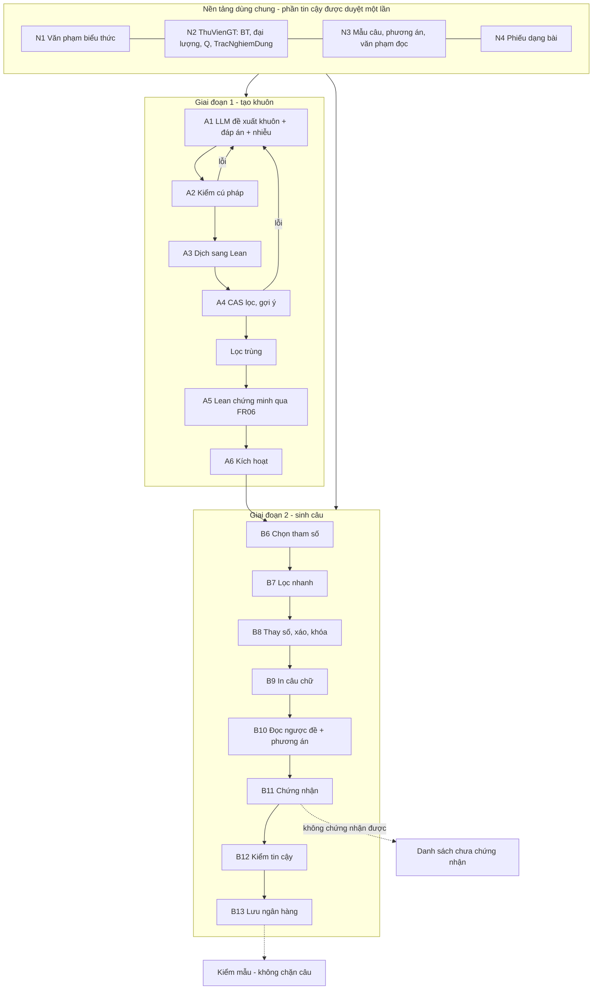

# Thiết kế hệ thống sinh câu trắc nghiệm Giải tích 1 có chứng nhận Lean

Phiên bản thiết kế: **2.1** · Ngày: 2026-11-26 · Thay cho bản 2.0 (thay đổi từ 2.0 lên 2.1 ghi ở Phụ lục B.3; từ 1.2 lên 2.0 ở Phụ lục B.1)

Bản 2.0 có ba thay đổi lớn so với bản 1.2:
1. **Đầu ra là câu trắc nghiệm 4 phương án** (một đáp án đúng, ba phương án nhiễu), không chỉ là đề bài.
2. **Phạm vi mở rộng ra toàn bộ dạng bài trắc nghiệm của Giải tích 1** (danh mục ở Phụ lục A), chia theo bốn kiểu đáp án T1–T4.
3. **Lõi được tổng quát hóa:** mọi dạng bài dùng chung một mệnh đề `TracNghiemDung`. Mỗi dạng chỉ định nghĩa một thứ: **Q**, tức "thế nào là đáp án đúng" theo giáo trình. Việc tìm chứng minh dùng cách của tài liệu phân tích (FR06), không có thư viện chiến lược riêng cho từng dạng.

Đối tượng đọc: người cài đặt (Claude Code) và sinh viên làm đồ án.

Ví dụ dùng xuyên suốt tài liệu:
> Khuôn: tính $\lim_{x\to a}\frac{x^2-a^2}{x-a}$, với a nguyên từ 1 đến 6, a ≠ 0. Đáp án `2*a`; nhiễu `a`, `-2*a`, `0`.
> Câu a = 2: "Tính giới hạn sau: $\lim\limits_{x \to 2} \dfrac{x^{2} - 4}{x - 2}$." A. $2$ B. $4$ C. $0$ D. $-4$. Khóa: B.

---

## Mục lục
0. Hướng dẫn cho người cài đặt
1. Mục tiêu và phạm vi
2. Nguyên tắc bất biến
3. Nền tin cậy
4. Kiến trúc tổng quan
5. Công nghệ, môi trường và cấu trúc repo
6. N1 — Văn phạm biểu thức và chuẩn hóa
7. N2 — Thư viện Lean `ThuVienGT`
8. N3 — Mẫu câu, hiển thị và đọc ngược
9. N4 — Danh mục dạng bài
10. Lưu trữ
11. Giai đoạn 1 — Tạo khuôn
12. Giai đoạn 2 — Sinh câu
13. Tìm chứng minh (FR06)
14. Thành phần Lean dùng chung và an toàn
15. Kiểm mẫu để đo
16. Câu đúng nhưng chưa chứng nhận được
17. Giao diện dòng lệnh
18. Kiểm thử
19. Các mốc cài đặt
20. Mở rộng
21. Hạn chế còn lại và câu hỏi mở
- Phụ lục A. Danh mục dạng bài, kiểu đáp án và Q
- Phụ lục B. Thay đổi từ bản 1.2 và đính chính
- Phụ lục C. Quan hệ với tài liệu "Phân tích hướng cấu trúc"

---

## 0. Hướng dẫn cho người cài đặt

1. Đọc hết tài liệu trước khi viết mã. Làm theo thứ tự các mốc ở mục 19. Mốc sau chỉ bắt đầu khi mốc trước đạt tiêu chí nghiệm thu.
2. Mục 2 gồm các **nguyên tắc bất biến**. Không được vi phạm, kể cả để cho tiện hay để vượt qua kiểm thử.
3. Mục 3 liệt kê **nền tin cậy**, trong repo được đánh dấu `TIN CẬY` ở chú thích đầu tệp. Mọi thay đổi ở các thành phần này phải tạo phiên bản nền tảng mới và chờ người duyệt. Không tự sửa chúng để "cho chạy được".
4. Mọi đoạn mã Lean trong tài liệu là **phác thảo chưa biên dịch**:
   - đối chiếu tên định lý, tên hàm và cú pháp với phiên bản Lean và Mathlib đã cố định;
   - sửa cho biên dịch được, nhưng **không đổi nghĩa** của định nghĩa;
   - nếu một định nghĩa có vẻ lệch giáo trình, ghi vào `docs/cau_hoi_mo.md` và hỏi người dùng.
5. Thư viện `ThuVienGT` không được chứa `sorry`, `axiom` hay `native_decide`. Nếu không chứng minh được một định lý của thư viện, dừng lại và báo cáo. Không thêm giả thiết, không làm yếu định nghĩa.
6. Nếu hai mục của tài liệu mâu thuẫn nhau, dừng lại, ghi vào `docs/cau_hoi_mo.md` và hỏi người dùng.
7. Tên định danh trong mã dùng tiếng Việt không dấu. Chú thích và thông báo cho người dùng viết tiếng Việt có dấu.
8. Kiểm thử phải chạy được mà không cần API LLM, nhờ `FakeLLM`. Kiểm thử cần Lean đánh dấu `@pytest.mark.lean`; kiểm thử cần Docker đánh dấu `@pytest.mark.sandbox`.
9. **Không viết cứng dạng bài.** Mọi phần phụ thuộc dạng bài lấy từ N4 và bảng đăng ký (mục 9.3). Mã của pipeline chỉ gọi qua bảng đăng ký.
10. **Tìm chứng minh luôn đi qua FR06** (mục 13). Không viết chiến lược chứng minh riêng trong mã pipeline cho một dạng bài.
11. **Một dạng bài chỉ được bật sinh câu ở chế độ `chinh_thuc`** khi Q, mẫu câu, văn phạm đọc của dạng đó đã được duyệt (mục 3.3).

---

## 1. Mục tiêu và phạm vi

### 1.1 Mục tiêu
Hệ thống sinh **câu trắc nghiệm** Giải tích 1 có tham số. Mỗi câu gồm một đề và bốn phương án A, B, C, D, trong đó đúng một phương án đúng. Mỗi câu vào ngân hàng có một **chứng nhận Lean** rằng câu đúng (mục 1.2). Chứng nhận được phát biểu **trên chính đề và chính bốn phương án đọc lại từ câu chữ hiển thị cho sinh viên**. Câu được hiển thị đúng chuỗi đã chứng nhận, không sinh lại lúc hiển thị.

Con người không tham gia vào việc sinh từng câu. Người chỉ làm hai việc:
- duyệt **một lần** nền tin cậy (mục 3);
- kiểm một mẫu nhỏ để **đo** chất lượng (mục 15). Việc kiểm mẫu không chặn câu.

### 1.2 Câu trắc nghiệm đúng
Một câu trắc nghiệm gồm đề, bốn phương án và khóa k (vị trí phương án đúng). Câu đúng khi, **với đề và bốn phương án đọc được từ câu chữ hiển thị**:

| # | Điều kiện | Bảo đảm bởi |
|---|---|---|
| 1 | Đề và mọi phương án chỉ hiểu được theo một nghĩa | Văn phạm đọc không mơ hồ (mục 8.3); mẫu câu cố định; chứng nhận phát biểu trên cái đọc được (mục 12.5–12.7); kiểm mẫu đo cách người thật đọc (mục 15) |
| 2 | **Đề có đúng một kết quả**: ∃! v, Q(v) | Lean: trường `duyNhat` |
| 3 | **Phương án ở vị trí khóa là kết quả**: Q(phương án k) | Lean: trường `dapAn` |
| 4 | **Bốn phương án khác nhau đôi một về giá trị** | Lean: trường `phanBiet` |
| 5 | **Mọi phương án hợp lệ** (là một giá trị có nghĩa: không có ln(−1), 1/0…) | Lean: trường `hopLe` |
| 6 | Ba phương án còn lại **không phải kết quả** | **Hệ quả** của 2, 3, 4 (định lý `nhieuSai`, mục 7.7) |
| 7 | (Tùy chọn theo N4) **Đúng dạng bài**, ví dụ đúng là dạng 0/0 | Lean: trường `dungDang` của dạng (mục 7.8) |

Riêng kiểu T4 (chọn khẳng định đúng), điều kiện 2–6 được thay bằng: khẳng định ở vị trí khóa đúng, ba khẳng định còn lại sai (mục 7.7).

### 1.3 Q, đề đúng, đáp án đúng
- **Q(v)** là **luật chấm đáp án** của dạng bài: "v có phải kết quả của đề không", định nghĩa theo giáo trình. Q chứa luôn điều kiện tồn tại và điều kiện xác định của đại lượng cần tính. Ví dụ với giới hạn: Q(v) = "biểu thức xác định gần điểm, và giới hạn **bằng v**".
- **Đề đúng** được định nghĩa từ Q: có **đúng một** v thỏa Q. Đề vô nghĩa thì không có v nào; đề có nhiều kết quả thì có nhiều v.
- **Đáp án đúng**: phương án ở vị trí khóa thỏa Q.
- **Nhiễu sai**: vì kết quả là duy nhất, một phương án **khác** đáp án thì **không** thỏa Q. Vì vậy chứng minh "nhiễu sai" rút về chứng minh "khác giá trị".

Q được viết **một lần cho mỗi đại lượng hoặc dạng bài** (có chỗ trống cho đề cụ thể), người duyệt đối chiếu với giáo trình một lần, rồi dùng cho mọi câu. Danh sách Q của từng dạng ở Phụ lục A.

### 1.4 Bốn kiểu đáp án

| Kiểu | Phương án là | Giá trị để so sánh | "Khác nhau" chứng minh bằng |
|---|---|---|---|
| **T1. Một số** | Biểu thức hằng (có thể có căn, ln, e, π), hoặc một trong các phương án đặc biệt "Không tồn tại", "$+\infty$", "$-\infty$" | Một số thực, hoặc một trong ba giá trị đặc biệt | Kẹp số bằng các cận đã chứng minh trong Mathlib |
| **T2. Một tập** | Tập hữu hạn, khoảng, hợp các khoảng, tập rỗng (trên ℝ, hoặc tập điểm trên ℝ² với hàm hai biến) | Một tập | Chỉ ra **một phần tử** thuộc tập này mà không thuộc tập kia |
| **T3. Một hàm** | Biểu thức theo x (và tham số), trên miền D ghi rõ trong đề | Hàm thu hẹp trên D; với nguyên hàm là **họ hàm hơn kém một hằng số** | Chỉ ra **một điểm** trong D hai hàm khác giá trị (với nguyên hàm: khác đạo hàm) |
| **T4. Một khẳng định** | Khẳng định điền từ **mẫu khẳng định** cố định của dạng bài | Không cần | Lean chứng minh khẳng định đúng và **phủ định** của ba khẳng định còn lại |

### 1.5 Phạm vi của phiên bản này
- **Trong phạm vi:**
  - nền tảng N1–N4 tổng quát (biểu thức nhiều biến, hằng π và e, lũy thừa số mũ thực, tích phân cận biến thiên, hàm từng khúc, tập, khoảng);
  - giai đoạn 1 (tạo khuôn kèm đáp án và nhiễu) và giai đoạn 2 (sinh câu trắc nghiệm);
  - toàn bộ dạng bài trắc nghiệm ở Phụ lục A, cài theo lộ trình ở mục 19;
  - kiểm mẫu để đo; lưu trữ, nhật ký, CLI, báo cáo.
- **Giới hạn chung của bản này:**
  - tham số là **số nguyên**, miền hữu hạn, tối đa `so_tham_so_toi_da` tham số (mặc định 2; mục 20 nêu cách nâng);
  - **ràng buộc** của tham số là phân thức hữu tỉ theo tham số (mục 6.6);
  - **khuôn** là đơn vị sinh câu: mọi câu đều sinh từ một khuôn đã kích hoạt.

### 1.6 Ngoài phạm vi
| Nội dung | Lý do |
|---|---|
| Câu tự luận, lời giải hiển thị cho sinh viên | Đồ án chỉ làm trắc nghiệm. Lời giải có thể thêm sau bằng cách kiểm lời giải QT04 của tài liệu phân tích, dùng lại chính chứng minh đáp án |
| Câu tự do (không theo khuôn) | Không bảo đảm được cùng mức với câu theo khuôn trong bản này |
| Vẽ đồ thị; bài ứng dụng có mô hình hóa bằng lời văn tự do; câu hỏi phát biểu lý thuyết | Không kiểm được bằng Lean, hoặc bước dịch lời văn sang công thức không chứng minh được |
| Chất lượng sư phạm của phương án nhiễu | Không chứng minh được; chỉ đo bằng kiểm mẫu (mục 15) |
| Ghép đề thi, chấm bài | Như tài liệu phân tích |

### 1.7 Một mức bảo đảm duy nhất
Câu chỉ vào ngân hàng chính thức khi **đã được chứng nhận** (mục 12.7). Bản này **bỏ** đường "Chỉ kiểm số" của tài liệu phân tích: câu chỉ được CAS kiểm mà Lean chưa chứng nhận thì không vào ngân hàng, và được ghi vào danh sách "chưa chứng nhận được" (mục 16).

---

## 2. Nguyên tắc bất biến

| Mã | Nguyên tắc |
|---|---|
| I1 | Nội dung do LLM sinh **không bao giờ được thực thi** bằng Python hay shell. Nó chỉ được đọc bằng bộ phân tích N1 hoặc kiểm bằng pydantic. Riêng phần thân chứng minh Lean do LLM viết chỉ được biên dịch **trong sandbox**, sau khi qua bước kiểm văn bản (mục 14.3). |
| I2 | Một câu chỉ vào ngân hàng khi chứng nhận của nó đã build xong và qua mọi phép kiểm tin cậy (mục 12.7). Câu được hiển thị đúng chuỗi `cau_chu` đã lưu và đã chứng nhận. |
| I3 | Mệnh đề Lean dùng ở cổng kiểm cuối chỉ do bộ sinh tin cậy tạo ra **từ câu chữ hiển thị, khóa đã lưu và N4**. LLM chỉ viết phần thân chứng minh, chèn vào chỗ cố định. |
| I4 | Câu chữ (đề, khung phương án, khẳng định) chỉ được ghép từ mẫu câu và mẫu khẳng định của N3. |
| I5 | Mọi quyết định đạt hay không đạt về toán do Lean đưa ra. Bộ lọc nhanh (SymPy, tính số) **chỉ được loại, không bao giờ được chấp nhận**. |
| I6 | Kết quả của CAS và tính số không bao giờ là bằng chứng. Chúng chỉ là bộ lọc (I5) hoặc **gợi ý** cho chứng minh. Gợi ý sai chỉ làm chứng minh thất bại. |
| I7 | Mọi lần gọi LLM, mọi lần chạy Lean và mọi phép kiểm đều được ghi lại, đủ để tái lập. |
| I8 | N1–N4, khuôn, prompt và thư viện Lean đều có phiên bản. Ở chế độ `chinh_thuc`, hệ thống từ chối chạy nếu phiên bản nền tảng chưa được duyệt. |
| I9 | Không viết cứng dạng bài trong mã pipeline (mục 0, ý 9). |
| I10 | **Mọi phương án** đều được đọc lại từ câu chữ hiển thị và được chứng nhận trên cái đọc được. Không có phương án nào được chứng nhận trên dạng "định in". |
| I11 | Một dạng bài chỉ được sinh câu chính thức khi Q, mẫu câu, mẫu khẳng định (nếu có) và văn phạm đọc của dạng đó đã được duyệt. |
| I12 | Không có mức bảo đảm "chỉ kiểm số" trong ngân hàng chính thức (mục 1.7). |

---

## 3. Nền tin cậy

"Đúng tuyệt đối" nghĩa là **đúng so với nền tin cậy**: một tập nhỏ thành phần mà tính đúng của mọi câu dựa vào. Các thành phần còn lại chỉ có thể làm câu bị loại.

### 3.1 Thành phần thuộc nền tin cậy (phải duyệt)

| Thành phần | Vai trò | Cách giảm rủi ro |
|---|---|---|
| Lean 4 và Mathlib (phiên bản cố định) | Kiểm chứng minh | Giả định của đồ án; chạy lean4checker |
| **Định nghĩa** trong `ThuVienGT`: `BT`, `Bien`, `GanBien`, `giaTri`, `XacDinh`, `QuaTrinh`, `locLan`, các định nghĩa đại lượng theo giáo trình (mục 7.4), các kiểu giá trị đáp án và hàm `val` (mục 7.5), **các Q** (mục 7.6), `TracNghiemDung`, `TracNghiemKhangDinh` (mục 7.7), các điều kiện đúng dạng (mục 7.8) | Phát biểu thế nào là câu đúng | Người duyệt đối chiếu giáo trình; ví dụ bắt buộc (mục 7.10); định lý cầu nối |
| **Phát biểu** các định lý cầu nối (mục 7.4) | Định nghĩa của hệ thống khớp định nghĩa của Mathlib, nên chứng minh bằng Mathlib cũng là chứng minh theo giáo trình | Người duyệt; phần chứng minh do Lean kiểm |
| Văn phạm đọc `latex_con.lark` và bộ chuyển `doc_nguoc.py` (đọc đề **và phương án**) | Mô hình cách sinh viên đọc | Người duyệt; strict LALR; kiểm mẫu |
| Mẫu câu, khung phương án, mẫu khẳng định của N3 và trường `nghia_lean` | Lời văn và nghĩa của nó trong Lean | Người duyệt |
| Các trường tin cậy của N4: `kieu_dap_an`, `Q`, `mau_cau_cho_phep`, `mau_khang_dinh_cho_phep`, `dung_dang` | Nối dạng bài với mệnh đề cần chứng minh | Người duyệt; kiểm nhất quán N3–N4 |
| Bộ in literal `in_lean_cay.py` | Đưa cái đọc được vào mệnh đề Lean | Rất ngắn; kiểm chéo `to_sexpr` ⇔ `BT.toSExpr` trên tập kiểm thử **và trên từng câu** ở B12 |
| Tiện ích đối chiếu `lean/KiemKhop/Main.lean` (lean_exe `kiem_khop`) và `kiem_tin_cay.py` (dịch cái đọc được thành S-biểu thức `Expr` của mệnh đề mong đợi) | Cổng kiểm cuối: kernel so kiểu ở mức `Expr`, thu axiom qua API | Không phân tích văn bản Lean trong môi trường đã nạp module không tin cậy; không chạy initializer; kết quả đọc từ tệp JSON; kiểm thử tấn công (mục 18.3). Đã thử ở M0 (`sinh-de-gt1/docs/ket_qua_M0.md`) |
| Sandbox | An toàn cho máy | Cấu hình cố định |

### 3.2 Thành phần không thuộc nền tin cậy
LLM (đề xuất khuôn, đáp án, nhiễu, viết chứng minh); SymPy, mpmath; bộ phân tích N1, `in_chuoi`, `chuan_hoa` Python; bộ in LaTeX; bộ dịch khuôn; bộ đưa phương án về dạng in; bộ xáo và gán khóa; các phép kiểm ở A2, A4, B10; kịch bản chứng minh; hàm `chuanHoa` trong Lean (đã chứng minh).

### 3.3 Quy trình duyệt nền tảng
Như bản 1.2 mục 3.3 (mã băm nền tảng, lệnh `sinhde nen-tang duyet`, hai chế độ `phat_trien` và `chinh_thuc`, mã băm `.olean`), bổ sung:
- **Duyệt theo khối.** Khối chung (BT, XacDinh, ChuanHoa, TracNghiemDung, văn phạm cơ sở) duyệt trước. Sau đó mỗi **đại lượng** (giới hạn, đạo hàm, tích phân, cực trị…) cùng các Q, mẫu câu, văn phạm đọc của nó được duyệt thành một khối riêng.
- Bảng `dang_bai_da_duyet` ghi dạng nào đã có đủ khối duyệt. B6 từ chối sinh câu chính thức cho dạng chưa có.
- **Quy ước phải chốt theo giáo trình** trước khi duyệt khối tương ứng (mục 21.2): lồi và lõm, điểm uốn, cực trị chặt hay không chặt, tiệm cận, phân loại điểm gián đoạn, miền của nguyên hàm.

---

## 4. Kiến trúc tổng quan



---

## 5. Công nghệ, môi trường và cấu trúc repo

Công nghệ, môi trường, cấu hình và `lakefile.lean` **như bản 1.2 mục 5**, cộng các điều đã chốt ở M0 (chi tiết trong `sinh-de-gt1/docs/ket_qua_M0.md`):
- Lean 4.36.0, Mathlib tag v4.36.0; môi trường Python dựng bằng `uv`.
- `ThuVienGT` dùng **import cụ thể**, không `import Mathlib`. Với `import Mathlib`, lần chạy lạnh mất 351 s và làm Windows cạn bộ nhớ; với import cụ thể chỉ còn 21 s, các lần sau 2–3 s. Khi thêm đại lượng mới thì thêm import tương ứng.
- Chế độ `build_module` cho ghi **cả `.lake/build` lẫn `.lake/config`**, vì Lake ghi lại `.lake/config` mỗi khi `lakefile.lean` đổi (sửa mục 13.2 của bản 1.2).
- `config.yaml`: `so_tien_trinh: 1`, `bo_nho_gb: 6` trên máy phát triển.
- Chưa dùng hệ thống `module` của Lean 4.36. Nếu dùng, thân các định nghĩa như `chuanHoa` mặc định không được xuất, mà `decide +kernel` trong chứng nhận cần chúng; phải thử trước ở M2.

Thay đổi trong cấu trúc repo:

```
sinhde/
├── nen_tang/
│   ├── van_pham.lark            # N1, mở rộng (mục 6.1)
│   ├── cay.py                   # thêm Pi, Bien(ten), TichPhanT, Tap, Khoang, PhuongAnDacBiet
│   ├── bieu_thuc_tham_so.py     # thay da_thuc_tham_so.py (mục 6.6)
│   └── ...                      # in_chuoi.py, chuan_hoa.py, mau_cau.py, dang_bai.py, ma_bam.py như cũ
├── hien_thi/
│   ├── latex.py                 # bộ in đề + bộ in phương án (không tin cậy)
│   ├── latex_con.lark           # văn phạm đọc đề + phương án (TIN CẬY)
│   ├── doc_nguoc.py             # trả CauDoc (TIN CẬY)
│   ├── dang_in.py               # đưa phương án về dạng in (không tin cậy, mục 12.3)
│   └── cau_chu.py
├── dap_an/
│   ├── xao_va_khoa.py           # chọn nhiễu, xáo thứ tự, gán khóa (không tin cậy)
│   └── loc_phuong_an.py         # lọc khác nhau bằng số (không tin cậy)
├── chung_minh/
│   └── fr06.py                  # bộ tìm chứng minh (mục 13)
└── ...
du_lieu/
├── mau_cau/                     # đề + khung phương án (TIN CẬY)
├── mau_khang_dinh/              # mẫu khẳng định cho T4 (TIN CẬY)
├── dang_bai/<MA>.yaml           # một tệp cho mỗi dạng ở Phụ lục A
└── ...
lean/ThuVienGT/
├── BieuThuc.lean  XacDinh.lean  ChuanHoa.lean  GiaoTrinh/  (một tệp cho mỗi đại lượng)
├── GiaTriDapAn.lean             # kiểu giá trị và val (mục 7.5)
├── Q/                           # Q theo đại lượng (mục 7.6)
├── TracNghiem.lean              # TracNghiemDung, TracNghiemKhangDinh (mục 7.7)
├── DangBai.lean                 # điều kiện đúng dạng (mục 7.8)
├── HoTro/                       # bổ đề, gồm kẹp số (mục 7.9)
└── ViDu/                        # ví dụ bắt buộc (mục 7.10)
```

---

## 6. N1 — Văn phạm biểu thức và chuẩn hóa

N1 là "ngôn ngữ" LLM dùng để viết khuôn, đáp án và phương án nhiễu. N1 biến chuỗi thành **cây Python của hệ thống**. N1 không thuộc nền tin cậy: N1 sai thì khuôn hoặc câu bị loại, vì Lean luôn chứng minh trên cái đọc lại từ câu chữ (N3).

### 6.1 Tệp `van_pham.lark`
```lark
// ===== Biểu thức =====
?bieu_thuc: hang_tu
          | bieu_thuc "+" hang_tu                     -> cong
          | bieu_thuc "-" hang_tu                     -> tru
?hang_tu: nhan_tu
        | hang_tu "*" nhan_tu                         -> nhan
        | hang_tu "/" nhan_tu                         -> chia
?nhan_tu: luy_thua
        | "-" nhan_tu                                 -> am
?luy_thua: nguyen_to
         | nguyen_to "^" so_mu                        -> mu
so_mu: SO_NGUYEN                                      -> so_mu_duong
     | "(" "-" SO_NGUYEN ")"                          -> so_mu_am
?nguyen_to: SO_NGUYEN                                 -> so
          | BIEN                                      -> bien        // x, y, t, n
          | THAM_SO                                   -> tham_so
          | "m"                                       -> an          // ẩn m (dạng tìm m)
          | "pi"                                      -> pi
          | "e"                                       -> hang_e      // đọc thành exp(1)
          | HAM "(" bieu_thuc ")"                     -> ham
          | "luythua" "(" bieu_thuc "," bieu_thuc ")" -> luythua     // số mũ thực
          | "tp" "(" bieu_thuc "," bieu_thuc "," bieu_thuc ")" -> tich_phan_t   // ∫_a^b f(t) dt
          | "(" bieu_thuc ")"

// ===== Ràng buộc của tham số =====
?dieu_kien: dieu_kien_va | dieu_kien "or" dieu_kien_va -> hoac
?dieu_kien_va: so_sanh | dieu_kien_va "and" so_sanh     -> va
so_sanh: bieu_thuc SO_SANH bieu_thuc

// ===== Tập và khoảng (phương án kiểu T2) =====
?tap: "rong"                                          -> tap_rong
    | "{" bieu_thuc ("," bieu_thuc)* "}"              -> tap_huu_han
    | khoang ("U" khoang)*                            -> hop_khoang
khoang: KIEU_KHOANG "(" dau_mut "," dau_mut ")"
?dau_mut: bieu_thuc | "vc" -> duong_vc | "-vc" -> am_vc
KIEU_KHOANG.2: "kmo" | "kdong" | "ktrai" | "kphai"    // (a,b) [a,b] [a,b) (a,b]
diem2: "(" bieu_thuc "," bieu_thuc ")"                // điểm trên ℝ² (hàm hai biến)

// ===== Phương án đặc biệt (kiểu T1) =====
dac_biet: "khong_ton_tai" | "duong_vc" | "am_vc"

SO_SANH: "<=" | ">=" | "!=" | "<" | ">" | "="
HAM.2: "sin" | "cos" | "tan" | "cot" | "arcsin" | "arccos" | "arctan"
     | "exp" | "ln" | "sqrt" | "cbrt" | "abs"
BIEN: "x" | "y" | "t" | "n"
THAM_SO: /[abcdfghkpqrsuvwz]/
SO_NGUYEN: /[0-9]+/
%import common.WS
%ignore WS
```

### 6.2 Ghi chú
- Các điểm bắt đầu: `bieu_thuc`, `dieu_kien`, `tap`, `diem2`, `dac_biet`.
- **Vai trò của biến** do N4 quy định cho từng dạng: `x` (biến chính), `y` (biến thứ hai của hàm hai biến), `t` (biến lấy tích phân, chỉ được dùng bên trong `tp(…)`), `n` (chỉ số của dãy). A2 kiểm mỗi biến chỉ xuất hiện đúng chỗ.
- **Tham số** là một chữ trong `a b c d f g h k p q r s u v w z`. So với bản 1.2, bỏ thêm `n`, `t`, `y` (đã là biến).
- **Hằng:** `pi` là π; `e` là số e, được đọc thành `Ham("exp", So(1))`. Không có hằng nào khác.
- **Lũy thừa:**
  - số mũ là số nguyên viết trực tiếp thì **bắt buộc** dùng `^`, ví dụ `x^2`, `x^(-1)`;
  - mọi trường hợp khác dùng `luythua(cơ số, số mũ)`, ví dụ `luythua(x, 1/3)`, `luythua(2, x)`;
  - viết `luythua(u, k)` với k là số nguyên bị từ chối (`E_LUYTHUA_NGUYEN`). Nhờ vậy mỗi lũy thừa chỉ có một cách viết;
  - **(bản 2.1)** số mũ của `luythua` cũng không được thành số nguyên **sau khi thay tham số**, ví dụ `luythua(x, a)` với a = 2. Nếu không, phương án in ra `x^{2}` và bị đọc thành `Mu`, một cây có miền xác định khác (`Mu` không đòi cơ số dương). A2 kiểm điều này trên **mọi** giá trị của miền: số mũ chuẩn hóa thành `So(q)` với q nguyên tại giá trị v nào thì bỏ v khỏi miền, hoặc báo `E_LUYTHUA_NGUYEN` nếu miền còn lại quá nhỏ.
- **Tích phân cận biến thiên:** `tp(f, a, b)` là $\int_a^b f(t)\,dt$. f chứa biến `t`; a, b không chứa `t`.
- Không có `log`, không có `tan^-1`, không có số thập phân.

### 6.3 Cây `cay.py`
Các lớp nút của bản 1.2 giữ nguyên (`So`, `ThamSo`, `An`, `Am`, `Cong`, `Tru`, `Nhan`, `Chia`, `Mu`, `LuyThua`, `Ham`, `SoSanh`, `Va`, `Hoac`), thay đổi và thêm:

```python
@dataclass(frozen=True) class Bien(Nut):      ten: str          # "x" | "y" | "t" | "n"
@dataclass(frozen=True) class Pi(Nut):        pass
@dataclass(frozen=True) class TichPhanT(Nut): f: Nut; a: Nut; b: Nut

# Phương án
@dataclass(frozen=True) class DacBiet:   loai: str              # "khong_ton_tai" | "duong_vc" | "am_vc"
@dataclass(frozen=True) class Khoang:    kieu: str; trai: "Nut | VoCung"; phai: "Nut | VoCung"
@dataclass(frozen=True) class TapHuuHan: phan_tu: tuple[Nut, ...]
@dataclass(frozen=True) class HopKhoang: cac_khoang: tuple[Khoang, ...]
@dataclass(frozen=True) class TapRong:   pass
@dataclass(frozen=True) class Diem2:     x: Nut; y: Nut
@dataclass(frozen=True) class KhangDinh: ma_mau: str; cho_trong: tuple[Nut, ...]   # T4
```

Hàm tiện ích của bản 1.2 giữ nguyên, bổ sung:
- `bien_dung(t) -> set[str]`: các biến xuất hiện; `chi_chua_tham_so(t)`: không chứa biến nào;
- `to_sexpr` thêm: `Pi` → `pi`; `Bien(v)` → `(bien v)`; `TichPhanT` → `(tpt F A B)`; các phương án → `(dacbiet …)`, `(khoang kieu A B)`, `(tap …)`, `(diem2 A B)`, `(khangdinh ma …)`. Phải trùng từng ký tự với `toSExpr` của Lean.

### 6.4 `in_chuoi.py`
**Đính chính so với các giải thích trước đây:** `in_chuoi(t)` in cây ra **chuỗi theo văn phạm N1**, chỉ thêm ngoặc khi thiếu ngoặc sẽ đọc ra cây khác. Ví dụ `(x^2 - a^2)/(x - a)`. Dạng đầy đủ ngoặc `(chia (tru …) …)` là của hàm khác, `to_sexpr`.

Quy tắc ngoặc, tính chất khứ hồi và kiểm thử: như bản 1.2 mục 6.4. Bổ sung in cho `Pi` (`pi`), `exp(1)` (`e`), `TichPhanT` (`tp(f, a, b)`), tập, khoảng, phương án đặc biệt.

Dùng ở: A1 (in khuôn đã có cho LLM), lọc trùng, nhật ký.

### 6.5 Chuẩn hóa `chuan_hoa.py`
Bảng hàm dựng thông minh của bản 1.2 mục 6.5 giữ nguyên, kèm ba nguyên tắc: không làm mất chỗ không xác định, không bỏ thừa số 0, không đổi giá trị và điều kiện xác định. Bổ sung:
- `Pi`, `Bien` giữ nguyên như lá.
- `TichPhanT(f, a, b)` thành `TichPhanT(chuan_hoa(f), chuan_hoa(a), chuan_hoa(b))`. Không gộp.
- `Ham("exp", So(1))` giữ nguyên (đây là e).
- **Lũy thừa của e** (bản 2.1). Chuỗi `e^{…}` luôn được đọc là hàm mũ (mục 8.3), nên hai cây sau phải được đưa về hàm mũ, nếu không câu sẽ không khứ hồi được:
  - `mk_mu(Ham("exp", So(1)), n)` → `Ham("exp", So(n))`;
  - `LuyThua(Ham("exp", So(1)), b)` → `Ham("exp", b)`.

  Cả hai giữ nguyên giá trị (e^n = exp n; e^b = exp b vì e > 0) và điều kiện xác định (vế trái chỉ đòi b xác định, vì cơ số e > 0). Hai quy tắc này thêm vào bảng 6.5 ở **cả Python lẫn Lean**, và vào các định lý `giaTri_chuanHoa`, `xacDinh_chuanHoa`.
- Phương án: chuẩn hóa từng biểu thức con; tập hữu hạn **không** sắp xếp và **không** bỏ phần tử trùng (để không làm mất lỗi của LLM; phần tử trùng bị A2 loại).

### 6.6 Biểu thức theo tham số (`bieu_thuc_tham_so.py`)
Thay mục 6.6 của bản 1.2. Có ba loại:

| Loại | Dùng cho | Được phép | Vì sao |
|---|---|---|---|
| **Ràng buộc** | Điều kiện của tham số | Phân thức hữu tỉ theo tham số: `+ − ×`, mũ nguyên dương, chia | Lean kiểm ràng buộc bằng `decide` trên ℚ; Python tính bằng `Fraction`. Khi có phép chia cho biểu thức chứa tham số, hệ thống **tự thêm điều kiện "mẫu ≠ 0"** vào ràng buộc ở cả Python lẫn Lean, nên hai bên luôn cùng kết quả |
| **Điểm, cận** | Điểm giới hạn, cận tích phân, điểm đạo hàm, đầu mút khoảng trong đề | Mọi biểu thức hằng theo tham số, kể cả π, √, ln. Ví dụ `pi/4`, `sqrt(a)`, `1/a` | Lean **so cây** (không cần tính ra số); điều kiện xác định của điểm nằm trong Q nên Lean phải chứng minh |
| **Phương án** | Đáp án và nhiễu | T1: biểu thức hằng theo tham số; T2: tập có phần tử là biểu thức hằng; T3: biểu thức theo biến chính và tham số; T4: mẫu khẳng định với chỗ trống là biểu thức hằng | |

Hàm chính:
- `la_rang_buoc_hop_le(t)`, `them_dieu_kien_mau(t)`: kiểm và bổ sung ràng buộc;
- `danh_gia_rang_buoc(t, gia_tri)`: tính chính xác bằng `Fraction`, dùng để liệt kê miền hợp lệ ở A2;
- `la_hang_theo_tham_so(t)`: kiểm điểm, cận, phương án T1 không chứa biến.

### 6.7 Kiểm thử N1
Như bản 1.2 mục 6.7, bổ sung:
- chuỗi hợp lệ: `pi/4`, `e`, `luythua(x, 1/3)`, `luythua(2, x)`, `tp(sin(t), 0, x^2)`, `kmo(-vc, 2) U kphai(3, vc)`, `{a, -a}`, `khong_ton_tai`;
- chuỗi bị từ chối: `luythua(x, 2)`, `t` ngoài `tp(…)`, `tp(t, t, 1)` (cận chứa t), `{}` (phải viết `rong`).

---

## 7. N2 — Thư viện Lean `ThuVienGT`

Thư viện định nghĩa **nghĩa toán học theo giáo trình**. Mỗi định nghĩa có chú thích `-- GT: mục ?, trang ?` để người dùng điền. Mọi tệp nằm trong `namespace ThuVienGT` và có `open Filter Topology`.

### 7.1 `BieuThuc.lean`
```lean
inductive Ham
  | sin | cos | tan | cot | arcsin | arccos | arctan | exp | ln | sqrt | cbrt | abs
  deriving DecidableEq, Repr

/-- Vai trò của biến trong đề. -/
inductive Bien | x | y | t | n
  deriving DecidableEq, Repr

inductive BT
  | hang (q : ℚ)
  | pi
  | bien (v : Bien)
  | an                                   -- ẩn m của dạng "tìm m"
  | am (a : BT) | cong (a b : BT) | tru (a b : BT) | nhan (a b : BT) | chia (a b : BT)
  | mu (a : BT) (n : ℤ)
  | luythua (a b : BT)
  | ham (f : Ham) (a : BT)
  | tichPhanT (f a b : BT)               -- ∫_a^b f dt; f dùng biến t
  deriving DecidableEq, Repr

/-- Gán giá trị cho các biến và cho ẩn m. -/
structure GanBien where
  bien : Bien → ℝ
  an   : ℝ

noncomputable def BT.giaTri : BT → GanBien → ℝ
  | .hang q, _          => (q : ℝ)
  | .pi, _              => Real.pi
  | .bien v, ρ          => ρ.bien v
  | .an, ρ              => ρ.an
  | .am a, ρ            => -(a.giaTri ρ)
  | .cong a b, ρ        => a.giaTri ρ + b.giaTri ρ
  | .tru a b, ρ         => a.giaTri ρ - b.giaTri ρ
  | .nhan a b, ρ        => a.giaTri ρ * b.giaTri ρ
  | .chia a b, ρ        => a.giaTri ρ / b.giaTri ρ
  | .mu a n, ρ          => a.giaTri ρ ^ n
  | .luythua a b, ρ     => a.giaTri ρ ^ b.giaTri ρ
  | .ham f a, ρ         => f.giaTri (a.giaTri ρ)
  | .tichPhanT f a b, ρ =>
      ∫ s in (a.giaTri ρ)..(b.giaTri ρ), f.giaTri { ρ with bien := Function.update ρ.bien .t s }
```
`Ham.giaTri` (kể cả `cbrt` theo giáo trình) và `Ham.ten` như bản 1.2.

Các cách nhìn tiện dùng (chỉ là định nghĩa rút gọn, không thêm nghĩa mới):
```lean
def ganX (s : ℝ) (m : ℝ := 0) : GanBien := ⟨fun v => if v = .x then s else 0, m⟩
def ganXY (s r : ℝ) : GanBien := ⟨fun v => if v = .x then s else if v = .y then r else 0, 0⟩
noncomputable def BT.f1 (e : BT) (m : ℝ := 0) : ℝ → ℝ := fun s => e.giaTri (ganX s m)  -- hàm một biến
noncomputable def BT.f2 (e : BT) : ℝ × ℝ → ℝ := fun p => e.giaTri (ganXY p.1 p.2)     -- hàm hai biến
noncomputable def BT.giaTriHang (e : BT) : ℝ := e.giaTri (ganX 0)                        -- e không chứa biến
def BT.chiChuaBien (S : List Bien) : BT → Bool := ...                                  -- kiểm biến dùng
```
`BT.toSExpr` như bản 1.2, thêm các nút mới; trùng từng ký tự với `to_sexpr` của Python.

### 7.2 `XacDinh.lean`
`Ham.dieuKien`, `Ham.dieuKienMo` như bản 1.2. `XacDinh : BT → GanBien → Prop` như bản 1.2 (thay `t : ℝ` bằng `ρ : GanBien`), thêm:
```lean
  | .pi, _              => True
  | .bien _, _          => True
  | .an, _              => True
  | .luythua a b, ρ     => XacDinh a ρ ∧ XacDinh b ρ ∧ 0 < a.giaTri ρ       -- GT: lũy thừa số mũ thực
  | .tichPhanT f a b, ρ => XacDinh a ρ ∧ XacDinh b ρ ∧
      ∀ s ∈ Set.uIcc (a.giaTri ρ) (b.giaTri ρ), XacDinh f { ρ with bien := Function.update ρ.bien .t s }
```
Rút gọn: `XacDinh1 e s := XacDinh e (ganX s)`, `XacDinh2 e p := XacDinh e (ganXY p.1 p.2)`, `XacDinhHang e := XacDinh e (ganX 0)`.

### 7.3 `ChuanHoa.lean`
Như bản 1.2 mục 7.3, mở rộng cho các nút mới (lá giữ nguyên; `tichPhanT` chuẩn hóa các con). Hai định lý chính phát biểu trên mọi `ρ : GanBien`:
```lean
theorem giaTri_chuanHoa (e : BT) : (chuanHoa e).giaTri = e.giaTri := by sorry
theorem xacDinh_chuanHoa (e : BT) (ρ : GanBien) : XacDinh (chuanHoa e) ρ ↔ XacDinh e ρ := by sorry
```
Phải chứng minh xong trước khi đóng mốc M2.

### 7.4 `GiaoTrinh/`: định nghĩa đại lượng theo giáo trình
Mỗi đại lượng có hai phần: **định nghĩa sát câu chữ giáo trình** và **định lý cầu nối** với khái niệm Mathlib. Bảng sau là danh sách phải có; các định nghĩa của bản 1.2 (giới hạn tại điểm và tại vô cùng, liên tục, đạo hàm cấp 1 và 2, tổng Riemann, tích phân suy rộng loại 1) giữ nguyên.

| Tệp | Định nghĩa theo giáo trình | Cầu nối với Mathlib |
|---|---|---|
| `QuaTrinh.lean` | `QuaTrinh`: `.diem (a : BT) (h : Huong)` (a là biểu thức hằng), `.duongVoCung`, `.amVoCung`; `locLan` dùng `a.giaTriHang` | — |
| `GioiHan.lean` | `GioiHanGT`, một phía, tại vô cùng; `GioiHanVoCungGT` (giới hạn bằng ±∞) | `gioiHanTheoQuaTrinh_iff` (với `Tendsto`) |
| `Day.lean` | Giới hạn dãy `GioiHanDayGT` (ε–N, n ∈ ℕ, dùng `e.giaTri` tại `n` gán bằng số tự nhiên) | Với `Tendsto … atTop` trên ℕ |
| `VoCungBe.lean` | Vô cùng bé, tương đương, bậc (so với `(x − a)^k`) | Với `Asymptotics.IsEquivalent`, `IsBigO` |
| `LienTuc.lean` | `HamTungKhuc` (n khúc, mở rộng `HamHaiKhuc` của bản 1.2); liên tục tại điểm; điểm gián đoạn và **phân loại** (khử được, loại 1, loại 2) theo giáo trình | Với `ContinuousAt`, giới hạn một phía |
| `DaoHam.lean` | Đạo hàm, đạo hàm một phía, cấp n (đòi khả vi trên lân cận ở cấp thấp hơn) | `HasDerivAt`, `HasDerivWithinAt`, `iteratedDeriv` kèm `ContDiffAt` |
| `Taylor.lean` | Hệ số và đa thức Taylor cấp n tại điểm | `taylorCoeffWithin` / `iteratedDeriv` kèm điều kiện trơn |
| `GiaTriTrungBinh.lean` | Điểm c của định lý Rolle, Lagrange | — (định nghĩa trực tiếp) |
| `CucTri.lean` | Cực đại, cực tiểu địa phương (**chặt hay không chặt: chốt theo giáo trình**), giá trị lớn nhất, nhỏ nhất trên tập | `IsLocalMax`, `IsLocalMin`, `IsGreatest`, `IsLeast` |
| `DonDieu.lean` | Đồng biến, nghịch biến trên khoảng | `StrictMonoOn`, `StrictAntiOn` (hoặc không chặt, theo giáo trình) |
| `LoiLom.lean` | Lồi, lõm, điểm uốn (**chốt quy ước "lồi" theo giáo trình**) | `ConvexOn`, `ConcaveOn` |
| `TiemCan.lean` | Tiệm cận đứng, ngang, xiên (**chốt định nghĩa theo giáo trình**) | Giới hạn |
| `TichPhan.lean` | Tích phân Riemann, nguyên hàm trên khoảng, tích phân suy rộng loại 1 và loại 2, hội tụ | `tichPhanGT_of_lienTuc`, `intervalIntegral`, `HasDerivAt` |
| `UngDung.lean` | Diện tích hình phẳng, thể tích tròn xoay, độ dài cung, diện tích trong tọa độ cực, **theo công thức của giáo trình** | — (định nghĩa bằng tích phân) |
| `NhieuBien.lean` | Giới hạn hai biến (lân cận thủng trong ℝ²), liên tục, đạo hàm riêng, đạo hàm theo hướng, vi phân toàn phần, đạo hàm hàm hợp, hàm ẩn | `Tendsto` trên `𝓝[≠] (a, b)`, `HasFDerivAt`, `HasDerivAt` của hàm riêng phần |
| `CucTriNhieuBien.lean` | Điểm dừng, phân loại bằng ma trận Hessian, cực trị có điều kiện | `IsLocalExtrOn`, `IsLocalMax` trên ℝ² |

Lưu ý chung cho mọi định nghĩa (theo QT16 của tài liệu phân tích): **điều kiện tồn tại luôn nằm trong kết luận**, không bao giờ là giả thiết. Không dùng các giá trị quy ước của Mathlib (`deriv`, `limUnder`, tích phân không kèm khả tích) **trong phát biểu** khi đại lượng có thể không tồn tại. `deriv` chỉ được dùng khi đi kèm điều kiện khả vi ngay trong cùng mệnh đề.

### 7.5 `GiaTriDapAn.lean`: phương án và giá trị của nó
Mỗi kiểu đáp án có một kiểu **phương án** (cái được in, đọc lại được) và một kiểu **giá trị** (cái để so sánh), nối bằng hàm `val`:

```lean
/-- T1: phương án số. -/
inductive PASo | so (v : BT) | khongTonTai | duongVoCung | amVoCung
inductive GiaTriSo | so (r : ℝ) | khongTonTai | duongVoCung | amVoCung
noncomputable def PASo.val : PASo → GiaTriSo
  | .so v => .so v.giaTriHang | .khongTonTai => .khongTonTai
  | .duongVoCung => .duongVoCung | .amVoCung => .amVoCung
def PASo.hopLe : PASo → Prop
  | .so v => v.chiChuaBien [] = true ∧ XacDinhHang v | _ => True

/-- T2: phương án tập (trên ℝ; bản trên ℝ² tương tự với `Diem2`). -/
inductive DauMut | so (v : BT) | duongVoCung | amVoCung
inductive KieuKhoang | mo | dong | nuaTrai | nuaPhai
inductive PATap | rong | huuHan (ds : List BT) | hopKhoang (ds : List (KieuKhoang × DauMut × DauMut))
noncomputable def PATap.val : PATap → Set ℝ := ...       -- tập số thực mà phương án biểu diễn
def PATap.hopLe : PATap → Prop := ...                    -- mọi phần tử, đầu mút xác định; khoảng không suy biến;
                                                         -- tập hữu hạn không có phần tử trùng giá trị

/-- T3: phương án hàm, so trên miền D. -/
structure PAHam where e : BT
noncomputable def PAHam.valTren (D : Set ℝ) (p : PAHam) : D → ℝ := fun s => p.e.f1 s
/-- T3 nguyên hàm: so "họ hàm" — hai hàm có cùng hiệu giữa mọi cặp điểm thì hơn kém một hằng số. -/
noncomputable def PAHam.valHo (I : Set ℝ) (p : PAHam) : I → I → ℝ := fun s r => p.e.f1 s - p.e.f1 r
def PAHam.hopLeTren (D : Set ℝ) (p : PAHam) : Prop := ∀ s ∈ D, XacDinh1 p.e s

/-- T4: khẳng định điền từ mẫu (mục 8.1); nghĩa do bảng `nghia` của mẫu quy định. -/
structure PAKhangDinh where ma : String; choTrong : List BT
```
Nhờ dùng **giá trị** để so (không so cây), hai cách viết của cùng một số (ví dụ `ln(6)` và `ln(2) + ln(3)`) là **cùng giá trị**. Hai phương án như vậy không thể qua điều kiện "khác nhau đôi một", và câu bị loại.

### 7.6 `Q/`: luật chấm đáp án theo đại lượng
Mỗi Q nhận các thành phần của đề (đọc được từ câu chữ) và một **giá trị**. Ví dụ:

```lean
/-- Giới hạn (một biến), kiểu T1. GT: mục ?, trang ? -/
def Q.gioiHan (q : QuaTrinh) (e : BT) : GiaTriSo → Prop
  | .so r        => (∀ᶠ s in locLan q, XacDinh1 e s) ∧ Tendsto e.f1 (locLan q) (𝓝 r)
  | .duongVoCung => (∀ᶠ s in locLan q, XacDinh1 e s) ∧ Tendsto e.f1 (locLan q) atTop
  | .amVoCung    => (∀ᶠ s in locLan q, XacDinh1 e s) ∧ Tendsto e.f1 (locLan q) atBot
  | .khongTonTai => (∀ᶠ s in locLan q, XacDinh1 e s) ∧
                    (¬ ∃ r, Tendsto e.f1 (locLan q) (𝓝 r)) ∧
                    ¬ Tendsto e.f1 (locLan q) atTop ∧ ¬ Tendsto e.f1 (locLan q) atBot

/-- Đạo hàm tại điểm, kiểu T1. -/
def Q.daoHamTaiDiem (e a : BT) : GiaTriSo → Prop
  | .so r => (∀ᶠ s in 𝓝 a.giaTriHang, XacDinh1 e s) ∧ HasDerivAt e.f1 r a.giaTriHang
  | _     => False

/-- Tìm m để hàm từng khúc liên tục tại điểm, kiểu T2: v đúng bằng tập các m thỏa. -/
def Q.timMLienTuc (f : HamTungKhuc) : Set ℝ → Prop :=
  fun S => ∀ m : ℝ, LienTucTaiGT f m ↔ m ∈ S

/-- Tìm đạo hàm f'(x) trên D, kiểu T3. -/
def Q.daoHamTrenMien (e : BT) (D : Set ℝ) : (D → ℝ) → Prop :=
  fun g => ∀ s : D, (∀ᶠ r in 𝓝 (s : ℝ), XacDinh1 e r) ∧ HasDerivAt e.f1 (g s) s

/-- Nguyên hàm trên khoảng I, kiểu T3: v là "họ" (hiệu giữa các điểm) của một nguyên hàm. -/
def Q.nguyenHam (f : BT) (I : Set ℝ) : (I → I → ℝ) → Prop :=
  fun h => ∃ F : ℝ → ℝ, (∀ s ∈ I, HasDerivAt F (f.f1 s) s) ∧ ∀ s r : I, h s r = F s - F r
```
- Q của **mọi dạng** ở Phụ lục A được viết theo cùng mẫu này, mỗi Q một định nghĩa có chú thích giáo trình.
- Với nguyên hàm, đề phải in rõ khoảng I (`I` là một khoảng, liên thông). Nhờ vậy nguyên hàm duy nhất sai khác một hằng số, và `∃!` đúng.
- Với T3 nói chung, đề phải in rõ miền D. Hai phương án chỉ khác nhau **ngoài** D được coi là trùng.

### 7.7 `TracNghiem.lean`: một mệnh đề chung cho mọi dạng
```lean
/-- Câu trắc nghiệm đúng (kiểu T1–T3). P: kiểu phương án; V: kiểu giá trị. -/
structure TracNghiemDung {P V : Type} (val : P → V) (hl : P → Prop) (Q : V → Prop)
    (pa : Fin 4 → P) (k : Fin 4) : Prop where
  duyNhat  : ∃! v, Q v                        -- đề có đúng một kết quả
  dapAn    : Q (val (pa k))                   -- phương án ở vị trí khóa là kết quả
  phanBiet : Function.Injective (fun i => val (pa i))   -- bốn phương án khác giá trị đôi một
  hopLe    : ∀ i, hl (pa i)                   -- mọi phương án có nghĩa

/-- Hệ quả: ba phương án còn lại không phải kết quả. -/
theorem TracNghiemDung.nhieuSai {P V} {val : P → V} {hl Q pa k}
    (h : TracNghiemDung val hl Q pa k) (i : Fin 4) (hi : i ≠ k) : ¬ Q (val (pa i)) := by
  intro hq
  obtain ⟨v, _, hv⟩ := h.duyNhat
  exact hi (h.phanBiet ((hv _ hq).trans (hv _ h.dapAn).symm))

/-- Kiểu T4: khẳng định ở vị trí khóa đúng, ba khẳng định còn lại sai. -/
structure TracNghiemKhangDinh (nghia : PAKhangDinh → Prop) (pa : Fin 4 → PAKhangDinh) (k : Fin 4) : Prop where
  dung : nghia (pa k)
  sai  : ∀ i, i ≠ k → ¬ nghia (pa i)
```
Định lý chuyển qua chuẩn hóa (mục 12.6 dùng):
- Mọi Q chỉ phụ thuộc đề qua `giaTri` và `XacDinh`. Vì `chuanHoa` không đổi hai thứ này, nên Q của đề sau chuẩn hóa **bằng** Q của đề gốc (định lý `Q.<tên>_chuanHoa`, một cho mỗi Q, chứng minh bằng `giaTri_chuanHoa`, `xacDinh_chuanHoa`).
- `val` và `hopLe` của phương án cũng chỉ phụ thuộc `giaTri`, `XacDinh`, nên `TracNghiemDung` chuyển được giữa phương án gốc và phương án đọc lại khi chúng cùng dạng chuẩn.

### 7.8 `DangBai.lean`: điều kiện đúng dạng (tùy chọn)
`Dang00`, `DangVCVC`, `DangVCTru` của bản 1.2 giữ nguyên, thêm các điều kiện nhận dạng khác nếu N4 yêu cầu (ví dụ `Dang1VC` cho 1^∞). Điều kiện đúng dạng **không ảnh hưởng tới đáp án đúng**. Nó chỉ bảo đảm câu được xếp đúng dạng bài. Khi phiếu N4 có `dung_dang`, chứng nhận phải có thêm định lý `dungDang` và B12 kiểm thêm định lý đó.

### 7.9 `HoTro/`: bổ đề hỗ trợ (không thuộc nền tin cậy, phải chứng minh xong)
- Các bổ đề của bản 1.2 mục 7.7 và 21.2.6 (`mau_khac_khong`, `tendsto_of_eventuallyEq`, `dang00_of_lienTuc`, `DieuKienTron`, `tichPhanSuyRong_of_nguyenHam`…), phát biểu lại cho `GanBien`.
- **Kẹp số** (chứng minh hai giá trị khác nhau):
  ```lean
  theorem khac_of_kep {u v : ℝ} {l₁ h₁ l₂ h₂ : ℚ} (hu : (l₁:ℝ) < u ∧ u < h₁) (hv : (l₂:ℝ) < v ∧ v < h₂)
      (h : h₁ ≤ l₂ ∨ h₂ ≤ l₁) : u ≠ v := by sorry
  ```
  kèm cận đã có trong Mathlib cho π, e, ln 2 (tên kiểm theo phiên bản, ví dụ `Real.pi_gt_d6`, `Real.exp_one_gt_d9`, `Real.log_two_gt_d9`), và bổ đề kẹp √n, ln n.
- **Khác nhau của tập:** `ne_of_mem_not_mem : a ∈ S → a ∉ T → S ≠ T`.
- **Khả tích của tích phân cận biến thiên** (bản 2.1). Mathlib quy ước tích phân của hàm không khả tích bằng 0, nên `giaTri` của `tichPhanT` chỉ có nghĩa khi hàm dưới dấu tích phân khả tích. Bổ đề phải có:
  ```lean
  theorem intervalIntegrable_of_xacDinh {f a b : BT} {ρ : GanBien}
      (h : XacDinh (.tichPhanT f a b) ρ) :
      IntervalIntegrable (fun s => f.giaTri { ρ with bien := Function.update ρ.bien .t s })
        MeasureTheory.volume (a.giaTri ρ) (b.giaTri ρ) := by sorry
  ```
  Bổ đề đúng vì xác định tại một điểm kéo theo liên tục tại điểm đó (`lienTuc_of_xacDinh`), nên hàm liên tục trên đoạn đóng và khả tích. Mọi Q có tích phân và định lý cầu nối của khối tích phân dùng bổ đề này.
- **Khác nhau của hàm, họ hàm:** khác tại một điểm thì khác; hai nguyên hàm có đạo hàm khác tại một điểm thì khác họ.
- **Duy nhất có sẵn:** giới hạn, đạo hàm, tích phân là duy nhất; Q dạng "⇔ thuộc S" duy nhất theo tính chất tập hợp; nguyên hàm trên khoảng duy nhất sai khác hằng số.

### 7.10 `ViDu/`: ví dụ bắt buộc
Các ví dụ của bản 1.2 mục 7.8 và 21.2.7 giữ nguyên. Thêm cho mỗi Q:
- **phải chứng minh được:** một câu trắc nghiệm đúng điển hình của dạng, ví dụ `TracNghiemDung` cho câu ví dụ đầu tài liệu;
- **phải chứng minh được phủ định**: một câu có hai phương án cùng giá trị (ví dụ `ln 6` và `ln 2 + ln 3`); một câu nguyên hàm có hai phương án hơn kém hằng số; một câu tìm m có đáp án thiếu một phần tử;
- **kẹp số:** `Real.pi / 4 ≠ Real.log 2`;
- **quy ước:** ví dụ cho từng quy ước đã chốt (lồi, điểm uốn, cực trị…), đối chiếu một bài trong giáo trình.

### 7.11 Nghiệm thu N2
Như bản 1.2 mục 7.9 (build, không `sorry`, chỉ ba tiên đề chuẩn, kiểm chéo chuẩn hóa, kiểm chéo bộ in literal, đo `decide`), áp dụng cho từng khối khi khối đó được cài.

---

## 8. N3 — Mẫu câu, hiển thị và đọc ngược

N3 là **tờ đề** (chiều in) và **đôi mắt sinh viên** (chiều đọc). Bản 2.0 mở rộng N3 để in và đọc được **cả bốn phương án**.

```
CHIỀU IN (không tin cậy)                         CHIỀU ĐỌC (tin cậy) = "sinh viên máy"
đề + 4 phương án ──in──▶ CÂU CHỮ ──đọc ngược──▶ CauDoc (đề + 4 phương án) ──in literal──▶ Lean
```

### 8.1 Mẫu câu, khung phương án, mẫu khẳng định (TIN CẬY)
**Mẫu câu đề** như bản 1.2 (mục 8.1, 21.3), thêm mẫu cho các dạng ở Phụ lục A. Ví dụ:
```yaml
- ma: TINH_GIOI_HAN
  khung: "Tính giới hạn sau: ${CT}$."
- ma: TIM_NGUYEN_HAM
  khung: "Tìm họ nguyên hàm của hàm số $f(x) = {HS}$ trên khoảng ${I}$."
- ma: TIM_M_LIEN_TUC
  khung: "Tìm tất cả các giá trị của $m$ để hàm số $f(x) = {HK}$ liên tục tại $x = {D}$."
- ma: CHON_KHANG_DINH_HOI_TU
  khung: "Cho tích phân $I = {TP}$. Khẳng định nào sau đây đúng?"
```
Lưu ý: dạng "tìm m" của bản 2.0 hỏi **tất cả** giá trị (kiểu T2), nên đáp án là một tập, có thể có nhiều phần tử hoặc rỗng.

**Khung phương án** cố định, một khung cho mỗi kiểu đáp án:
```yaml
khung_phuong_an:
  T1: "{NHAN}. ${PA}$"           # PA là biểu thức hằng; phương án đặc biệt dùng chữ cố định bên dưới
  T2: "{NHAN}. ${PA}$"           # PA là tập hoặc khoảng
  T3: "{NHAN}. ${PA}$"           # PA là biểu thức theo x
  T3_NGUYEN_HAM: "{NHAN}. ${PA} + C$"
  T4: "{NHAN}. {KD}"             # KD là một khẳng định điền từ mẫu khẳng định
nhan: ["A", "B", "C", "D"]
phuong_an_dac_biet:
  khong_ton_tai: "Không tồn tại"
  duong_vc: "$+\\infty$"
  am_vc: "$-\\infty$"
```
Câu chữ đầy đủ là đề, xuống dòng, rồi bốn dòng phương án theo thứ tự A, B, C, D.

**Mẫu khẳng định** cho kiểu T4. Mỗi mẫu là một câu cố định có chỗ trống, kèm nghĩa Lean:
```yaml
- ma: KD_HOI_TU_BANG
  van_ban: "$I$ hội tụ và $I = {V}$."
  nghia_lean: ThuVienGT.KD.hoiTuBang
- ma: KD_PHAN_KY
  van_ban: "$I$ phân kỳ."
  nghia_lean: ThuVienGT.KD.phanKy
- ma: KD_GIAN_DOAN_LOAI_1
  van_ban: "$x = {D}$ là điểm gián đoạn loại một của $f$."
  nghia_lean: ThuVienGT.KD.gianDoanLoai1
```
LLM không bao giờ viết lời văn: đề, khung phương án và khẳng định đều lấy từ các mẫu này.

### 8.2 Bộ in LaTeX `hien_thi/latex.py` (không tin cậy)
Toàn bộ quy tắc ngữ cảnh và bọc ngoặc của bản 1.2 (mục 8.2, 21.3.2) giữ nguyên, với các thay đổi:

| Thành phần | Dạng in |
|---|---|
| `Pi` | `\pi` |
| `Ham("exp", So(1))` | `e` |
| `Ham("exp", a)`, a khác 1 | `e^{…}` như cũ |
| `LuyThua(a, b)` | in(a, CS) + `^{` + in(b, TD) + `}`. Phân biệt với `Mu` nhờ quy tắc đọc ở mục 8.3 |
| `Bien("y")` | `y` |
| `TichPhanT(f, a, b)` | `\int_{A}^{B} F \, dt`, với F in trong ngữ cảnh TP (mục 21.3.2 bản 1.2) |
| **Nhân viết liền** | **Chỉ khi vế trái là số nguyên dương** (`2x`, `3\sin\left(x\right)`). Hệ số phân số luôn dùng `\cdot`: `\dfrac{1}{2} \cdot x`. Đây là sửa đổi so với bản 1.2, để bỏ cách viết `\dfrac{1}{2}x` có thể hiểu hai nghĩa |
| Tập hữu hạn | `\left\{ a; b \right\}` (dấu chấm phẩy ngăn phần tử) |
| Khoảng | `\left( a; b \right)`, `\left[ a; b \right]`, `\left[ a; b \right)`, `\left( a; b \right]`; vô cùng `+\infty`, `-\infty` |
| Hợp khoảng | các khoảng nối bằng ` \cup ` |
| Tập rỗng | `\varnothing` |
| Điểm trên ℝ² | `\left( a; b \right)` (chỉ xuất hiện trong tập điểm, đọc theo ngữ cảnh) |

**Dạng in của phương án.** Phương án T1 được in **đúng như cây sau chuẩn hóa** của công thức khuôn tại giá trị tham số. Không có bước rút gọn ngầm. Muốn in gọn hơn thì đi qua bước "dạng in" có chứng minh (mục 12.3).

### 8.3 Văn phạm đọc `latex_con.lark` (TIN CẬY)
Quy ước đọc của bản 1.2 (mục 8.3, 21.3.3) giữ nguyên, với các thay đổi và bổ sung. Người duyệt xác nhận các quy ước này:
1. **Nhân viết liền** chỉ hợp lệ khi vế trái là **số nguyên dương**. `\dfrac{1}{2}x` bị từ chối.
2. `\pi` là π. `e` đứng riêng là số e. `e^{…}` là hàm mũ.
3. **Lũy thừa:** `^{k}` với k là số nguyên viết trực tiếp (kể cả `^{-1}` viết `^{-1}`) là `Mu`. Mọi số mũ khác (`^{\dfrac{1}{3}}`, `^{x}`, `^{\pi}`) là `LuyThua`. Cơ số e luôn đọc là hàm mũ, không phải `LuyThua`.
4. `\int_{A}^{B} … \, dt`: biến lấy tích phân phải là `t`; A, B không chứa `t`; `t` không được xuất hiện ngoài tích phân.
5. **Phương án:** mỗi dòng phương án phải khớp **từng ký tự** với khung phương án của kiểu đáp án ghi trong mẫu câu, nhãn đúng thứ tự A, B, C, D. Phần trong `$…$` đọc bằng điểm bắt đầu theo kiểu: `pa_so`, `pa_tap`, `pa_ham`; phương án đặc biệt và khẳng định T4 so khớp với văn bản cố định.
6. **Tập hữu hạn** đọc theo đúng thứ tự in; hai phần tử viết giống hệt nhau thì bị từ chối.
7. Mọi quy ước "nghi ngờ là cấm" của bản 1.2 vẫn áp dụng.

Đầu ra vẫn là **cây thô**, không chuẩn hóa.

### 8.4 Đọc ngược `doc_nguoc.py` (TIN CẬY)
`doc_cau_chu(chuoi) -> CauDoc`, với:
```python
@dataclass(frozen=True)
class CauDoc:
    ma_mau: str                 # mẫu câu đề khớp được (đúng một mẫu)
    de: DeDoc                   # các thành phần của đề (như bản 1.2)
    kieu_dap_an: str            # lấy từ mẫu câu
    phuong_an: tuple[PhuongAnDoc, PhuongAnDoc, PhuongAnDoc, PhuongAnDoc]   # theo thứ tự A, B, C, D
```
Các bước:
1. Tách câu chữ thành phần đề và bốn dòng phương án.
2. Khớp phần đề với khung mẫu câu, phải đúng một mẫu. Đọc các chỗ trống của đề như bản 1.2.
3. Khớp từng dòng phương án với khung phương án của kiểu đáp án. Đọc phần công thức hoặc khẳng định.
4. Trả về cây thô của đề và của từng phương án.

Khóa **không** nằm trong câu chữ. Khóa được lưu riêng (mục 10) và B12 đọc từ bản ghi.

### 8.5 Bộ in literal `in_lean_cay.py` (TIN CẬY)
Như bản 1.2, thêm literal cho `BT.pi`, `BT.bien .x/.y/.t/.n`, `BT.tichPhanT`, `PASo`, `PATap`, `PAHam`, `PAKhangDinh`, `Fin 4`. Mỗi loại nút một dòng, không tính toán.

### 8.6 Nghiệm thu N3
- **Khứ hồi cho đề** như bản 1.2 mục 8.5 và 21.3.4.
- **Khứ hồi cho phương án:** với ít nhất 5000 bộ phương án ngẫu nhiên của mỗi kiểu, `chuan_hoa(doc(in(pa))) == pa` và thứ tự nhãn đúng.
- **Từ chối:** `\dfrac{1}{2}x`; `x^{2}` viết bằng `LuyThua`; phương án thiếu nhãn hoặc sai thứ tự nhãn; tập hữu hạn có hai phần tử viết giống nhau; `t` ngoài tích phân.
- Văn phạm không có xung đột LALR.

---

## 9. N4 — Danh mục dạng bài

### 9.1 Phiếu dạng bài
Mỗi dạng ở Phụ lục A có một tệp `du_lieu/dang_bai/<MA>.yaml`. Ví dụ cho `GH_00`:
```yaml
ma: GH_00
phien_ban: 3
ten: Giới hạn dạng 0/0 tại một điểm
dai_luong: gioi_han
kieu_dap_an: T1                                  # TIN CẬY
Q: ThuVienGT.Q.gioiHan                           # TIN CẬY: luật chấm đáp án
qua_trinh_cho_phep: [diem_hai_phia, diem_trai, diem_phai]   # TIN CẬY
mau_cau_cho_phep: [TINH_GIOI_HAN]                # TIN CẬY
phuong_an_dac_biet_cho_phep: [khong_ton_tai, duong_vc, am_vc]   # TIN CẬY
dung_dang: ThuVienGT.Dang00                      # TIN CẬY, tùy chọn
hinh_dang_goc: chia                              # dùng khi có dung_dang
bien_cho_phep: [x]
so_tham_so_toi_da: 2
mo_ta_cho_llm: >
  Thương p/q theo x. Tại điểm d, với mọi giá trị tham số thỏa ràng buộc: p và q cùng tiến về 0,
  biểu thức xác định trên lân cận bỏ điểm, giới hạn hữu hạn. Kèm đáp án theo tham số và ít nhất
  3 phương án nhiễu theo tham số, mỗi nhiễu ghi lỗi sai mà nó mô phỏng.
loi_sai_goi_y:                                   # không tin cậy: gợi ý cho LLM viết nhiễu
  - thay_thang_x                                 # thay x = d vào tử, ra 0
  - quen_he_so
  - sai_dau
  - nham_dao_ham_khi_dung_lhospital
  - ket_luan_khong_ton_tai
kich_ban_mac_dinh: [K1_khu_dang]                 # không tin cậy: gợi ý kịch bản đầu tiên cho FR06
rang_buoc_chat_luong: [khong_tam_thuong]
```

Các trường tin cậy là: `kieu_dap_an`, `Q`, `qua_trinh_cho_phep` (hoặc các trường tương ứng của loại đề), `mau_cau_cho_phep`, `mau_khang_dinh_cho_phep` (kiểu T4), `phuong_an_dac_biet_cho_phep`, `dung_dang`. Các trường còn lại sai thì chỉ làm sinh kém hoặc chứng minh chậm.

### 9.2 Kiểm nhất quán khi nạp (`dang_bai.py`)
Như bản 1.2 mục 9.2, bổ sung:
- `Q` tồn tại trong Lean và có kiểu khớp `kieu_dap_an` (kiểm bằng tệp tạm `#check`);
- mẫu câu khai báo đúng kiểu đáp án; mẫu khẳng định (T4) có `nghia_lean` tồn tại;
- dạng có trong `dang_bai_da_duyet` thì mới được sinh câu ở chế độ `chinh_thuc`.

### 9.3 Bảng đăng ký theo đối tượng × đại lượng
Bảng đăng ký loại yêu cầu của bản 1.2 (mục 21.1) được tổ chức lại theo hai trục để không phải viết riêng cho từng dạng:

| Trục | Giá trị |
|---|---|
| **Đối tượng** của đề | hàm một biến; hàm từng khúc; dãy; hàm hai biến; tích phân (xác định, suy rộng, cận biến thiên); miền phẳng (ứng dụng) |
| **Đại lượng** được hỏi | giới hạn; vô cùng bé; liên tục; đạo hàm; Taylor; giá trị trung bình; cực trị; đơn điệu; lồi lõm; tiệm cận; nguyên hàm; tích phân; ứng dụng; đạo hàm riêng; cực trị nhiều biến |

Mỗi đối tượng có các thành phần (không tin cậy): `schema`, `doc`, `thay_tham_so`, `in_de`, `so_khop_doc`, `mau_lean`. Mỗi đại lượng có: `phep_thu` (A4), `goi_y`, danh sách Q. Một dạng bài là một cặp (đối tượng, đại lượng) cộng các trường của phiếu.

---

## 10. Lưu trữ

Lược đồ của bản 1.2 mục 10 giữ nguyên, thay đổi như sau:

```sql
-- khuon: thêm
  kieu_dap_an TEXT,
  dap_an_json TEXT,                 -- cây đáp án theo tham số
  nhieu_json TEXT,                  -- danh sách {cay, loi_sai}
  nhieu_bo_theo_gia_tri TEXT,       -- JSON: giá trị tham số -> các nhiễu không dùng được (QT03)

-- cau: thêm
  phuong_an_json TEXT,              -- 4 phương án phía sinh, theo thứ tự hiển thị (không tin cậy)
  khoa INTEGER,                     -- 0..3: vị trí phương án đúng (A..D)
  nguon_phuong_an TEXT,             -- JSON: mỗi vị trí ứng với đáp án hay nhiễu nào của khuôn, lỗi sai
  phuong_an_doc_json TEXT,          -- 4 phương án đọc được từ câu chữ (B10)
-- cau.dap_an_da_cm bỏ: đáp án luôn đã chứng minh

CREATE TABLE dang_bai_da_duyet (
  ma_dang_bai TEXT PRIMARY KEY, nen_tang_id INTEGER, khoi_da_duyet TEXT, duyet_luc TEXT);

CREATE TABLE chua_chung_nhan (      -- mục 16
  id INTEGER PRIMARY KEY, doi_tuong TEXT, doi_tuong_id INTEGER, ma_dang_bai TEXT,
  buoc TEXT, nghia_vu TEXT,         -- vd. "A5:dapAn", "B11:khop_pa_2"
  cas_ket_luan TEXT,                -- CAS cho rằng đúng / sai / không rõ
  thong_bao_lean TEXT, tao_luc TEXT);
```

---

## 11. Giai đoạn 1 — Tạo khuôn

Bộ điều phối `giai_doan_1/quy_trinh.py`: `tao_khuon(ma_dang_bai, yeu_cau_dot, so_khuon)`.
Thứ tự: A1 → A2 → A3 (chứng minh để trống) → A4 → lọc trùng → A5 → A6.

### 11.1 A1 — LLM đề xuất khuôn, đáp án và nhiễu
Giao diện LLM, cách gọi (tool use bắt buộc đúng schema, mỗi ứng viên một lần gọi), ghi nhật ký, ngân sách: như bản 1.2 mục 11.1.

Schema được lắp lúc chạy theo dạng bài. So với bản 1.2, thêm các trường:
```json
{
  "dap_an": {"type": "string"},
  "phuong_an_nhieu": {
    "type": "array", "minItems": 3, "maxItems": 6,
    "items": {"type": "object", "additionalProperties": false,
      "required": ["bieu_thuc", "loi_sai"],
      "properties": {"bieu_thuc": {"type": "string"},
                     "loi_sai": {"type": "string", "enum": ["<lấy từ loi_sai_goi_y của N4>", "khac"]},
                     "giai_thich": {"type": "string"}}}
  }
}
```
- `dap_an`, `bieu_thuc` viết theo văn phạm N1 với điểm bắt đầu đúng kiểu: biểu thức hằng (T1), `tap` (T2), biểu thức theo biến chính (T3). Phương án đặc biệt viết `khong_ton_tai`, `duong_vc`, `am_vc`.
- Với T4, thay hai trường trên bằng `khang_dinh`: 4–6 khẳng định, mỗi khẳng định gồm mã mẫu khẳng định, các chỗ trống, và nhãn `dung` hoặc `sai` (đúng một khẳng định có nhãn `dung`).
- Prompt (`prompts/de_xuat_khuon.v2.md`) nhắc LLM: viết đáp án **ở dạng gọn** (ví dụ `sqrt(2)/2` thay vì `1/sqrt(2)`), vì phương án được in đúng như công thức.

Ví dụ:
```json
{"ma_dang_bai": "GH_00", "bieu_thuc": "(x^2 - a^2)/(x - a)",
 "tham_so": [{"ten": "a", "kieu": "nguyen", "tu": 1, "den": 6}], "rang_buoc": "a != 0",
 "yeu_cau": {"loai": "gioi_han", "qua_trinh": "diem_hai_phia", "diem": "a"},
 "mau_cau": "TINH_GIOI_HAN",
 "dap_an": "2*a",
 "phuong_an_nhieu": [
   {"bieu_thuc": "a",    "loi_sai": "quen_he_so"},
   {"bieu_thuc": "-2*a", "loi_sai": "sai_dau"},
   {"bieu_thuc": "0",    "loi_sai": "thay_thang_x"},
   {"bieu_thuc": "a^2",  "loi_sai": "khac", "giai_thich": "nhầm (x−a)(x+a) thành x·a"}]}
```

### 11.2 A2 — Kiểm cú pháp
Các phép kiểm và mã lỗi của bản 1.2 (mục 11.2, 21.5) giữ nguyên, áp dụng cho đề. Thêm cho đáp án và nhiễu:

| Mã lỗi | Kiểm |
|---|---|
| `E_PA_VAN_PHAM` | Đọc được đáp án và từng nhiễu bằng N1, đúng điểm bắt đầu theo kiểu |
| `E_PA_KIEU` | Đúng kiểu đáp án: T1 không chứa biến; T3 chỉ chứa biến chính; T2 là tập hợp lệ; phương án đặc biệt thuộc `phuong_an_dac_biet_cho_phep` |
| `E_PA_THAM_SO` | Đáp án và nhiễu chỉ dùng tham số đã khai báo |
| `E_PA_SO_LUONG` | Có ít nhất 3 nhiễu |
| `E_PA_TRUNG_CAY` | Hai phương án có cùng cây sau chuẩn hóa |
| `E_LUYTHUA_NGUYEN` | Dùng `luythua` với số mũ nguyên |
| `E_KD` (T4) | Mã mẫu khẳng định thuộc danh sách cho phép; đúng một khẳng định nhãn `dung` |

Ràng buộc: tự thêm điều kiện "mẫu ≠ 0" (mục 6.6), rồi liệt kê miền hợp lệ bằng `danh_gia_rang_buoc`.

### 11.3 A3 — Dịch sang Lean (không tin cậy)
Quy tắc dịch đề như bản 1.2 mục 11.3 (tham số thành `p1`, `p2`; giữ nguyên cấu trúc; ràng buộc thành `abbrev R`). Thêm:
- `def dapAn (p1 : ℤ) : P` và `def nhieu (p1 : ℤ) : Fin n → P`, với P là kiểu phương án của dạng (mục 7.5);
- các định lý phải chứng minh, đều để trống ở A3:

```lean
theorem duyNhat (p1 : ℤ) (h : R p1) : ∃! v, Q (de p1) v                              -- ①
theorem dapAn_dung (p1 : ℤ) (h : R p1) : Q (de p1) (val (dapAn p1))                  -- ②
theorem hopLe (p1 : ℤ) (h : R p1) : hopLe (dapAn p1) ∧ ∀ i, hopLe (nhieu p1 i)       -- ③
theorem khac (p1 : ℤ) (h : R p1) (i : Fin n) : val (nhieu p1 i) ≠ val (dapAn p1)     -- ④
theorem khacNhau (p1 : ℤ) (h : R p1) (i j : Fin n) (hij : i ≠ j) :
    val (nhieu p1 i) ≠ val (nhieu p1 j)                                              -- ⑤
-- tùy chọn: theorem dungDang (p1 : ℤ) (h : R p1) : <dung_dang> (de p1)
```
Mệnh đề lấy Q và `val` theo phiếu N4. LLM không viết mệnh đề.

Với T4: thay ①–⑤ bằng `kd_dung : nghia (kd p1 k)` và `kd_sai : ∀ i ≠ k, ¬ nghia (kd p1 i)`, với k là khẳng định có nhãn `dung`.

### 11.4 A4 — CAS lọc sớm và tính gợi ý (không tin cậy)
Theo QT02 và QT03 của tài liệu phân tích, với **mọi** giá trị tham số trong miền:
1. **Kiểm đáp án bằng hai cách độc lập:** (a) SymPy tính đại lượng; (b) tính số độ chính xác cao. So với giá trị của `dap_an`. Lệch thì gửi lỗi `E_THU_DAP_AN` cho LLM, kèm giá trị tính được.
2. **Kiểm đề:** các phép thử của bản 1.2 (mục 11.4, 21.7) theo đại lượng.
3. **Kiểm nhiễu (QT03):** tính giá trị từng nhiễu bằng mpmath 50 chữ số. Một nhiễu "trùng" đáp án hoặc nhiễu khác ở giá trị tham số v khi hai giá trị cách nhau dưới `nguong_khac` (mặc định 10⁻²). Xử lý:
   - nếu sau khi bỏ các nhiễu trùng tại v vẫn còn ≥ 3 nhiễu, ghi vào `nhieu_bo_theo_gia_tri[v]`;
   - nếu không, bỏ v khỏi miền;
   - nếu miền còn ít hơn `mien_toi_thieu`, gửi lỗi `E_THU_NHIEU` cho LLM.

   Ví dụ: `a^2` trùng `2*a` tại a = 2, nên ghi `{2: ["a^2"]}`.
4. **Gợi ý cho chứng minh:** như bản 1.2 (rút gọn g, phân tích mẫu, bán kính, đạo hàm…), thêm **cận số** của đáp án và từng nhiễu tại mỗi giá trị, dùng cho kẹp số.

### 11.5 Lọc trùng
Như bản 1.2 mục 11.6: đổi tên tham số, sắp hai vế của `Cong` và `Nhan`, `in_chuoi`, ghép yêu cầu, băm SHA-256. Bản 2.0 **không** đưa đáp án và nhiễu vào mã băm: hai khuôn cùng đề nhưng khác nhiễu vẫn là trùng.

### 11.6 A5 — Lean chứng minh khuôn
Với từng định lý ①–⑤ (và `dungDang` nếu có), tìm chứng minh bằng **FR06** (mục 13), ở hai mức:
- **mức khuôn:** cho mọi tham số;
- **mức tách theo giá trị:** `interval_cases`, khi miền nhỏ hơn `mien_toi_da_tach_gia_tri`. Với ④ và ⑤, các nhiễu nằm trong `nhieu_bo_theo_gia_tri[v]` được loại khỏi nghĩa vụ tại v.

Nhãn khuôn:
- `cm_theo_khuon`: mọi định lý chứng minh được;
- `cm_mot_phan`: một số định lý chứng minh được, phần còn lại chứng minh ở từng câu;
- `cm_theo_cau`: không định lý nào chứng minh được ở mức khuôn.

Kiểm cuối tệp khuôn: như bản 1.2 mục 13.4.

### 11.7 A6 — Kích hoạt
Như bản 1.2 mục 11.6: ghi tệp, build trong sandbox, lưu mã băm, chuyển `da_kich_hoat`. Khuôn `cm_theo_cau` phải chứng nhận thử được một câu trước khi kích hoạt.

---

## 12. Giai đoạn 2 — Sinh câu

Bộ điều phối `giai_doan_2/quy_trinh.py`: `sinh_cau(khuon_id, so_cau, seed)`. Ở chế độ `chinh_thuc`, trước khi chạy phải kiểm: nền tảng đã duyệt, dạng bài có trong `dang_bai_da_duyet`, mã băm `.olean` không đổi.

### 12.1 B6 — Chọn tham số
Như bản 1.2. Không dùng LLM. Ví dụ: a = 2.

### 12.2 B7 — Lọc nhanh
Chỉ chạy khi khuôn chưa `cm_theo_khuon`. Như bản 1.2, thêm kiểm đáp án và nhiễu tại giá trị đã chọn (mục 11.4, ý 1 và 3).

### 12.3 B8 — Dựng đề và phương án
1. **Đề:** `chuan_hoa(thay_tham_so(…))` như bản 1.2.
2. **Phương án:**
   - lấy đáp án và các nhiễu của khuôn, bỏ các nhiễu trong `nhieu_bo_theo_gia_tri[v]`;
   - thay tham số, chuẩn hóa từng phương án;
   - `loc_phuong_an`: kiểm lại bằng số rằng các phương án cách nhau ít nhất `nguong_khac`;
   - chọn 3 nhiễu bằng `rng` (ưu tiên các lỗi sai khác nhau).
3. **Dạng in (tùy chọn, `dang_in.py`):** nếu phương án có thể in gọn hơn, ví dụ `1/sqrt(2)` thành `sqrt(2)/2`, thì tạo phương án gọn **và** một nghĩa vụ chứng minh `giaTriHang(gọn) = giaTriHang(gốc)`. Nghĩa vụ này được FR06 chứng minh ở B11. Không chứng minh được thì dùng lại phương án gốc. Mặc định tắt.
4. **Xáo và khóa (`xao_va_khoa.py`):** hoán vị bốn phương án bằng `rng`, ghi `khoa` (vị trí đáp án) và `nguon_phuong_an`.

Ví dụ a = 2: đáp án `4`; nhiễu `2`, `-4`, `0` (bỏ `a^2` vì trùng tại a = 2). Sau khi xáo: A = 2, B = 4, C = 0, D = −4; khóa = 1 (B).

### 12.4 B9 — Sinh câu chữ
- In đề như bản 1.2.
- In từng phương án bằng bộ in phương án (mục 8.2), ghép vào khung phương án theo kiểu đáp án.
- `cau_chu` = đề + bốn dòng phương án. Lưu `cau_chu` và `khoa`, đúng một lần.

```
Tính giới hạn sau: $\lim\limits_{x \to 2} \dfrac{x^{2} - 4}{x - 2}$.
A. $2$
B. $4$
C. $0$
D. $-4$
```

### 12.5 B10 — Đọc ngược
- `cau_doc = doc_cau_chu(cau_chu)` (bộ đọc tin cậy, mục 8.4): đề và bốn phương án đọc được.
- Kiểm sớm (không tin cậy): mẫu câu đúng; kiểu đáp án đúng; `chuan_hoa` của đề và của **từng phương án** đọc được trùng với phía sinh (B8). Lệch thì loại câu với mã `E_KHU_HOI`; từ 2 câu trở lên của cùng một khuôn trong một đợt thì tạm dừng khuôn.
- Lưu `cay_doc_json`, `phuong_an_doc_json`. **Mọi bước sau dùng `cau_doc`.**

### 12.6 B11 — Chứng nhận
Tệp chứng nhận phát biểu trên **literal của đề và bốn phương án đọc được**, in bằng `in_lean_cay.py`. Mẫu cho câu ví dụ, khuôn `cm_theo_khuon`:

```lean
import ThuVienKhuon.GH00_017_v2
open ThuVienGT Filter Topology
set_option autoImplicit false
namespace ChungNhan.C000153

def deDoc : BT := BT.chia (BT.tru (BT.mu (.bien .x) 2) (.hang 4)) (BT.tru (.bien .x) (.hang 2))
def qtDoc : QuaTrinh := .diem (.hang 2) .haiPhia
def paDoc : Fin 4 → PASo := ![.so (.hang 2), .so (.hang 4), .so (.hang 0), .so (.am (.hang 4))]
def khoa : Fin 4 := 1

-- `decide +kernel`: `decide` thường không rút gọn được phép toán trên ℚ (M0, thử nghiệm 2)
theorem thoa_R : Khuon.GH00_017_v2.R 2 := by decide +kernel
theorem khop_de : chuanHoa deDoc = chuanHoa (Khuon.GH00_017_v2.de 2) := by decide +kernel
-- so qua chuẩn hóa: điểm của khuôn như `a/2` tại a = 2 là cây `chia (hang 2) (hang 2)`, còn cái đọc được là `hang 1`
theorem khop_qt : QuaTrinh.chuanHoa (Khuon.GH00_017_v2.quaTrinh 2) = QuaTrinh.chuanHoa qtDoc := by decide +kernel
-- mỗi phương án đọc được khớp (qua chuẩn hóa) với đáp án hoặc một nhiễu của khuôn, theo nguon_phuong_an
theorem khop_pa : PASo.chuanHoa (paDoc 0) = PASo.chuanHoa (Khuon.GH00_017_v2.nhieu 2 0) ∧
                  PASo.chuanHoa (paDoc 1) = PASo.chuanHoa (Khuon.GH00_017_v2.dapAn 2) ∧
                  PASo.chuanHoa (paDoc 2) = PASo.chuanHoa (Khuon.GH00_017_v2.nhieu 2 2) ∧
                  PASo.chuanHoa (paDoc 3) = PASo.chuanHoa (Khuon.GH00_017_v2.nhieu 2 1) := by decide +kernel

theorem dung : TracNghiemDung PASo.val PASo.hopLe (Q.gioiHan qtDoc deDoc) paDoc khoa := by
  -- ráp từ các định lý ①–⑤ của khuôn tại p1 = 2, chuyển qua chuẩn hóa (mục 7.7)
  exact TracNghiemDung.cua_khuon … thoa_R khop_de khop_qt khop_pa

end ChungNhan.C000153
```
- `TracNghiemDung.cua_khuon` là **một bổ đề chung** trong `ThuVienGT` (không thuộc nền tin cậy, đã chứng minh). Nó ráp ①–⑤ của khuôn, các phép khớp và các định lý chuyển qua chuẩn hóa thành `TracNghiemDung`.
- **Khuôn `cm_mot_phan` hoặc `cm_theo_cau`:** định lý nào khuôn chưa có thì chứng minh trực tiếp trên đề và phương án của câu bằng FR06, với gợi ý của giá trị này.
- **Dạng in có chứng minh (mục 12.3 ý 3):** thêm định lý `bang_i : (paDoc i).val = (pa_goc i).val`, chứng minh bằng FR06.
- **Kiểu T4:** kết luận là `TracNghiemKhangDinh nghia kdDoc khoa`.
- **Gộp module:** các câu của cùng một khuôn trong một đợt được ghi vào **một module** `ChungNhan.K<khuon>_D<dot>`, mỗi câu một `namespace` và một định lý `dung` riêng. Nhờ vậy giảm số lần build. B12 vẫn kiểm **từng câu**.

Build trong sandbox. Không build được thì ghi vào `chua_chung_nhan` (mục 16) và loại câu với mã `E_CHUNG_NHAN`.

### 12.7 B12 — Kiểm tin cậy (TIN CẬY)
1. **Tự đọc lại** `cau.cau_chu` bằng `doc_cau_chu`: được đề và bốn phương án. Đọc `cau.khoa` từ bản ghi. Không dùng `cay_json`, `phuong_an_json` và không đọc tệp chứng nhận.
2. **Tự lấy** `Q`, `kieu_dap_an`, `dung_dang` từ phiếu N4 của dạng bài (qua khuôn). Kiểm mẫu câu đọc được khai báo dạng này.
3. **Kiểm chéo literal cho từng câu:** in literal của đề và từng phương án bằng `in_lean_cay.py`; cho Lean in `toSExpr` của các literal đó; so với `to_sexpr` của Python trên cây đọc được. Lệch thì loại.
4. **Dựng mệnh đề mong đợi ở mức `Expr`.** `kiem_tin_cay.py` dịch đề, bốn phương án đọc được, khóa và Q của N4 thành **S-biểu thức của `Expr`** cho mệnh đề
   `TracNghiemDung PASo.val PASo.hopLe (Q.gioiHan (.diem (.hang 2) .haiPhia) (BT.chia …)) ![…] 1`,
   mỗi nút một hàm tạo, tên hằng viết đầy đủ (`ThuVienGT.BT.chia`…). **Không** sinh tệp `.lean` văn bản để elaborate: một macro hoặc notation toàn cục trong module được import có thể đổi nghĩa tệp đó, và `#print axioms` khi đó cũng không còn đáng tin (M0, thử nghiệm 3 đã cho thấy tệp kiểu này chấp nhận một chứng nhận rỗng).
5. **Gọi tiện ích `kiem_khop`** trong sandbox, với yêu cầu JSON `{"module", "dinh_ly", "kieu"}`. Tiện ích:
   - nạp module từ `.olean`, không chạy initializer, không nạp phần mở rộng môi trường;
   - dựng `Expr` thẳng từ S-biểu thức, không qua bộ phân tích Lean;
   - kiểm định lý tồn tại, là `theorem`, không có tham số vũ trụ, và kernel xác nhận kiểu khớp;
   - thu tập axiom bằng API; tập này chỉ được gồm `propext`, `Classical.choice`, `Quot.sound`;
   - ghi kết quả JSON ra tệp; Python không đọc stdout.

   Ở chế độ `chinh_thuc`, chạy thêm lean4checker cho module. **Cần thử đầu M4:** cách viết hằng ℚ, π và phép đổi ℚ → ℝ trong S-biểu thức sao cho kernel so được với kiểu đã elaborate trong chứng nhận.
6. `cau_chu` đúng bằng khung đề và khung phương án với các chỗ trống đã lưu.
7. Có `dung_dang` thì gọi `kiem_khop` thêm một lần cho định lý `dungDang`, với kiểu `<dung_dang> <quá trình> <đề>` dựng theo cùng cách ở bước 4.
8. Lưu mã băm tệp chứng nhận.

Không đạt bất kỳ bước nào thì loại câu với mã `E_TIN_CAY`.

### 12.8 B13 — Lưu ngân hàng
Như bản 1.2. Khi hiển thị, chỉ dùng đúng `cau_chu` đã lưu; đáp án hiển thị cho người ra đề lấy từ `khoa`.

---

## 13. Tìm chứng minh (FR06)

Mọi nghĩa vụ chứng minh của hệ thống (định lý ①–⑤ của khuôn, `dungDang`, các định lý trực tiếp của câu, đẳng thức dạng in) được tìm theo cách của tài liệu phân tích, mục 1.7 / FR06. Thử **từ rẻ đến đắt**, dừng ở cách đầu tiên Lean chấp nhận:

| Thứ tự | Cách | Mô tả |
|---|---|---|
| 1 | **Kịch bản chứng minh của khuôn** | Tệp Lean có chỗ trống, gắn với khuôn, dùng lại cho mọi câu của khuôn. Kịch bản đầu tiên lấy theo `kich_ban_mac_dinh` của N4 và điền gợi ý của A4. Khi LLM (bước 3) viết được chứng minh cho một khuôn, chứng minh đó **được lưu làm kịch bản của khuôn** |
| 2 | **Chiến thuật tự động cố định** | Một danh sách cố định, thử lần lượt: `decide`, `norm_num [ThuVienGT.simp_bo]`, `simp`, `positivity`, `linarith`, `nlinarith`, `field_simp; ring`, `fun_prop`, `continuity`, `interval_cases` rồi lặp lại, `exact?` có giới hạn thời gian |
| 3 | **LLM viết chứng minh và sửa theo thông báo lỗi** | Như bản 1.2 mục 11.5 (gửi phát biểu, định nghĩa liên quan, danh sách bổ đề `ThuVienGT`, gợi ý, lỗi lần trước; tối đa `so_vong_sua_chung_minh` vòng; kiểm văn bản; sandbox) |
| 4 | **Chia bước trung gian** | LLM đề xuất một chuỗi `have` trung gian; mỗi `have` được chứng minh lại bằng cách 2, rồi cách 3 |

- **Chiều sai.** Khi CAS cho rằng một nghĩa vụ sai tại một giá trị tham số (ví dụ nhiễu trùng đáp án), FR06 thử chứng minh **phủ định** tại giá trị đó. Chứng minh được thì có bằng chứng chắc chắn: siết miền hoặc bỏ nhiễu ở giá trị đó.
- **Điều kiện chấp nhận:** không còn `sorry`; chỉ ba tiên đề chuẩn; chứng minh đúng mệnh đề đã cố định; văn bản qua `kiem_doan_chung_minh` (mục 14.3).
- **Không có thư viện chiến lược theo dạng bài.** Các bổ đề trong `ThuVienGT/HoTro` không phải chiến lược: chúng là định lý dùng chung mà cả bốn cách đều được gọi tới.
- **Ghi nhận:** mỗi nghĩa vụ không chứng minh được sau cả bốn cách được ghi vào `chua_chung_nhan` (mục 16).

---

## 14. Thành phần Lean dùng chung và an toàn

### 14.1 `LeanRunner`
Như bản 1.2 mục 13.1 (ba chế độ `kiem_tep_tam`, `build_module`, `kiem_khop`), đã cài ở M0. Thêm:
- **Lean REPL là tùy chọn** (bản 2.1; bản 2.0 ghi "bắt buộc"). REPL giữ Mathlib trong bộ nhớ suốt đợt sinh; trên máy phát triển (15,5 GB RAM) điều này có thể làm Windows cạn bộ nhớ. Chỉ bật sau khi đo ở M6: thời gian tiết kiệm được so với chạy từng tệp (khoảng 2–3 s mỗi lần khi cache đã nóng, M0) và bộ nhớ REPL dùng. REPL nếu dùng cũng chạy trong sandbox.
- **Làm nóng** ở đầu mỗi đợt sinh (`LeanRunner.lam_nong`, M0): chạy một tệp chỉ gồm các import của `ThuVienGT` trong sandbox.

### 14.2 Sandbox
Như bản 1.2 mục 13.2.

### 14.3 Kiểm văn bản chứng minh do LLM viết
Như bản 1.2 mục 13.3 (độ dài, ký tự cấm, danh sách từ cấm).

### 14.4 Kiểm tệp khuôn
Như bản 1.2 mục 13.4.

### 14.5 Mã băm và kiểm lại
Như bản 1.2 mục 13.5. `kiem-lai` chạy lại B12 cho mọi câu, dùng `cau_chu` **và** `khoa` đã lưu. Sửa khóa hoặc sửa một phương án trong CSDL đều bị phát hiện.

### 14.6 Chạy song song và khóa
Như bản 1.2 mục 13.6.

---

## 15. Kiểm mẫu để đo (không chặn câu)

Mục đích, cách chọn mẫu, xử lý sự cố nền tảng, báo cáo cận trên 95%: như bản 1.2 mục 14. Thay đổi ở phiếu kiểm:
- người kiểm **gõ lại đề và cả bốn phương án** theo cú pháp N1 (không xem cây, không xem khóa);
- người kiểm **tự chọn phương án đúng**; so với khóa;
- người kiểm đánh dấu: câu chỉ có một cách hiểu; mỗi nhiễu "hợp lý" hay "quá dễ loại" (để đo chất lượng nhiễu, không ảnh hưởng tới độ đúng).

Chấm:
- đề hoặc một phương án gõ lại lệch với cái đọc được (sau khi loại lỗi gõ) là **sự cố nền tảng** (văn phạm đọc hoặc mẫu câu có lỗi);
- người kiểm chọn khác khóa: ghi lại để xem xét. Đây **không** tự động là sự cố, vì người kiểm có thể giải sai; nhưng nếu người kiểm chỉ ra được lý do toán học thì xử lý như sự cố nền tảng (Q có thể lệch giáo trình).

Báo cáo thêm: tỉ lệ câu người kiểm chọn đúng khóa; phân bố đánh giá nhiễu theo loại lỗi sai.

---

## 16. Câu đúng nhưng chưa chứng nhận được

Hệ thống an toàn một phía: có thể bỏ sót câu đúng. Bản 2.0 ghi nhận những câu và khuôn bị bỏ vì **không chứng minh được** (khác với bị bỏ vì **chứng minh được là sai**):
- mỗi nghĩa vụ thất bại sau cả bốn cách của FR06 được ghi vào `chua_chung_nhan`: dạng bài, bước, tên nghĩa vụ, kết luận của CAS, thông báo Lean;
- câu và khuôn này **không bao giờ vào ngân hàng**;
- báo cáo (`sinhde bao-cao`) có: tỉ lệ chứng nhận theo dạng bài; các nghĩa vụ hay thất bại nhất; số nghĩa vụ mà CAS cho là đúng nhưng Lean không chứng minh được.

Dùng để cải thiện: thêm bổ đề vào `HoTro`, thêm kịch bản cho khuôn, sửa prompt. **Không** nới Q, **không** tin CAS.

---

## 17. Giao diện dòng lệnh

Như bản 1.2 mục 15, thêm:
```
sinhde dang-bai danh-sach                 # các dạng, kiểu đáp án, trạng thái duyệt, tỉ lệ chứng nhận
sinhde nen-tang duyet --khoi <tên khối> --nguoi "<tên>"
sinhde cau xem <id>                       # câu chữ, khóa, nguồn của từng phương án, chứng nhận
sinhde chua-chung-nhan [--dang <MA>]      # danh sách mục 16
```

---

## 18. Kiểm thử

### 18.1 Các loại kiểm thử
Như bản 1.2 mục 16.1, bổ sung:
- **khứ hồi phương án** (mục 8.6);
- **đầu–cuối có Lean**, mỗi kiểu đáp án ít nhất một khuôn viết tay, sinh 5 câu, cả 5 được chứng nhận:

  | Kiểu | Khuôn viết tay |
  |---|---|
  | T1 | `(x^2 - a^2)/(x - a)`, x → a, a ∈ [1..6], a ≠ 0; đáp án `2*a`; nhiễu `a`, `-2*a`, `0` |
  | T1 (có căn) | `sqrt(x^2 + a)`, đạo hàm tại x = 1, a ∈ [1..8]; đáp án `1/sqrt(1 + a)`; nhiễu `1/(2*sqrt(1 + a))`, `2/sqrt(1 + a)`, `-1/sqrt(1 + a)` |
  | T2 | Tìm tất cả m để hàm $\frac{x^2-a^2}{x-a}$ (x ≠ a), $m^2$ (x = a) liên tục tại x = a; đáp án `{sqrt(2*a), -sqrt(2*a)}`… |
  | T3 | Nguyên hàm của `2*x + a` trên `kmo(-vc, vc)`; đáp án `x^2 + a*x`; nhiễu `x^2`, `2`, `x^2 + a` |
  | T4 | Tích phân `1/x^a` từ 1 đến +∞ với a ∈ [2..5]; khẳng định đúng "hội tụ và bằng 1/(a − 1)" |

### 18.2 Khuôn sai phải bị loại với đúng mã lỗi
Bảng của bản 1.2 mục 16.1 và 21.11 giữ nguyên, thêm:

| Khuôn | Mã lỗi mong đợi |
|---|---|
| Đáp án `a` cho khuôn `(x^2 - a^2)/(x - a)` | `E_THU_DAP_AN` (A4) |
| Nhiễu `x` trong câu kiểu T1 | `E_PA_KIEU` |
| Chỉ có 2 nhiễu | `E_PA_SO_LUONG` |
| Hai nhiễu `2*a` và `a + a` | Không lỗi ở A2 (khác cây); bị bắt ở A4 (`nhieu_bo_theo_gia_tri` mọi giá trị, rồi `E_THU_NHIEU`) |
| Nhiễu `ln(6)` cùng đáp án `ln(2) + ln(3)` | `E_THU_NHIEU` |
| Nguyên hàm có nhiễu `x^2 + a*x + 1` (hơn kém đáp án một hằng số) | `E_THU_NHIEU` (so theo họ hàm) |
| `luythua(x, 2)` | `E_LUYTHUA_NGUYEN` |
| T4 có hai khẳng định nhãn `dung` | `E_KD` |

### 18.3 Kiểm thử tấn công (đều phải bị chặn)
Bảng của bản 1.2 mục 16.1 giữ nguyên, thêm:

| Tình huống | Bị chặn ở |
|---|---|
| Sửa `khoa` trong CSDL sau khi chứng nhận | `kiem-lai`: tệp kiểm khớp dùng khóa mới, không khớp chứng nhận |
| Đổi chỗ hai phương án trong `cau_chu` | `kiem-lai`: phương án đọc được không khớp chứng nhận |
| Tệp chứng nhận chứng minh cho Q yếu hơn (ví dụ bỏ điều kiện xác định) | B12 lấy Q từ N4 |
| Tệp chứng nhận bỏ trường `phanBiet` bằng cách chứng minh cho một cấu trúc khác | B12: kiểu không khớp `TracNghiemDung` |
| Module khuôn khai báo `macro_rules` hoặc `notation3` toàn cục để mệnh đề trông như `TracNghiemDung …` được đọc thành `True` | B12: `kiem_khop` so ở mức `Expr`, không đọc văn bản (đã có kiểm thử từ M0: `tests/test_kiem_khop.py`) |
| Module có khối `initialize` in ra kết quả "đạt" giả | B12: `kiem_khop` không chạy initializer, kết quả đọc từ tệp JSON |
| Phương án in `\dfrac{1}{2}x` | Văn phạm đọc từ chối |
| Bộ xáo ghi khóa sai | B11 không chứng minh được `dapAn` tại vị trí khóa; B12 không khớp |

---

## 19. Các mốc cài đặt

Lộ trình chia hai phần: **lõi** chạy đầu–cuối với một dạng, rồi **mở rộng theo đại lượng**. Mỗi mốc mở rộng có tiêu chí nghiệm thu chung: ví dụ bắt buộc của khối chứng minh xong; khứ hồi N3 của khối đạt; khối được duyệt; mỗi dạng của khối có ít nhất 3 khuôn viết tay đạt `cm_theo_khuon` hoặc `cm_mot_phan`; tỉ lệ chứng nhận được báo cáo.

| Mốc | Nội dung | Nghiệm thu |
|---|---|---|
| M0 | Khởi tạo repo, Lean + Mathlib cố định, sandbox, cấu hình, CSDL | Như bản 1.2 |
| M1 | N1 tổng quát: biến, π, e, `luythua`, `tp`, tập, khoảng, phương án đặc biệt; `to_sexpr`; `in_chuoi`; chuẩn hóa. **Mở rộng từ N1 của bản 1.2 đã cài** (commit `ea7111f`): giữ văn phạm lõi, cây, chuẩn hóa, kiểm thử theo tính chất; đổi biến thành `Bien(ten)`, ẩn `m`, bộ chữ cái tham số, `to_sexpr` của biến, ràng buộc phân thức hữu tỉ, quy tắc lũy thừa của e | Mục 6.7 |
| M2 | N2 lõi: `BT` tổng quát, `GanBien`, `XacDinh`, `ChuanHoa`, `GiaTriDapAn`, `TracNghiemDung`, `TracNghiemKhangDinh`, `cua_khuon`, Q và định nghĩa của **giới hạn**, kẹp số | Mục 7.11 cho khối lõi + giới hạn |
| M3 | N3 + N4 lõi: bộ in đề và phương án, văn phạm đọc đề và phương án, `doc_nguoc` trả `CauDoc`, khung phương án, phiếu `GH_00`, bảng đăng ký | Mục 8.6, 9.2 |
| M4 | Giai đoạn 2 với một khuôn viết tay (`GH_00`, T1) có chứng minh viết tay | Đầu–cuối T1; kiểm thử tấn công mục 18.3 |
| M5 | Giai đoạn 1 không có LLM: A2, A3, A4, lọc trùng, kích hoạt | Bảng 18.2 phần T1 |
| M6 | FR06 cách 1 và 2 (kịch bản, chiến thuật tự động), REPL | 5 khuôn viết tay `GH_00` đạt `cm_theo_khuon` không cần LLM |
| M7 | LLM: A1 (khuôn + đáp án + nhiễu), vòng sửa, FR06 cách 3 và 4 | Kiểm thử FakeLLM; chạy thật `sinhde khuon tao --so 5` |
| M8 | Duyệt nền tảng theo khối, chế độ `chinh_thuc`, kiểm mẫu, `kiem-lai`, mục 16, báo cáo | Các lệnh chạy được; báo cáo có cận trên 95% và tỉ lệ chứng nhận |
| M9 | **Khối giới hạn còn lại** (T1): dãy, ∞/∞, ∞ − ∞, 1^∞ và các dạng mũ, một phía, không tồn tại, vô cùng bé | Tiêu chí chung |
| M10 | **Khối đạo hàm** (T1): tại điểm, cấp cao, một phía, tiếp tuyến, vi phân, Taylor (hệ số), giá trị trung bình (điểm c) | Tiêu chí chung |
| M11 | **Khối tích phân** (T1): xác định, từng khúc, cận biến thiên, phụ thuộc tham số, suy rộng loại 1 và 2, ứng dụng | Tiêu chí chung; cầu nối tích phân Riemann |
| M12 | **Kiểu T2**: tìm m (liên tục, khả vi, cực trị, hội tụ), điểm gián đoạn, miền xác định, cực trị, đơn điệu, lồi lõm, điểm uốn, tiệm cận | Tiêu chí chung; quy ước đã chốt (mục 21.2) |
| M13 | **Kiểu T4**: mẫu khẳng định; phân loại gián đoạn, xét khả vi, xét hội tụ, áp dụng định lý giá trị trung bình | Tiêu chí chung |
| M14 | **Kiểu T3**: đạo hàm f′(x), đa thức Taylor, nguyên hàm, tiệm cận xiên | Tiêu chí chung |
| M15 | **Hàm nhiều biến**: giới hạn, liên tục, đạo hàm riêng, theo hướng, vi phân, hàm hợp, hàm ẩn, cực trị tự do và có điều kiện | Tiêu chí chung |

Mốc M0–M8 làm chắc trước. Các mốc M9–M15 có thể chọn làm một phần trong khuôn khổ đồ án; phần chưa làm được trình bày ở mức thiết kế (Phụ lục A ghi giai đoạn của từng dạng).

---

## 20. Mở rộng

1. **Thêm một dạng bài** cùng đối tượng và đại lượng đã có: thêm phiếu N4, mẫu câu (nếu cần), ví dụ bắt buộc. Không sửa mã pipeline.
2. **Thêm một đại lượng mới:** thêm định nghĩa theo giáo trình, cầu nối, Q, ví dụ bắt buộc ở N2; phép thử và gợi ý ở bảng đăng ký; mẫu câu và văn phạm đọc nếu có ký hiệu mới. Duyệt khối mới.
3. **Nhiều tham số hơn:** nâng `so_tham_so_toi_da`; `interval_cases` lồng nhau; B6 lấy mẫu trên tích các miền.
4. **Lời giải hiển thị:** dùng kiểm lời giải QT04 của tài liệu phân tích; đích gốc là `Q (de) (val (dapAn))`, nên lời giải và đáp án kiểm trên cùng một mệnh đề.
5. **Câu tự do:** cần thêm FR05 (dịch đề sang Lean, tự kiểm đúng nghĩa) của tài liệu phân tích, và vẫn phải qua B10–B12 trên câu chữ hiển thị.

---

## 21. Hạn chế còn lại và câu hỏi mở

### 21.1 Hạn chế còn lại
| Hạn chế | Ảnh hưởng |
|---|---|
| Nền tin cậy lớn hơn bản 1.2 (nhiều Q, nhiều mẫu câu, văn phạm đọc phương án) | Khối lượng duyệt tăng; giảm bằng cách duyệt theo khối |
| "Sinh viên máy" đọc chuỗi LaTeX, sinh viên nhìn hình hiển thị | Chỉ đo được bằng kiểm mẫu |
| Chất lượng nhiễu không chứng minh được | Chỉ đo được |
| Tỉ lệ chứng nhận của các dạng khó (∞ − ∞, suy rộng, nguyên hàm phức tạp, hàm nhiều biến) có thể thấp | Mất câu đúng, không lọt câu sai; báo cáo theo mục 16 |
| Kẹp số không phân biệt được hai số quá gần nhau | Ngưỡng `nguong_khac` loại các nhiễu như vậy |
| Khối lượng cài đặt lớn, nhất là chứng minh các định lý thư viện (chuẩn hóa, cầu nối, `cua_khuon`) | Rủi ro tiến độ; lộ trình ở mục 19 |

### 21.2 Quy ước phải chốt theo giáo trình trước khi duyệt
| Khái niệm | Câu hỏi cần chốt |
|---|---|
| Lồi, lõm | "Lồi" là $f'' \ge 0$ hay $f'' \le 0$ theo giáo trình MI1111? |
| Điểm uốn | Có đòi tiếp tuyến tồn tại tại điểm, hay chỉ đổi chiều lồi lõm? |
| Cực trị | Cực trị địa phương chặt hay không chặt? Có xét tại biên đoạn không? |
| Đồng biến, nghịch biến | Chặt hay không chặt? |
| Tiệm cận | Tiệm cận ngang, xiên xét riêng từng phía ±∞ hay gộp? Đáp án tiệm cận đứng là tập các x = a? |
| Điểm gián đoạn | Định nghĩa loại một, loại hai; điểm không thuộc miền xác định có được gọi là điểm gián đoạn không? |
| Nguyên hàm | Miền I in trên đề như thế nào; "họ nguyên hàm" viết "+ C" |
| Đạo hàm, liên tục | Có đòi xác định trên **cả** lân cận không (như câu hỏi mở số 6 của bản 1.2) |

### 21.3 Câu hỏi mở (người dùng cần trả lời)
1. Tên giáo trình, năm xuất bản, và các mục định nghĩa dùng để đối chiếu (câu hỏi 1 và 6 của bản 1.2).
2. Các quy ước ở mục 21.2.
3. Ai duyệt nền tin cậy; có hai người duyệt độc lập không; ai làm kiểm mẫu.
4. Phương án dự phòng cho cầu nối tích phân Riemann (câu hỏi 8 của bản 1.2).
5. `nguong_khac` mặc định 10⁻² có phù hợp không.
6. Có dùng phương án đặc biệt "Không tồn tại" làm **đáp án đúng** không (Q cho phép), hay chỉ làm nhiễu.
7. Có bật bước "dạng in" (mục 12.3 ý 3) ngay từ đầu không.
8. Danh mục dạng bài chính thức của học phần: người dùng tự lập từ đề cương và giáo trình của học phần, rồi ánh xạ các mã ở Phụ lục A vào danh mục đó. Không dùng tệp hay dữ liệu của hệ thống khác.

---

## Phụ lục A. Danh mục dạng bài, kiểu đáp án và Q

Danh mục lập từ Bảng 1.2 "Phạm vi kiến thức" của tài liệu phân tích. Mã dạng là đề xuất; khi người dùng lập xong danh mục dạng bài chính thức của học phần (câu hỏi mở 8), các mã sẽ được ánh xạ vào danh mục đó. Cột "Mốc" chỉ mốc cài đặt ở mục 19. Dạng đánh ✱ đã có trong bản 1.2 (ở dạng đề đúng, chưa có phương án).

### A.1 Hàm một biến

| Mã | Dạng bài | Kiểu | Q(v): "v là kết quả" khi | Mốc |
|---|---|---|---|---|
| GH_DAY | Giới hạn dãy số | T1 | Dãy xác định từ một chỉ số và tiến tới v (hoặc ±∞, hoặc không có giới hạn) | M9 |
| GH_00 ✱ | Giới hạn dạng 0/0 | T1 | Biểu thức xác định gần điểm và giới hạn là v | M2–M8 |
| GH_VC ✱ | Giới hạn dạng ∞/∞ | T1 | Như trên, quá trình ±∞ | M9 |
| GH_VCT ✱ | Giới hạn dạng ∞ − ∞ | T1 | Như trên | M9 |
| GH_MU | Giới hạn dạng 1^∞, 0^0, ∞^0, 0·∞ | T1 | Như trên (biểu thức có `luythua`) | M9 |
| GH_MP | Giới hạn một phía; giới hạn không tồn tại | T1 | Như trên, có thể v = "Không tồn tại" | M9 |
| VCB_BAC | Bậc của vô cùng bé | T1 | v là số k để biểu thức tương đương C·(x − a)^k, C ≠ 0 | M9 |
| VCB_HS | Tìm hệ số để hai vô cùng bé tương đương | T2 | v là tập các giá trị tham số làm hai vô cùng bé tương đương | M12 |
| LT_TS ✱ | Tìm tất cả m để hàm từng khúc liên tục | T2 | ∀m: liên tục tại điểm ⇔ m ∈ v | M12 |
| LT_DGD | Tìm các điểm gián đoạn | T2 | ∀x: gián đoạn tại x ⇔ x ∈ v | M12 |
| LT_PL | Phân loại điểm gián đoạn | T4 | Khẳng định "x = d là điểm gián đoạn loại …" đúng | M13 |
| DH_DIEM ✱ | Đạo hàm tại một điểm | T1 | Hàm xác định quanh điểm, khả vi, đạo hàm bằng v | M10 |
| DH_CAP ✱ | Đạo hàm cấp n tại một điểm | T1 | Các đạo hàm cấp thấp hơn tồn tại quanh điểm; đạo hàm cấp n tại điểm bằng v | M10 |
| DH_MP | Đạo hàm một phía | T1 | Đạo hàm trái (phải) bằng v | M10 |
| DH_KV | Xét khả vi tại điểm | T4 | Khẳng định "khả vi, f′(d) = …" / "không khả vi" đúng | M13 |
| DH_TS | Tìm tham số để hàm khả vi | T2 | ∀m: khả vi tại điểm ⇔ m ∈ v | M12 |
| DH_BT | Biểu thức đạo hàm f′(x) trên D | T3 | ∀x ∈ D: f khả vi tại x và f′(x) = v(x) | M14 |
| TT_HSG | Hệ số góc, tung độ gốc của tiếp tuyến tại điểm | T1 | v = f′(d) (hoặc f(d) − d·f′(d)) với điều kiện khả vi | M10 |
| VP_DIEM | Vi phân tại điểm (giá trị df tại d với dx cho trước) | T1 | v = f′(d)·dx | M10 |
| TL_HS | Hệ số của xⁿ trong khai triển Taylor | T1 | Hàm trơn tới cấp n tại điểm; v = f⁽ⁿ⁾(d)/n! | M10 |
| TL_DT | Đa thức Taylor cấp n | T3 | v là đa thức có các hệ số như trên | M14 |
| TL_GH | Giới hạn tính bằng khai triển | T1 | Như GH | M9 |
| GTTB_C | Điểm c của định lý Rolle, Lagrange | T2 | ∀c ∈ (a; b): f′(c) thỏa đẳng thức của định lý ⇔ c ∈ v | M12 |
| GTTB_AD | Định lý có áp dụng được không | T4 | Khẳng định về các giả thiết của định lý đúng | M13 |
| CT_DIEM | Điểm cực trị | T2 | ∀x: f đạt cực trị tại x ⇔ x ∈ v (theo quy ước đã chốt) | M12 |
| CT_GT | Giá trị cực đại, cực tiểu | T1 | v là giá trị cực đại (cực tiểu) duy nhất; đề phải bảo đảm có đúng một | M10 |
| GTLN | Giá trị lớn nhất, nhỏ nhất trên đoạn | T1 | v là phần tử lớn nhất (nhỏ nhất) của f([a; b]) | M10 |
| CT_TS | Tìm tham số để hàm có cực trị tại điểm | T2 | ∀m: f đạt cực trị tại d ⇔ m ∈ v | M12 |
| DB_KHOANG | Khoảng đồng biến, nghịch biến | T2 | v là tập lớn nhất (hợp khoảng) trên đó f đồng biến (theo quy ước) | M12 |
| TC_DUNG | Tiệm cận đứng | T2 | ∀a: x = a là tiệm cận đứng ⇔ a ∈ v | M12 |
| TC_NGANG | Tiệm cận ngang | T2 | ∀b: y = b là tiệm cận ngang ⇔ b ∈ v | M12 |
| TC_XIEN | Tiệm cận xiên | T3 (hoặc T1 cho hệ số) | v là đường thẳng y = kx + b thỏa định nghĩa | M14 |
| LL_KHOANG | Khoảng lồi, lõm | T2 | Theo quy ước đã chốt | M12 |
| DU | Điểm uốn | T2 | ∀x: x là hoành độ điểm uốn ⇔ x ∈ v | M12 |

### A.2 Tích phân một biến

| Mã | Dạng bài | Kiểu | Q(v): "v là kết quả" khi | Mốc |
|---|---|---|---|---|
| NH | Họ nguyên hàm trên khoảng I | T3 | v là họ của một hàm F với F′ = f trên I | M14 |
| TP_XD ✱ | Tích phân xác định | T1 | Hàm liên tục (hoặc liên tục từng khúc) trên đoạn; tích phân bằng v | M11 |
| TP_TK | Tích phân hàm từng khúc, có trị tuyệt đối | T1 | Như trên | M11 |
| TP_CBT_DH | Đạo hàm của tích phân cận biến thiên tại điểm | T1 | Đạo hàm theo x của $\int_a^{u(x)} f(t)\,dt$ tại d bằng v | M11 |
| TP_CBT_GH | Giới hạn chứa tích phân cận biến thiên | T1 | Như GH | M11 |
| TP_TS | Tích phân phụ thuộc tham số | T1 | Như TP_XD (tham số của đề là tham số khuôn) | M11 |
| TP_SR1 ✱ | Tích phân suy rộng loại 1 | T1 | Tích phân trên mọi đoạn hữu hạn tồn tại và tiến tới v (hoặc ±∞) | M11 |
| TP_SR2 | Tích phân suy rộng loại 2 | T1 | Như trên, kỳ dị tại cận | M11 |
| TP_HT | Xét hội tụ, phân kỳ | T4 | Khẳng định "hội tụ và bằng …" / "phân kỳ" đúng | M13 |
| TP_HT_TS | Tìm tham số để tích phân hội tụ | T2 | ∀m: hội tụ ⇔ m ∈ v | M12 |
| UD_DT | Diện tích hình phẳng | T1 | v = tích phân theo công thức của giáo trình, với các đường cho trong đề | M11 |
| UD_TT | Thể tích vật thể tròn xoay | T1 | Như trên | M11 |
| UD_DDC | Độ dài cung | T1 | Như trên | M11 |
| UD_CUC | Diện tích trong tọa độ cực | T1 | Như trên | M11 |

### A.3 Hàm nhiều biến

| Mã | Dạng bài | Kiểu | Q(v): "v là kết quả" khi | Mốc |
|---|---|---|---|---|
| GH2 | Giới hạn hàm hai biến | T1 | Xác định trên lân cận thủng trong ℝ² và giới hạn bằng v (hoặc không tồn tại) | M15 |
| GH2_TT | Giới hạn hai biến có tồn tại không | T4 | Khẳng định đúng | M15 |
| LT2 | Xét liên tục hàm hai biến | T4 | Khẳng định đúng | M15 |
| DHR_DIEM | Đạo hàm riêng cấp 1, cấp 2 tại điểm | T1 | Đạo hàm riêng tồn tại và bằng v | M15 |
| DHR_BT | Biểu thức đạo hàm riêng | T3 | Như DH_BT, theo một biến | M15 |
| VPTP | Vi phân toàn phần tại điểm | T1 | Hàm khả vi tại điểm; giá trị df với (dx, dy) cho trước bằng v | M15 |
| DH_HUONG | Đạo hàm theo hướng, gradient tại điểm | T1 | Như trên | M15 |
| DH_HOP | Đạo hàm hàm hợp tại điểm | T1 | Như trên | M15 |
| DH_AN | Đạo hàm hàm ẩn tại điểm | T1 | Tồn tại hàm ẩn khả vi quanh điểm (theo định lý hàm ẩn của giáo trình); đạo hàm bằng v | M15 |
| CT2_DD | Điểm dừng | T2 | ∀p ∈ ℝ²: p là điểm dừng ⇔ p ∈ v | M15 |
| CT2_PL | Phân loại điểm dừng (Hessian) | T4 | Khẳng định "cực đại / cực tiểu / không là cực trị" đúng | M15 |
| CT2_GT | Giá trị cực trị tự do | T1 | Như CT_GT | M15 |
| CT_LAG | Cực trị có điều kiện | T1, T2 | Theo định nghĩa cực trị trên tập ràng buộc | M15 |
| GTLN2 | Giá trị lớn nhất, nhỏ nhất trên miền đóng | T1 | v là phần tử lớn nhất (nhỏ nhất) của f(D) | M15 |

---

## Phụ lục B. Thay đổi từ bản 1.2 lên 2.0 và đính chính

### B.1 Thay đổi
| # | Thay đổi | Lý do | Mục |
|---|---|---|---|
| 1 | Đầu ra là câu trắc nghiệm 4 phương án có chứng nhận | Mục tiêu đồ án | 1 |
| 2 | Mệnh đề chung `TracNghiemDung`; mỗi dạng chỉ định nghĩa Q; "nhiễu sai" là hệ quả | Một khung cho mọi dạng; nền tin cậy gọn | 1.2–1.3, 7.6–7.7 |
| 3 | Bốn kiểu đáp án T1–T4, kiểu giá trị và `val` | So bằng giá trị, không so cây; xử lý được hai cách viết của cùng một số, họ nguyên hàm | 1.4, 7.5 |
| 4 | Cấu trúc đề đúng riêng theo họ (`DeDungGioiHan`…) được thay bằng ∃! v, Q v; điều kiện đúng dạng thành tùy chọn | Gộp xác định, tồn tại, duy nhất vào Q | 1.2, 7.8 |
| 5 | `BT` tổng quát: nhiều biến (`GanBien`), π, e, `luythua` dùng được, tích phân cận biến thiên | Phủ toàn phạm vi | 6, 7.1–7.3 |
| 6 | Điểm, cận là biểu thức hằng bất kỳ; ràng buộc là phân thức hữu tỉ, tự thêm "mẫu ≠ 0" | Gỡ hạn chế "đa thức theo tham số" | 6.6 |
| 7 | Văn phạm đọc và đọc ngược cho cả bốn phương án; khung phương án; mẫu khẳng định | Chứng nhận trên đúng phương án hiển thị | 8 |
| 8 | Cấm nhân viết liền sau phân số (`\dfrac{1}{2}x`) | Cách viết có thể hiểu hai nghĩa | 8.2, 8.3 |
| 9 | Kiểm chéo literal ⇔ `toSExpr` **cho từng câu** ở B12 | Mỗi câu có bằng chứng riêng cho bộ chép | 12.7 |
| 10 | Tìm chứng minh theo FR06; bỏ bảng chiến lược theo dạng (X1, K1…) của bản 1.2, giữ chúng làm kịch bản mặc định | Theo tài liệu phân tích; không viết cứng chiến lược theo dạng | 13 |
| 11 | Tìm m hỏi **tất cả** giá trị (T2), không chỉ đúng một | Theo QT16 của tài liệu phân tích | 7.6, A.1 |
| 12 | Bỏ mức "Chỉ kiểm số"; thêm danh sách "chưa chứng nhận được" | Đúng tuyệt đối; đo được câu bị mất | 1.7, 16 |
| 13 | Duyệt nền tảng theo khối; dạng chỉ bật khi đã duyệt | Nền tin cậy lớn hơn | 3.3, 9.2 |
| 14 | Gộp module chứng nhận theo khuôn và đợt; REPL bắt buộc | Tốc độ | 12.6, 14.1 |
| 15 | Kiểm mẫu gõ lại cả phương án, đo chất lượng nhiễu | Đo được nhiều hơn | 15 |

### B.3 Thay đổi từ bản 2.0 lên 2.1
| # | Vấn đề ở bản 2.0 | Sửa trong bản 2.1 | Mục |
|---|---|---|---|
| 1 | Cổng kiểm cuối (B12) quay lại tệp kiểm khớp dạng văn bản với `open ThuVienGT`, `example … :=` và `#print axioms`. M0 đã chứng minh cách này bị lừa: một `macro_rules` toàn cục trong module được import làm tệp biên dịch đạt với chứng nhận rỗng | Khôi phục cổng kiểm ở mức `Expr` của bản 1.2: `kiem_tin_cay.py` dựng S-biểu thức của mệnh đề mong đợi, tiện ích `kiem_khop` (đã cài ở M0) so bằng kernel và thu axiom qua API. Thêm hai kiểm thử tấn công | 3.1, 12.7, 18.3 |
| 2 | Câu hỏi mở 8 và Phụ lục A dùng tệp taxonomy của một hệ thống khác | Người dùng tự lập danh mục dạng bài chính thức từ đề cương và giáo trình học phần; không dùng dữ liệu của hệ thống khác | 21.3, Phụ lục A |
| 3 | `Mu(e, n)` in ra `e^{n}` nhưng bị đọc thành `exp(n)`; `LuyThua(e, b)` tương tự: câu không khứ hồi được | Chuẩn hóa đưa hai dạng này về `Ham("exp", …)`, ở cả Python lẫn Lean | 6.5 |
| 4 | `luythua(x, a)` có thể thành số mũ nguyên sau khi thay tham số, in ra `x^{2}` và bị đọc thành `Mu` (miền xác định khác) | A2 kiểm trên mọi giá trị của miền; bỏ giá trị vi phạm | 6.2 |
| 5 | `khop_qt` so quá trình không qua chuẩn hóa, nên điểm như `a/2` không khớp cái đọc được | So `QuaTrinh.chuanHoa` của hai bên | 12.6 |
| 6 | `giaTri` của tích phân cận biến thiên dùng quy ước "không khả tích thì bằng 0" của Mathlib mà chưa có bổ đề khả tích | Thêm `intervalIntegrable_of_xacDinh` vào `HoTro` | 7.9 |
| 7 | Mẫu chứng nhận dùng `decide` | Dùng `decide +kernel` (M0: `decide` thường không chạy trên ℚ; `decide +kernel` mất dưới 0,1 s mỗi cây trên 50 cây) | 12.6 |
| 8 | Chưa ghi các điều M0 đã chốt | Ghi vào mục 5: phiên bản, import cụ thể, `.lake/config`, cấu hình bộ nhớ, câu hỏi về hệ thống `module` | 5 |
| 9 | Lean REPL "bắt buộc" | Tùy chọn, bật sau khi đo ở M6, vì máy phát triển thiếu bộ nhớ; thêm bước làm nóng | 14.1 |
| 10 | M1 ghi như cài mới | Ghi rõ M1 mở rộng từ N1 đã cài của bản 1.2 | 19 |

### B.2 Đính chính các giải thích trước đây
| Đã nói | Đúng là |
|---|---|
| `in_chuoi` in dạng đầy đủ ngoặc `(chia (tru …) …)` | `in_chuoi` in **chuỗi cú pháp N1**, ít ngoặc nhất, ví dụ `(x^2 - a^2)/(x - a)`. Dạng đầy đủ ngoặc là `to_sexpr` |
| Các nút Lean tên `BT.so`, `BT.bien`, `BT.thamSo` | Bản 1.2: `BT.hang`, `BT.x`; tham số dịch thành `BT.hang (p1 : ℚ)`. Bản 2.0: `BT.hang`, `BT.bien .x`, … |
| `x + 2` và `2 + x` có thể bị coi là hai khuôn khác nhau | Lọc trùng sắp hai vế của `Cong` và `Nhan` trước khi băm, nên được coi là trùng |

---

## Phụ lục C. Quan hệ với tài liệu "Phân tích hướng cấu trúc"

| Nội dung trong tài liệu phân tích | Trong bản 2.0 |
|---|---|
| Mục 1.4: trắc nghiệm gồm đáp án và ba nhiễu là biểu thức theo tham số | Giữ nguyên (mục 11.1) |
| QT02: kiểm đáp án bằng CAS hai cách | Giữ, làm **bộ lọc** ở A4; quyết định cuối là Lean |
| QT03: nhiễu khác đáp án và khác nhau, so bằng CAS; bỏ giá trị tham số vi phạm | Giữ cách bỏ giá trị; thêm **Lean chứng minh** khác nhau (định lý ④ ⑤) |
| Bảng 1.3: "kiểm phương án nhiễu thật sự sai" ngoài phạm vi | **Làm được**: nhiễu sai là hệ quả của ∃! và khác nhau (mục 7.7) |
| QT16: điều kiện tồn tại trong kết luận; tìm tham số dạng "⇔ thuộc S"; khái niệm theo giáo trình | Giữ nguyên, là nguyên tắc viết Q (mục 7.4, 7.6) |
| FR06 (mục 1.7): kịch bản của khuôn → chiến thuật tự động → LLM → chia bước | Giữ nguyên làm cách tìm chứng minh duy nhất (mục 13) |
| Nhãn "Chỉ kiểm số", câu chờ duyệt | Bỏ khỏi ngân hàng chính thức (mục 1.7, 16) |
| Câu tự do, FR05 | Ngoài phạm vi bản này (mục 20) |
| Lời giải có cấu trúc, QT04 | Ngoài phạm vi; tích hợp được về sau (mục 20) |
| Kiểm mẫu theo phiên bản quy trình | Giữ, mở rộng cho phương án (mục 15) |
